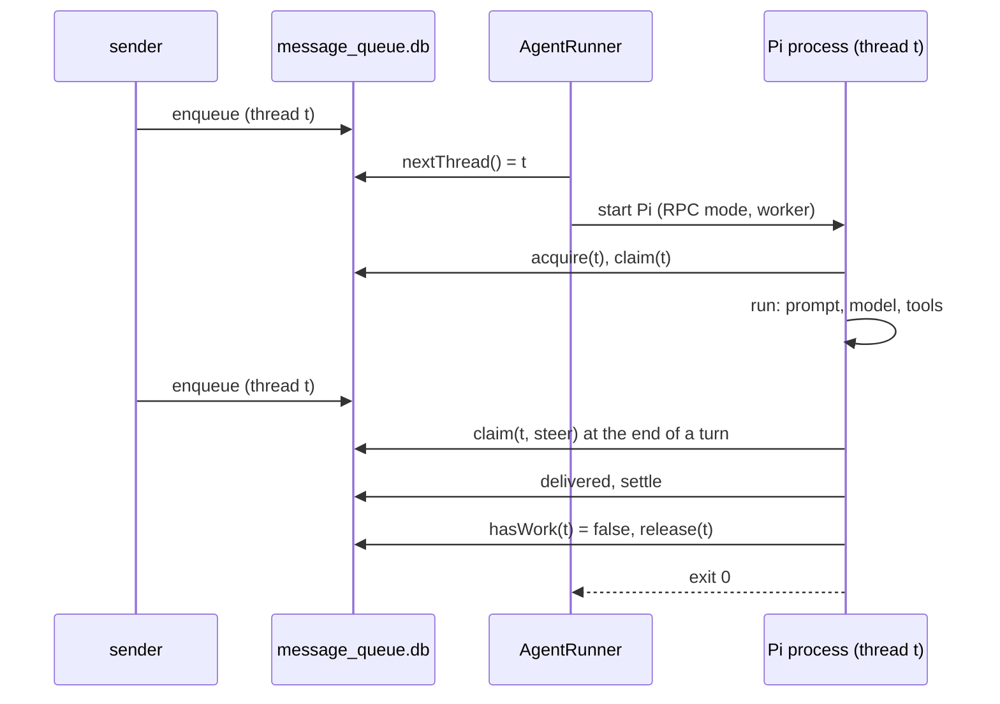

# Agent runner

The `AgentRunner` (`src/agent-runtime/agent-runner.ts`) serves the queue of one agent: it starts a Pi process for each thread that has messages. It is built, but no command starts it yet; `agentx serve` will, through the [coordinator](../../coordinator-runtime/README.md). Until then a thread's queue is worked by a session opened with `agentx run` ([Agent](../agent/README.md#threads)).

## How it works

An `AgentRunner` runs until it is told to stop. The tests start one with `test/runner-process.mjs`. The runner only starts Pi processes, one per thread ([D31](#d31)). Taking, delivering and settling a message happens in the [message queue extension](../pi-package/message-queue/README.md#the-message-queue-extension) inside each session ([D23](#d23)), and the extension also ends the session when its thread has no more work ([D32](../pi-package/message-queue/README.md#d32)).

- **Loop.** Once a second, while fewer than `maxWorkers` threads are running, the runner takes the next thread from the [queue](../pi-package/message-queue/README.md#messages): first in, first out. It passes over a thread that a live process holds, and one whose own Pi process has not exited yet.
- **Worker.** One Pi process per thread: the pinned Pi CLI in RPC mode, in which Pi stays open until its input closes. The runner sends it no prompts. The session takes its thread's lease, works the thread's messages, and ends itself when the thread has no [work](../pi-package/message-queue/README.md#the-queue-class) left.
- **Limit.** `maxWorkers` is the number of threads, and so Pi processes, running at once. More threads wait their turn.
- **Stopping.** `stop()` starts no more threads, and `run()` returns when the running ones have ended. If the runner process is ended instead, its Pi processes end with it and their messages get another attempt ([below](#when-a-pi-process-ends)).

One runner serves one agent.

## Starting a thread's Pi process

The runner starts Pi the way `agentx run --thread-id <thread> --mode rpc` does: the same CLI, flags and environment, all taken from `pi-launch.ts`, so there is nothing to keep in step between the two ([Agent](../agent/README.md#how-agentx-run-starts-pi)).

| The runner passes | Why |
|---|---|
| `cwd` = the agent directory, `PI_CODING_AGENT_DIR` = `agent-x/.pi` | as `agentx run` |
| `-nc`, `--approve`, `-e <pi-package>`, `--session-dir` | as `agentx run` |
| `--session-id <thread>` | the thread is the session ([D21](../pi-package/message-queue/README.md#d21)) |
| `--mode rpc` | Pi stays open and reports on its output instead of drawing a terminal UI |
| `--agentx-worker` | tells the message queue extension that nobody watches this session ([D32](../pi-package/message-queue/README.md#d32)) |

What it does with the process ([Pi](../pi/README.md#rpc-mode)):

- **It reads Pi's output**, one JSON record per line; Pi waits when nobody reads. Every request of an extension is answered as cancelled: nobody is there, an unanswered dialog (`select`, `confirm`, `input`, `editor`) holds its run forever, and Pi ignores an answer to a request that waits for none. An extension's notification, and an error Pi reports about an extension, go to the runner's error output with the thread's id. Every other record is the session's activity, which the runner ignores.
- **It keeps Pi's input open.** Pi in RPC mode closes its session when its input closes, so a runner that dies takes its Pi processes with it.
- **It keeps the end of Pi's error output**, which says why Pi stopped.

The runner holds no lease. A thread belongs to its Pi process from the moment the session starts ([Message queue](../pi-package/message-queue/README.md#threads-and-leases)).

Measured on a laptop, a Pi process is ready 0.15 to 0.2 seconds after it is started and uses about 130 MB while idle.

## When a Pi process ends

A message's status is changed by whoever is still there to change it.

| What happens | Who updates the thread's messages | When |
|---|---|---|
| The session ends itself: the thread has no work, or the session lost its thread | The message queue extension has settled them. Pi exits with code 0 and the runner does nothing. | |
| The Pi process dies: killed, out of memory, crashed | The runner takes the thread from the dead process, which ends the attempt of the messages it left in flight. | at once |
| The Pi process cannot run the thread: an extension does not load, or Pi cannot be started | The runner counts an attempt for the thread's waiting messages, with Pi's own error as the reason. | at once |
| The Pi process is told to stop (`SIGTERM`, `SIGHUP`), or the runner stops or dies and Pi's input closes | Pi closes the session, which aborts a run in progress, and the message queue extension ends the attempt. | at once |
| Everything dies together, as when the machine does | The next process to take the thread, once the dead holder's lease has run out. | 110 to 120 s later |

Ending an attempt puts a message back on the queue, or makes it `failed` when that was its third attempt ([D24](../pi-package/message-queue/README.md#d24)).

- **Taking the thread from a dead process.** The lease of a process that died is still live for up to two minutes. The runner saw its own Pi process end, so it takes the thread by that process's id without waiting ([D33](../pi-package/message-queue/README.md#d33)), and gives it up again at once.
- **Counting an attempt.** A process that failed by itself and left no message in flight cannot run the thread. Without a counted attempt it would be started again every second, forever; with it, a broken agent fails its messages after three starts. A process that was told to stop is not counted this way: Pi exits with 143 or 129 after closing its session on `SIGTERM` or `SIGHUP`, and a signal that reaches it before it listens, or a terminal's Ctrl-C, ends it directly.
- **The reason** is the last line of Pi's error output that starts with `Error:`, or else the signal or the exit code. It goes to the runner's error output, and into the `error` of the messages whose attempt the runner counted. Messages that a dead process left in flight get "The process running this thread stopped."

## Known limits

- A Pi process is started for each burst of messages on a thread and ends when the thread is empty, so each burst pays for starting Pi, loading extensions and connecting MCP servers.
- A Pi process that hangs without exiting keeps its worker and its thread. Nothing limits how long a run may take, and the runner does not check that a session it started is working.
- Every interruption costs a message one of its three attempts, also a restart of the runner during its run.
- Each running thread is a Pi process of about 130 MB.
- Started from a terminal, the runner shares the terminal's Ctrl-C with its Pi processes: they end at once instead of finishing their runs, and their messages wait for the next runner.
- Threads of one agent share the agent's `storage/workspace`; nothing keeps two threads from writing the same file.

## Decisions

### D23. The message queue extension is the only consumer of the queue; the runner only starts Pi processes

- **Problem.** Messages must reach a thread's session under the runner and under `agentx run`, where there is no runner. A message can arrive while the session is idle or while it is running.
- **Decision.** The message queue extension, loaded into every session, claims its thread's messages, starts a run with them when the session is idle, steers them in during a run, and settles them. The runner picks the thread of the oldest waiting message and starts its Pi process. It changes a message's status only when that process ends with a failure.
- **Why.** One delivery path for a person's session and the runner's, so an agent behaves the same in both. The extension is where Pi tells what happened to a message: saved, run completed, failed, aborted.
- **Consequence.** Pi does not tell an extension whether it accepted a message, so the extension asks Pi about the model and the login first and otherwise judges by what follows ([message queue extension](../pi-package/message-queue/README.md#the-message-queue-extension)).

### D31. The runner starts a Pi process per thread, in RPC mode

- **Problem.** Threads of an agent must run at the same time, unattended, as the same agent that `agentx run` starts. The runner has to start a thread's session, notice that it is dead, and be able to end it, and one thread must not take the others down.
- **Decision.** One runner serves one agent. For each running thread it starts one Pi CLI process in RPC mode, with exactly what `agentx run` passes plus `--mode rpc` and `--agentx-worker`, and `maxWorkers` limits how many run at once. The runner reads each process's output, answers dialogs as cancelled, and acts when the process exits.
- **Why.** A process is what can die alone, be seen to die, and be killed. `agentx run` and the runner share one way of starting Pi, so the agent is the same under both with nothing to keep in step, and the runner does not load Pi. Starting a process costs little: measured, Pi is ready in 0.15 to 0.2 seconds, beside model calls that take seconds.
- **Rejected.** Pi's `RpcClient`: it cannot answer an extension's dialog, starts whichever `node` is on `PATH`, and kills the process one second after asking it to stop.
- **Consequence.** About 130 MB for each running thread. The runner has to read every process's output. A process that hangs is not noticed ([known limits](#known-limits)).
