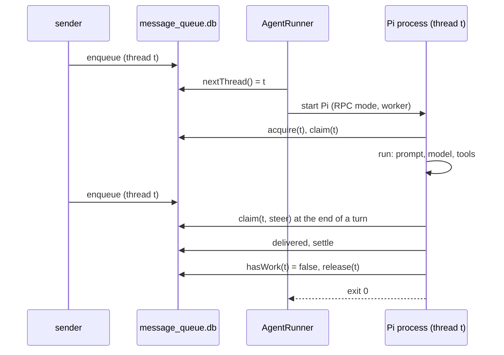

# Agent runner

The `AgentRunner` (`src/agent-runtime/agent-runner.ts`) serves one agent's queue: it starts a Pi process for each thread that has messages. No command starts it yet; `agentx serve` will, through the [coordinator](../../coordinator-runtime/README.md). Until then, a session opened with `agentx run` works its thread's queue ([Agent](../agent/README.md#threads)). The tests start a runner with `test/runner-process.mjs`.

## How it works

The runner only starts Pi processes ([D31](#d31)). The [message queue extension](../pi-package/message-queue/README.md#the-message-queue-extension) in each session takes, delivers and settles the messages ([D23](#d23)), and ends the session when its thread has no work left ([D32](../pi-package/message-queue/README.md#d32)).

`new AgentRunner(agentRoot, maxWorkers, stallMs = 10 minutes)` serves one agent. Once a second it:

1. **Ends stuck workers.** A worker whose lease has run out has a blocked main thread; it gets `SIGKILL`. A worker that wrote nothing on stdout for `stallMs` is stuck, for example on a tool that never returns; it gets `SIGTERM` once. Set `stallMs` above the longest a tool may run without output.
2. **Starts threads.** While fewer than `maxWorkers` run, it takes the thread of the oldest waiting [message](../pi-package/message-queue/README.md#messages). It skips threads it already runs and threads a live process holds.

A worker is the pinned Pi CLI in RPC mode, which stays open until its input closes. The runner sends it no prompts. The session takes the thread's lease, works its messages, and ends itself when the thread has no [work](../pi-package/message-queue/README.md#the-queue-class) left.

**Stopping.** `stop()` starts no more threads; `run()` returns when the running ones end, which can take long under steady traffic. `stop(true)` also sends `SIGTERM` to every worker: each run is aborted and its messages wait for the next runner, with the attempt counted. `test/runner-process.mjs` calls `stop()` on the first `SIGINT` or `SIGTERM` and `stop(true)` on the second. If the runner dies, its Pi processes end with it.

## Starting a thread's Pi process

The runner starts Pi as `agentx run --thread-id <thread> --mode rpc` does. Both take the CLI, flags and environment from `pi-launch.ts` ([Agent](../agent/README.md#how-agentx-run-starts-pi)).

| The runner passes | Why |
|---|---|
| `cwd` = the agent directory, `PI_CODING_AGENT_DIR` = `agent-x/.pi` | as `agentx run` |
| `-nc`, `--approve`, `-e <pi-package>`, `--session-dir` | as `agentx run` |
| `--session-id <thread>` | the thread is the session ([D21](../pi-package/message-queue/README.md#d21)) |
| `--mode rpc` | Pi stays open and reports on stdout, with no terminal UI |
| `--agentx-worker` | tells the message queue extension that nobody watches the session ([D32](../pi-package/message-queue/README.md#d32)) |

While it runs ([Pi](../pi/README.md#rpc-mode)), the runner:

- **Reads stdout**, one JSON record per line. Pi waits when nobody reads.
- **Cancels every extension request.** Nobody is there, and an unanswered dialog would block its run forever. The extension gets `false` or no value. The runner logs each cancelled dialog's title, so an extension that keeps asking can be found. The harness prompt tells the model that such questions count as declined. In RPC mode `ctx.hasUI` is true, so extensions still ask.
- **Logs** extension notifications and extension errors with the thread id. It ignores other records.
- **Keeps stdin open**, because Pi closes its session when stdin closes.
- **Keeps the end of stderr**, which says why Pi stopped.

The runner holds no lease. The Pi process holds the thread from the moment its session starts ([Message queue](../pi-package/message-queue/README.md#threads-and-leases)).

## When a Pi process ends

| What happens | Who updates the messages |
|---|---|
| The session ends itself because its thread has no work left; exit 0 | The extension has settled them. The runner does nothing. |
| The session lost its lease to another process; exit 0 | It aborts its run at once. The new holder took its messages in flight and gives them another attempt. The runner does nothing. |
| Pi is told to stop: `SIGTERM` or `SIGHUP`, or stdin closes because the runner died | Pi closes the session and aborts the run; the extension ends the attempt. A runner that is still there also puts back anything left in flight, with no extra attempt counted. |
| Pi dies by itself (crash, out of memory, killed), cannot start, or hangs and gets `SIGKILL` | The runner, at once. Messages left in flight lose their attempt. If none were in flight, the waiting messages lose one, with Pi's error as the reason. |
| Everything dies, as when the machine does | The next process to take the thread, once the lease runs out: 110 to 120 s later |

A lost attempt puts a message back on the queue, or marks it `failed` after the third ([D24](../pi-package/message-queue/README.md#d24)).

- The runner frees the thread at once by its dead process's id, instead of waiting up to two minutes for the lease to run out ([D33](../pi-package/message-queue/README.md#d33)).
- Waiting messages lose an attempt so that a broken agent fails its messages after three starts, instead of restarting every second forever.
- Exit codes 143 and 129 (Pi closing after `SIGTERM` or `SIGHUP`), and the signals `SIGTERM`, `SIGHUP` and `SIGINT`, count as told to stop.
- The reason is the last stderr line like `Error: ...` or `TypeError: ...`, or else the signal or exit code. The runner logs it.

## Known limits

- Each burst of messages on a thread starts a new Pi process, which pays for starting Pi, loading extensions and connecting MCP servers. Pi is ready in 0.15 to 0.2 s on a laptop.
- Nothing limits a run that keeps writing, such as a model that calls tools in a loop. A silent tool that rightly runs longer than `stallMs` is stopped, and its message fails after three attempts.
- Every interruption costs a message an attempt, including a runner restart.
- Each running thread is a Pi process of about 130 MB.
- Started from a terminal, the runner shares Ctrl-C with its Pi processes: they end at once, and their messages wait for the next runner.
- Threads of one agent share `storage/workspace`; nothing stops two from writing the same file.

## Decisions

### D23. The message queue extension is the only consumer of the queue; the runner only starts Pi processes

- **Decision.** The extension in every session takes its thread's messages, starts or joins a run, and settles them. The runner only starts a Pi process per thread, and touches messages only when that process fails.
- **Why.** One delivery path for a person's session and the runner's, so the agent behaves the same in both.

### D31. The runner starts a Pi process per thread, in RPC mode

- **Decision.** Each running thread gets one Pi CLI process in RPC mode, started with what `agentx run` passes plus `--agentx-worker`; `maxWorkers` caps how many run at once.
- **Why.** A process can fail alone, be seen to fail, and be killed. Sharing `pi-launch.ts` keeps the agent the same as under `agentx run`.
- **Rejected.** Pi's `RpcClient`: it cannot answer dialogs, runs whichever `node` is on `PATH`, and kills the process one second after asking it to stop.
