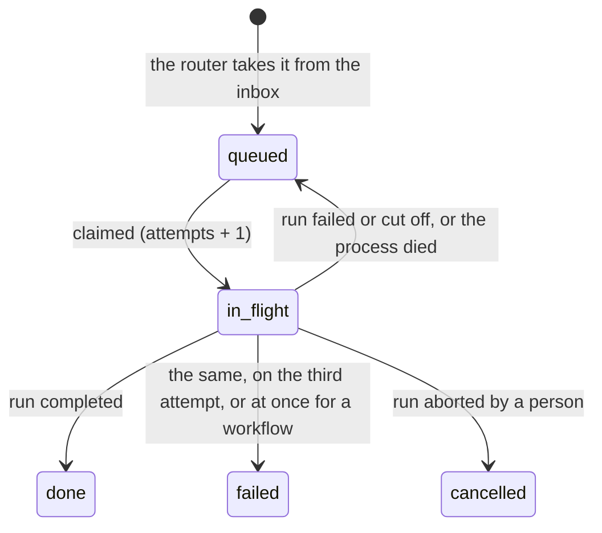

# Events

What reaches an agent is an event ([D47](#d47)). Every event comes in through the agent's inbox. The router loop gives an event without a thread its thread, and stores it in the agent's queue. Then the thread decides who takes it:

| Thread | Who takes it |
|---|---|
| none | the [routers](#routing), which pick a thread first |
| `workflow.<name>` | the [workflow runner](../workflows/README.md) |
| any other, such as `main` | a Pi session for that thread, through the [event queue extension](../pi/pi-package/event-queue/README.md) |

```
src/agent-runtime/events/
  queue.ts          class Queue: the agent's queue file and every step on it
  mailbox.ts        the inbox and outbox: a folder per event, a marker per waiting event
  send-event.ts     sendEvent: the agent sends, into its outbox
  event-router.ts   class EventRouter: the loop that takes the inbox into the queue
```

Each agent's queue is a SQLite file, `storage/event_queue.db`, so an agent sees only its own events. The [event queue extension](../pi/pi-package/event-queue/README.md) imports `queue.ts` as source, because Pi loads its package as source.

## Events

A sender gives:

| Field | Meaning |
|---|---|
| `threadId` | Optional. A thread, the folder of its Pi sessions ([D21](../pi/README.md#d21)), or `workflow.<name>`: letters, digits, `.`, `_`, `-`, starting and ending with a letter or digit, at most 200 characters. Without it, the routers pick. |
| `content` | Markdown for the agent. It may not contain `<agentx-metadata` ([D25](../pi/pi-package/event-queue/README.md#d25)). Large data goes in a file ([D49](#d49)). |
| `metadata` | Optional facts for the model, one per line. A name may not start with `agentX-`, or hold `:` or a line break. `source` says where the event came from, such as `cli` or `workflow.<name>`. |
| `key` | Optional. An event whose key is there already is added once ([D50](#d50)). |
| `doNotSteer` | Optional. Never joins a run in progress; waits for the next one. |
| `isSilent` | Optional. Never starts a run; goes along with the next event that does. |

The fields are checked at run time too, since a workflow can pass anything.

An event's `id` has 12 letters, digits, `-` and `_`, and never starts with `-`. It is made from the receiving agent and the key (a random key when none is given). The queue adds `status`, `attempts`, `error`, `entryId` (the Pi session entry that got it), `createdAt` and `updatedAt`.

Events are first in, first out: the router takes the inbox oldest first, the Pi runner serves the thread of the oldest waiting event first, and a thread's events go oldest first. A newer event can still be steered into a run ahead of an older `doNotSteer` one.

## Mailboxes

Every event reaches an agent through its **inbox**, and only the [router loop](#routing) adds events to the queue ([D54](#d54)). Every event the agent sends, also to itself, leaves through its **outbox**, which the [coordinator](../../coordinator-runtime/services/relay/README.md) takes. Both are mailboxes ([D55](#d55)):

```
storage/workspace/inbox/<id>/event.json        the event, its agentX- facts, its id, when it was sent
storage/workspace/inbox/<id>/<file>            its files; the content's last line names them
storage/workspace/inbox/.pending/<time>-<id>   empty: the event waits
storage/workspace/outbox/...                   the same, with `to` and `from`, and without agentX- facts or the files line
```

- **Writing.** The folder is written under a hidden name and renamed, then the marker is created. A reader never sees half an event.
- **Reading.** Markers sort oldest first by name. A marker's name starts with a time that never repeats in one process, so one sender's events keep their order.
- **No locks.** Each writer makes its own folder and marker, and the reader deletes its own marker. Any number of processes can write one mailbox.
- **Folders are kept** after the event is taken, so the files the content names stay there.
- An event that cannot be read has its marker moved to `.rejected/`, for a person to look at.

## Sending and delivering

Two functions put an event into a mailbox ([D48](#d48)):

- **`sendEvent`** sends from inside an agent, into its own outbox. Only the agent sends: the model with `agentx event send` in its bash, its workflows with `ctx.send`, and the workflow runner with its [failure reports](../workflows/README.md#failure-reports). `agentx event send` needs `AGENTX_AGENT`, which only the agent's processes have ([D43](../agent/README.md#d43)), and sends only as that agent.
- **`deliverEvent`**, in the coordinator runtime, writes an inbox; nothing outside the coordinator runtime does. Only the host calls it: the coordinator, and a person's `agentx event deliver` ([Coordinator](../../coordinator-runtime/README.md#delivering)).

`sendEvent` checks the event as the queue would, copies its files into the event's folder, and records the thread that sends it: the folder of Pi's `PI_SESSION_FILE` in the model's bash ([Pi](../pi/pi-reference/README.md#tools)), the babysitter thread for a workflow, and `main` otherwise.

The coordinator delivers the event, to another agent or the sender itself, with `agentX-FromAgent`, `agentX-FromThread` and, from a workflow, `agentX-FromWorkflow`. The receiver answers on that thread. A refused event comes back to the sending thread ([Coordinator](../../coordinator-runtime/services/relay/README.md)). Without `agentx serve`, sent events wait in the outbox.

## States



- **Claim.** To start a run, a Pi session takes all queued events of its thread, or none if all are silent. To steer, it takes those not marked `doNotSteer`. The workflow runner takes the oldest one.
- **Delivered.** Once Pi has saved the user message, the extension writes its session entry id to `entryId`.
- **Settle.** When a Pi run ends, its events become `done`, go back to the queue, or become `failed` on the third attempt ([D24](../pi/pi-package/event-queue/README.md#d24)). An aborted run's events become `cancelled`, or get another attempt in a worker ([D32](../pi/pi-package/event-queue/README.md#d32)).
- **Finish.** A workflow's event becomes `done`, or `failed` with the reason. It gets one attempt ([D53](../workflows/README.md#d53)).
- **Process died.** What a dead holder left in flight goes back to the queue the same way ([Pi runner](../pi/README.md#when-a-pi-process-ends)), or fails on a workflow's thread.

`done`, `failed` and `cancelled` are final. To try again, send the event again.

## Threads and leases

Two processes writing one Pi session would split the conversation, and Pi has no lock against it ([Pi](../pi/pi-reference/README.md#sessions)). So one process at a time holds a thread ([D22](#d22)):

- The `threads` table has one lease per thread: its owner (process id and start time) and when it was last written. A lease not written for 2 minutes is free.
- A Pi session takes its thread's lease when it starts and gives it up when it closes. It checks the lease every second and rewrites it every 10 seconds.
- Only the holder can claim or settle the thread's events.
- The workflow runner holds a workflow's thread while it runs one of its events, so a workflow runs one event at a time.
- Taking over a thread ends the attempt of what the old holder left in flight. This waits for the lease to run out, unless the Pi runner frees the thread of its own dead Pi process ([D33](../pi/README.md#d33)).
- `agentx chat` refuses a thread another live process holds ([Agent](../agent/README.md#threads)).

## The Queue class

| Methods | Used by | Do |
|---|---|---|
| `enqueue`, `get` | the router | Add an event with its thread, id and facts; find a copy by id |
| `acquire`, `renew`, `release`, `heldElsewhere` | holders, `agentx chat` | Take, keep, give up and check a thread's lease |
| `abandon`, `expired`, `nextThread` | the Pi runner, the workflow runner | Free a dead process's thread; pick the next thread with work |
| `claim`, `claimOldest`, `delivered`, `settle`, `finish`, `fail` | the extension, the workflow runner | Take events, record the session entry, end the run |

Each method is one atomic step. The file uses WAL mode, and waits up to 5 seconds for another process's write.

## Routing

The `EventRouter` loop takes the inbox oldest first, one event at a time. When the inbox is empty, it looks again a second later.

1. An event whose id is on the queue already is a copy: its marker is deleted, and no router is asked.
2. An event without a thread goes to the routers, each only when the one before picked nothing ([D51](#d51)): the agent's own, `storage/knowledge/event_router.mjs`, then the developer's, `.pi/event_router.mjs`. A missing file is skipped. When none picks a thread, the event goes to `main`. Each call runs in a child process ([functions](../functions/README.md)), with up to `routerSeconds` ([settings](../supervisor/README.md#settings)).
3. An event that names a thread keeps it.
4. The event goes on the queue with its thread, id and send time, and its marker is deleted.

**When a router fails**, it counts as one that picked nothing. The event gets `agentX-RouterError: <why>`, a name only the harness can set, so the agent learns its router broke. What the router printed goes to `storage/workspace/router-logs/<event id>.<agent or developer>.log`.

The first stop signal stops routing after the call in progress. The second ends it, and the event waits in the inbox for the next start.

## The routers' contract

Both routers export one function. Its types come with the `agent-x` package (`src/agent-runtime/functions/contracts.ts`):

```js
/** @type {import("agent-x").Router} */
export default async function route(event, ctx) {
	// event: { id, content, metadata, createdAt }
	// ctx:   { workflows: [{ name, description }] }
	return { thread: "main" }; // a Pi thread or "workflow.<name>"; nothing leaves the event to the next router
}
```

- `agentx init-agent` writes the developer's router, which sends every event to `main`, for the developer to change. The agent writes its own when it needs one.
- The agent edits its own router; an edit applies to the next event. The developer's is checked in and read-only to the agent.
- A router may read the event's files, import the project's packages, and ask a model.

## Known limits

- No delay between Pi attempts, so a model outage fails events within seconds.
- A thread held by a killed process stays blocked for up to 2 minutes, unless the Pi runner that started it frees it.
- Nothing prunes settled events, mailbox folders or logs.
- Nothing carries an answer back to a person who delivered an event. It is in the thread's session.
- The queue file must be on a local disk; SQLite locking is not reliable on network file systems.
- SQLite before 3.51.3 has a rare bug that can corrupt a WAL file ([sqlite.org](https://sqlite.org/wal.html)). `node -p process.versions.sqlite` shows Node's version.
- No event reaches the queue without `agentx run`. Events are routed one at a time, so a burst, and an event that names its thread, waits behind a slow router.
- Until sandboxes, an agent can write any agent's inbox, outbox or queue, and a process of the agent can drop `AGENTX_AGENT` and run `agentx event deliver` past its `canSendTo`.
- When the agent's router fails and the developer's sends the event to a workflow, no model reads its `agentX-RouterError`; the router's log has it.

## Decisions

<a id="d19"></a>
### D19. SQLite through Node's built-in `node:sqlite`

- **Decision.** `node:sqlite` in WAL mode, with a busy timeout and `BEGIN IMMEDIATE` for transactions that read then write.
- **Why.** WAL lets many processes on one machine share a file safely, and a built-in module needs no install and loads inside Pi.
- **Rejected.** `better-sqlite3`, a native build pnpm blocks until approved; Turso, where several processes on one file is experimental.

<a id="d22"></a>
### D22. One live process per thread, by a lease in the queue file

- **Decision.** Each thread has a lease that lasts 2 minutes and is rewritten every 10 seconds. A session without the lease takes no input, and a holder that loses it aborts its run.
- **Why.** Pi does not lock session files. A lease that expires covers a killed holder; checking whether a process id is alive does not, since ids are reused.
- **Consequence.** A process blocked for more than 110 seconds can lose its thread; it notices within a second of resuming and stops.

<a id="d47"></a>
### D47. What reaches an agent is an event, and its thread decides who takes it

- **Decision.** One table, `events`, holds everything that reaches an agent. An event without a thread gets one from the routers; one on `workflow.<name>` goes to the workflow runner; any other to Pi.
- **Why.** One table and one set of states for every input, and each row shows where its event went. An event that names a thread reaches it even when the agent's router is broken.

<a id="d48"></a>
### D48. Only the agent sends, into its own outbox; only the host delivers, with `deliverEvent`

- **Decision.** The agent sends with `sendEvent`: the model's `agentx event send`, its workflows' `ctx.send`, and failure reports. Every event it sends, also to itself, goes into its own outbox. `deliverEvent`, in the coordinator runtime, writes every inbox: for the coordinator, and for a person's `agentx event deliver`.
- **Why.** Every event an agent sends takes one path, and every event goes into an inbox through one function with one set of checks. An agent writes only its own `storage/`, as a sandbox will allow. The sender is the outbox the event was found in, so no agent can pose as another. A person is not an agent: a delivery from a terminal is held to no `canSendTo`, and needs no `agentx serve`.
- **Consequence.** An agent's events to itself, failure reports included, arrive only under `agentx serve`.

<a id="d49"></a>
### D49. An event's files are in its inbox folder

- **Decision.** An event's content is markdown. Large data is a file sent with it, kept by name in the event's folder, `storage/workspace/inbox/<id>/`, and named on the content's last line.
- **Why.** The model reads a short message and opens a file when it needs it; the router and workflows read the same file. The folder travels with the event, across a sandbox too.
- **Rejected.** Moving the folder once the event is routed, away from where the content says.

<a id="d50"></a>
### D50. An event's key makes adding it idempotent

- **Decision.** Every event has a key, the sender's or a random one, and its id is made from the receiving agent and the key. An event whose id is there already is not added again. The coordinator refuses an event whose id was not made from its key.
- **Why.** A sender that sends again, such as a schedule fired twice, adds one event, with no list of seen ids kept anywhere. No sender can pick an id that takes the place of another event.

<a id="d51"></a>
### D51. Two routers, the agent's then the developer's, each called in a child process

- **Decision.** An event without a thread goes to the agent's router, then the developer's, then `main`. Each is optional: a module whose default export returns `{ thread }` or nothing, called in a child process per event. A new agent has a developer's router that sends everything to `main`. A router that fails counts as one that picked nothing, and the event gets `agentX-RouterError`.
- **Why.** The agent knows best where the events it has learned about belong. The developer's router settles the rest, also when the agent's breaks. A child process keeps a router that loops or crashes from stalling the agent, and applies an edit at once.
- **Rejected.** A router loaded into `agentx run`: faster, but one stuck in a loop stops the agent. The developer's router first: the agent could not take over events as it learns.
- **Consequence.** Each event without a thread starts a router process, until the developer deletes the starter router.

<a id="d54"></a>
### D54. Every event reaches an agent through its inbox, and only the router loop adds events to the queue

- **Decision.** `deliverEvent` writes an agent's inbox. The `EventRouter` takes it oldest first, routes events without a thread, and is the only code that adds events to the queue. The coordinator never opens a queue file.
- **Why.** One way in and one order for every event, with copies caught in one place. SQLite in WAL mode needs every process on one machine; an inbox of plain files works across a sandbox's boundary and holds events while the agent is down.
- **Rejected.** The coordinator writing the queue file; an HTTP port per agent, which loses events while the agent is down.
- **Consequence.** An event reaches the queue only while `agentx run` runs.

<a id="d55"></a>
### D55. A mailbox is a folder per event, kept, and an empty marker per waiting event

- **Decision.** A mailbox holds `<id>/event.json` with the event's files, and `.pending/<time>-<id>` for each event that waits. A writer writes the folder under a hidden name, renames it, then creates the marker; the reader deletes the marker.
- **Why.** Create, rename and delete are each one step of the file system, so any number of writers share a mailbox with no lock.
- **Rejected.** A cursor the reader keeps, which skips an event whose writer finishes after a newer one's; a list of waiting ids in one file, which needs a lock; an append-only log, never trimmed without a lock.
