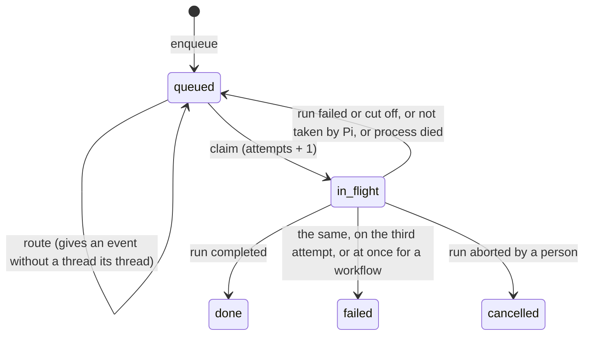

# Events

What reaches an agent is an event ([D47](#d47)). This module stores events, takes them from every sender, and gives each event without a thread its thread. Who then takes it: the [Pi runner](../pi/README.md) for a Pi thread, the [workflow runner](../workflows/README.md) for `workflow.<name>`.

| `thread_id` | Who takes it |
|---|---|
| none | the [event router](#routing), which gives it a thread |
| `workflow.<name>` | the [workflow runner](../workflows/README.md), which runs that workflow with it |
| any other, such as `main` | the [Pi runner](../pi/README.md) starts a Pi process for the thread, and the [event queue extension](../pi/pi-package/event-queue/README.md) in that session hands the event to Pi |

```
src/agent-runtime/events/
  queue.ts         class Queue: the agent's queue file, its tables, every step on it
  send-event.ts    sendEvent: how every sender adds an event
  event-router.ts  class EventRouter: the loop of `agentx run` that calls the agent's router
```

Each agent has its queue in a SQLite file, `agent-x/agents/<name>/storage/event_queue.db`, so an agent's processes see only its own events. The CLI and `agentx run` use the compiled `queue.ts` in `dist/`; the [event queue extension](../pi/pi-package/event-queue/README.md) imports it from source, because Pi loads its package as source. Each process opens the file with `new Queue(agentRoot)`. A new file gets its tables in one transaction under the write lock, so several processes can open it at once.

## Events

A sender gives:

| Field | Meaning |
|---|---|
| `threadId` | Optional. The conversation, which is the id of the Pi session that gets the event ([D21](../pi/README.md#d21)), or `workflow.<name>`. Pi's rule for session ids applies: letters, digits, `.`, `_`, `-`, starting and ending with a letter or digit, at most 200 characters. Without one, the agent's router picks the thread. |
| `content` | Markdown for the agent. It may not contain `<agentx-metadata` ([D25](../pi/pi-package/event-queue/README.md#d25)). Large data goes in a file under `storage/attachments/`, whose path the content names ([D49](#d49)). |
| `metadata` | Optional facts for the model, one per line. A name may not start with `agentX-` or contain `:` or a line break. No name or value may contain `<agentx-metadata`. `source` says where the event came from, such as `composio`, `cli` or `workflow.<name>`. |
| `key` | Optional. Adding an event whose key is already there adds nothing and returns that event's id ([D50](#d50)). |
| `doNotSteer` | Never joins a run in progress; starts the next run. |
| `isSilent` | Never starts a run; goes along with the next event that does, or joins a run in progress. |

The queue adds `id` (12 random letters, digits, `-` and `_`, so nobody can guess one, and never starting with `-`, so a command line does not read it as an option), `status`, `attempts`, `error`, `entryId` (the Pi session entry of the last delivery), `createdAt` and `updatedAt`. The column `seq` keeps the order of arrival.

Events are first in, first out: the router takes the oldest event without a thread first, the Pi runner serves the thread of the oldest waiting event first, and a thread's events go oldest first. The one exception: a newer event can be steered into a run ahead of an older `doNotSteer` one.

## Sending

Every sender goes through `sendEvent` (`src/agent-runtime/events/send-event.ts`): `agentx event send` ([CLI](../../cli/README.md#commands)), a workflow's `ctx.send`, and the workflow runner's failure reports. It can send to another agent of the project, and it refuses a workflow thread whose workflow does not exist. Besides the sender's metadata it takes the harness's own `agentX-` facts, which no sender may name: a workflow's `ctx.send` adds `agentX-WorkflowRun`. For now it writes straight into the receiving agent's file; the [coordinator](../../../tasks/backlog/coordinator.md) will add events instead, behind the same function.

## States



- **Route.** An event without a thread is `queued` and waits for the router, which gives it its thread once: the update checks that it has none yet.
- **Claim.** The thread's holder takes its queued events. To start a run, a Pi session takes all of them, or none if all are silent. To steer, it takes those not marked `doNotSteer`. The workflow runner takes the oldest one.
- **Delivered.** Once Pi has saved the user message, the extension writes its session entry id to `entry_id`. The event has reached the model.
- **Settle.** When a Pi run ends:
  - completed: the events Pi saved become `done`;
  - failed: they go back to the queue, or become `failed` on the third attempt ([D24](../pi/pi-package/event-queue/README.md#d24));
  - aborted: every event in flight becomes `cancelled`, or gets another attempt in a worker ([D32](../pi/pi-package/event-queue/README.md#d32)).
- **Finish.** When a workflow's run ends, its event becomes `done`, or `failed` with the reason ([Workflows](../workflows/README.md#a-run)).
- **Not taken, or the process died.** A claimed event Pi never saved, or one left in flight by a process that stopped, goes back to the queue the same way ([Pi runner](../pi/README.md#when-a-pi-process-ends)). On a workflow's thread it becomes `failed`: a run gets one attempt, because it may have done part of its work ([D53](../workflows/README.md#d53)).

`done`, `failed` and `cancelled` are final. To try an event again, send it again.

## Threads and leases

Two processes writing one Pi session split the conversation, and Pi has no lock against it ([Pi](../pi/pi-reference/README.md#sessions)). So one process at a time holds a thread ([D22](#d22)):

- The `threads` table has one lease per thread: the owner (process id and start time) and when it was last written. A lease not written for 2 minutes is free.
- A Pi session takes its thread's lease when it starts and gives it up when it closes. It checks the lease every second, before every model call and after every turn, and writes it again once it is 10 seconds old.
- Only the holder can claim or settle the thread's events. A claim renews the lease in the same step.
- The Pi runner holds no thread; the Pi process it starts takes it. The workflow runner holds a workflow's thread while it runs one of its events, so a workflow runs one event at a time.
- Taking a thread from a holder that stopped ends the attempt of the events it left in flight. This waits for the old lease to run out, unless the Pi runner frees the thread of its own dead Pi process ([D33](../pi/README.md#d33)).
- `agentx chat` refuses a thread that another live process holds ([Agent](../agent/README.md#threads)).

## The Queue class

| Method | Used by | Does |
|---|---|---|
| `enqueue(event, facts)` | `sendEvent` | Adds an event, with the harness's `agentX-` facts; returns its id, or the id of the event that has its key. |
| `nextUnrouted()`, `route(id, threadId, metadata)` | the router | The oldest event without a thread; gives it its thread once, and false if it has one already. |
| `acquire(threadId, retry)`, `renew`, `release(threadId)` | the holder | Takes, keeps and gives up the lease. `acquire` returns false when another live process holds the thread; `renew` when the lease is not this process's. Taking a thread over ends the attempt of what its last holder left in flight; with `retry` false, as the workflow runner passes, those events fail at once. |
| `abandon(threadId, pid, failure)` | the Pi runner | Frees a thread whose holder, process `pid`, has ended. With `failure`, if the holder left nothing in flight, the waiting events lose an attempt. |
| `expired(threadId, pid)` | the Pi runner | Whether the lease of process `pid` has run out, as when the process is blocked. |
| `heldElsewhere(threadId)` | `agentx chat` | Whether another live process holds the thread. |
| `nextThread(except, workflows)` | the Pi runner, the workflow runner | The Pi thread, or with `workflows` the workflow thread, of the oldest event with work that nobody holds. Work is a queued event that can start a run, or one in flight. |
| `hasWork(threadId)` | a worker | Whether the thread still has work. |
| `claim(threadId, steer)`, `inFlight(threadId)`, `inFlightIds(threadId)` | the extension, the workflow runner | Takes queued events and counts the attempt; whether, and which, taken events are not settled yet. |
| `claimOldest(threadId)`, `finish(threadId, id, error)` | the workflow runner | Takes the oldest queued event; ends its run, `done` or `failed`. |
| `delivered(threadId, ids, entryId)` | the extension | Records the session entry. |
| `settle(threadId, result)` | the extension | Settles the events of a run that ended. |
| `fail(threadId, error)` | the extension | Ends the attempt of everything in flight on the thread. |
| `list(limit)`, `get(id)`, `byKey(key)`, `withMetadata(name, value)` | `agentx event` | Finds events for an audit. |
| `withQueue(agentRoot, work)` | everyone | Opens an agent's queue, does `work`, and closes it. `workflowName(threadId)` gives the workflow of a workflow's thread. |

Each method is one atomic step: one statement, or a transaction that takes the write lock first (`BEGIN IMMEDIATE`). The file uses WAL mode and waits up to 5 seconds for another process's write. Opening retries the switch to WAL for 5 seconds, because that step fails at once when two processes make it together.

## Looking at the queue

`agentx event list` shows an agent's newest events and where each went; `agentx event show <id>` shows one whole: its content and metadata, its thread and whether the router failed, its status and error, the session entry that got it, and for a workflow's event, its run ([CLI](../../cli/README.md#commands)).

## Routing

Once a second, the loop takes the oldest `queued` event that has no thread, and calls the router with it. One event at a time.

1. If `storage/knowledge/event_router.mjs` is missing, the loop writes the starter router, which sends every event to `main`, with comments that explain the contract.
2. It reads the agent's [workflows](../workflows/README.md), for the router's context and to check its answer.
3. It calls the router in a child process ([below](../functions/README.md)), with up to `routerSeconds` ([settings](../supervisor/README.md#settings)).
4. It gives the event the thread the router answered: `route(id, thread, metadata)`, which changes only an event that has no thread yet, so an event is never routed twice.

**When the router fails**, the event goes to `main` instead, with `agentX-RouterError: <why>` in its metadata, a name only the harness can set, so no event is stuck and the agent learns its router broke. The reason is one line, which the model sees with the event: `failed: <the error it threw>`, `timeout: …`, `exit: …` (the process ended without an answer), `bad answer: …` (not `{ thread }` with a thread id the queue allows), or `unknown workflow: …`. What the router printed goes to `storage/workspace/router-logs/<event id>.log`, the last 2 KB, and the reason names the file. The reason cannot go in the event's `error`, which a delivery clears.

The first stop signal stops routing; a router call in progress finishes. The second ends it, and its event waits for the next start.

## The router's contract

`storage/knowledge/event_router.mjs`, the agent's own ([D35](../agent/README.md#d35)), exports one function. Its types come with the `agent-x` package (`src/agent-runtime/events/contracts.ts`), for a `.ts` file with `import type` or a `.mjs` file with JSDoc:

```js
/** @type {import("agent-x").Router} */
export default async function route(event, ctx) {
	// event: { id, content, metadata, createdAt }
	// ctx:   { workflows: [{ name, description }] }
	return { thread: "main" }; // a Pi thread, or "workflow.<name>"
}
```

- The agent edits it; the edit applies to the next event, because each call is a new process.
- A developer shapes routing through the agent's system prompt and workflows, not the router file, which is the agent's.
- It may read the attachments the content names, import the project's packages (`agent-x/package.json`), and ask a model.

## Known limits

- No delay between Pi attempts, so a model provider outage fails events within seconds, after Pi's own retries inside the run.
- A thread held by a killed process stays blocked for 110 to 120 seconds, unless the Pi runner that started it frees it ([D33](../pi/README.md#d33)).
- Nothing prunes settled events, attachments or logs.
- Nothing carries the answer back to the sender. It is in the session, at the event's `entry_id`.
- The file must be on a local disk; SQLite locking is not reliable on network file systems.
- SQLite before 3.51.3 (or 3.50.7, 3.44.6) has a rare bug that can corrupt a WAL file ([sqlite.org](https://sqlite.org/wal.html), "The WAL-Reset Bug"). `node -p process.versions.sqlite` shows what Node bundles; Node 24.12 bundles 3.50.4.
- Until the coordinator adds events, `sendEvent` writes into other agents' files directly, which a sandbox will not allow.
- An old agentx still running when the file is renamed keeps writing to the old name.
- Events are routed one at a time, up to `routerSeconds` each, so a burst waits behind a slow router.
- The router has the agent's rights. Until sandboxes, it can also touch other agents' files.

## Decisions

<a id="d19"></a>
### D19. SQLite through Node's built-in `node:sqlite`

- **Decision.** `node:sqlite` in WAL mode, with a busy timeout and `BEGIN IMMEDIATE` for transactions that read and then write.
- **Why.** WAL lets many processes on one machine share a file safely, and a built-in module needs no install and loads inside Pi. The tests run eight processes on one file.
- **Rejected.** `better-sqlite3`, a native build that pnpm blocks until the user approves it; Turso, where several processes on one file is experimental.

<a id="d22"></a>
### D22. One live process per thread, by a lease in the queue file

- **Decision.** Each thread has a lease in the `threads` table that lasts 2 minutes and is written every 10 seconds. A session without the lease takes no input, and a holder that loses it aborts its run at once.
- **Why.** Pi does not lock session files, and a lease that expires covers a killed holder, even across containers; asking whether a process id is alive does not, since ids are reused.
- **Consequence.** A process paused or blocked for more than 110 seconds can lose its thread; it notices within a second of resuming and stops.

<a id="d47"></a>
### D47. What reaches an agent is an event, and its thread decides who takes it

- **Decision.** One table, `events`, holds everything that reaches an agent. An event without a thread goes to the router, one on `workflow.<name>` to the workflow runner, and any other to Pi. A sender that names a thread skips the router.
- **Why.** One table and one set of states for every input, and an event's row shows where it went. A failure report or another agent that names a thread reaches it even when the agent has broken its router.
- **Rejected.** A table of events apart from messages, as cognisphere-harness plans: turning an event into a message would copy it, and the two would need one transaction across tables.

<a id="d48"></a>
### D48. Every sender goes through `sendEvent`

- **Decision.** `agentx event send`, workflows and their failure reports add events with `sendEvent`. It writes straight into the receiving agent's file until the coordinator adds every event.
- **Why.** One place that the coordinator replaces, with no change for those who send.

<a id="d49"></a>
### D49. Events hold no attachments

- **Decision.** An event's content is markdown. Large data is a file under the agent's `storage/attachments/`, written before the event, whose path the content names.
- **Why.** The model reads a short message, and opens the data with its read tool when it needs it; the router and workflows read the same file. A 58 KB email in the content would fill the model's context.

<a id="d50"></a>
### D50. An event's key makes adding it idempotent

- **Decision.** `key` is optional and unique. Adding an event whose key is there adds nothing and returns that event's id.
- **Why.** A sender that sends again, such as a webhook delivered twice or a failure report after a crash, adds one event, with no list of seen ids kept anywhere else.

<a id="d51"></a>
### D51. One router, the agent's own: a function called in a child process for each event

- **Decision.** The router is `storage/knowledge/event_router.mjs`, a module whose default export takes the event and the agent's workflows and returns `{ thread }`. `agentx run` writes a starter that returns `main` when the file is missing, and calls the function in a child process of its own for each event. When the router fails, the event goes to `main` with `agentX-RouterError: <why>` in its metadata and the router's output in a log.
- **Why.** The agent knows best where its events belong, and keeps the router as it keeps its knowledge. A function with a typed contract is simpler to write than a script that parses its input, and a child process keeps a router that loops or crashes from stalling the agent, and applies an edit at once. Sending a failed event to `main` loses nothing and tells the agent.
- **Rejected.** A router module loaded into `agentx run`, as cognisphere-harness does: faster, but a router stuck in a loop stops the agent. A router answer of several threads, or of "drop": a workflow that does nothing drops an event already. A setting that names the router or turns it off: unlike the knowledge folders of [D35](../agent/README.md#d35), every agent has exactly one router.
