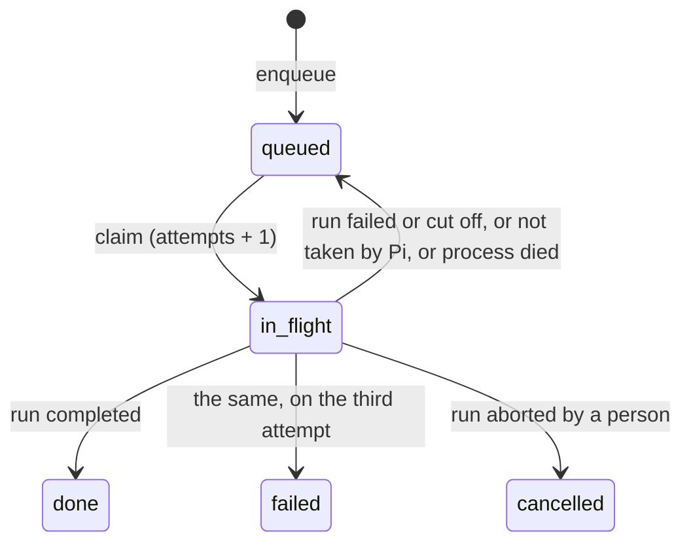

# Message queue

Each agent has a message queue: a SQLite file, `agent-x/agents/<name>/storage/message_queue.db`. Senders put messages on it, the [runner](../../agent-runner/README.md) starts a Pi process for a thread that has messages, and the [message queue extension](#the-message-queue-extension) in that process's session takes them and hands them to Pi.

```
src/agent-runtime/pi-package/extensions/message-queue/
  queue.ts     class Queue: the file, its schema, every step on it
  render.ts    how messages look to the model: metadata block, then content
  index.ts     the extension
```

All of the queue's code is in the extension's folder ([D27](#d27)). `queue.ts` is used from two places: compiled, by the CLI and the runner, and from source, by the extension. A process opens the file through `new Queue(agentRoot)`; nothing else is shared between processes.

## Messages

A sender gives:

| Field | Meaning |
|---|---|
| `threadId` | Required. The conversation the message belongs to. It is the id of the Pi session that receives it ([D21](#d21)), so it follows Pi's rule for session ids: letters, digits, `.`, `_`, `-`, starting and ending with a letter or digit; 200 characters at most. |
| `content` | The text for the agent. |
| `metadata` | Optional object of facts for the model, shown one per line. Names must not start with `agentX-` or contain `:` or a line break. |
| `doNotSteer` | The message never enters a run that is in progress; it starts the next one. |
| `isSilent` | The message never starts a run; it goes along with the next message that does, or into a run in progress. |

The queue adds `id`, `status`, `attempts`, `error`, `entryId` (the Pi session entry that holds the last delivery), `createdAt` and `updatedAt`.

Messages are handled first in, first out: the runner serves the thread of the oldest waiting message first, and a thread's messages are delivered oldest first. The one exception is the flag that asks for it: during a run, a newer message is steered in ahead of an older one marked `doNotSteer`.

## States



- **Claim.** The session that holds the thread takes its queued messages. A claim to start a run takes all of them, and takes nothing when all are silent. A claim to steer takes those not marked `doNotSteer`.
- **Delivered.** When Pi has saved the user message, the extension writes the session entry's id to `entry_id`. A message with an entry has reached the model.
- **Settle.** When the run has ended, the messages Pi saved become `done`. If the run failed, they return to the queue, or become `failed` when it was their third attempt ([D24](#d24)). If the run was aborted, every message in flight becomes `cancelled`; in a session the runner started, where only the closing of the session aborts a run, they get another attempt instead ([D32](#d32)).
- **Not taken, or the process died.** A claimed message that Pi never saved returns to the queue the same way, as does every message left in flight by a process that stopped. Who does that for a dead process, and when: [Agent runner](../../agent-runner/README.md#when-a-pi-process-ends). How a session finds out that Pi did not take a message: [message queue extension](#the-message-queue-extension).

`done`, `failed` and `cancelled` are final. To try a message again, send it again.

## Threads and leases

Two processes writing one Pi session split the conversation in two, and Pi has no lock against it ([Pi](../../pi/README.md#sessions)). So a thread belongs to one process at a time ([D22](#d22)):

- The `threads` table holds a lease per thread: the owner (process id plus process start time) and when the lease was last written. A lease not written for two minutes is free. Its holder checks every second that the lease is still its own and writes it again once it is 10 seconds old, so a session that holds its thread writes to the file every 10 seconds, not every second.
- A Pi session takes its thread's lease when it starts and gives it up when it closes. Only the holder can claim or settle the thread's messages, and a claim renews the lease in the same step.
- The runner holds no thread. It starts a Pi process for a thread that nobody holds, and that process takes the thread.
- Taking a thread from a holder that stopped ends the attempt of the messages it left in flight. That waits until the holder's lease has run out, with one exception: the runner takes a thread from the Pi process it started as soon as it has seen that process end ([D33](#d33)).
- `agentx run` refuses a thread that another live process holds ([Agent](../../agent/README.md#threads)).

## The message queue extension

`extensions/message-queue/index.ts` does everything that happens to a queue message inside a Pi session: it takes the thread's messages off the queue, sends them to Pi, records the session entry each became, and settles them when the run ends. A session is a thread: the extension reads the thread id from the session id. It behaves the same in a session that stays open under `agentx run` (the terminal UI, RPC mode) and under the runner ([D23](../../agent-runner/README.md#d23)), except for what follows from nobody watching the runner's sessions ([workers](#workers)).

| When | It does |
|---|---|
| `session_start` | Opens the queue and takes the thread's lease. Starts a one-second timer. Reads the agent's time zone from its settings. |
| each second | Checks that the lease is still its own, and writes it again once it is 10 seconds old. A session whose lease is no longer its own lets go of the thread and aborts its run in progress. If Pi is idle, claims the thread's queued messages and sends them as one user message, which starts a run. A worker whose thread has no work ends the session instead. |
| `turn_end` | Checks the lease, as each second does. After a completed turn, claims the messages that may be steered and sends them as a steer. Pi puts a steer in before the next model call; after the last turn of a run, that makes the run go on. Not when the run is being aborted: Pi would save the message without the model seeing it. |
| `context`, before every model call | Checks the lease, as each second does, so a session that lost its thread makes no model call. Looks at the session entries added since it last looked, and for each user message with `agentX-MessageId` lines writes the entry's id to those messages in the queue. Pi saves a user message after the message's own events, so the entry exists by the next model call and not before. |
| `agent_before_settle` | Notes whether Pi judged the run failed, and why. Pi does not send this for an aborted run. |
| `agent_settled` | Settles the run's messages: done for those Pi saved, another attempt if the run failed, and cancelled for everything in flight if it was aborted. In a worker, an aborted run gets another attempt. |
| `input` | Lets input through. In a session without the lease, refuses it. |
| `session_shutdown` | Stops the timer, gives up the lease, closes the queue. |

Details that follow from how Pi works ([Pi](../../pi/README.md#delivering-messages)):

- **Waiting for messages is a timer.** Pi has events for the moments of a run, and none for "something arrived" while a session sits idle. A timer started on `session_start` and stopped on `session_shutdown` is how Pi's documentation has an extension wait.
- **A one-shot run takes nothing from the queue.** With `-p` or `--mode json`, Pi runs one prompt, prints the last answer and exits. Queue messages steered into such a run would replace the answer to the prompt ([D28](#d28)). The session still holds its thread for as long as it runs. A session that is not saved (`--no-session`) takes nothing either: there would be no record of the messages.
- **Pi does not tell an extension whether it accepted a message.** A refusal goes to the host's error listener, and another extension can swallow input without a trace. So the extension does two things:
  - Before it starts a run, it asks Pi whether there is a model and a login for it. If not, the messages fail at once with that reason, three times, instead of being sent.
  - For everything else it judges by the outcome. Before a run starts, Pi looks idle while it prepares the prompt, which can take as long as another extension or a login refresh needs. If a minute after the last send Pi is idle and a message is still in flight, the message was not taken and gets another attempt.
- **A session without its thread's lease takes no input.** That happens when Pi itself picked the session (`-c`, `-r`, `/resume`) and another process is running that thread, or when the process was paused or blocked so long that another took the thread. The extension says so, a one-shot run ends with exit status 1, and nothing is written to the session. A run in progress when the lease is found gone is aborted at once; its messages are the new holder's to try again.

Sending with `deliverAs: "steer"` covers both cases of a send: Pi queues it during a run and starts a run when idle.

### Workers

The runner starts Pi with `--agentx-worker`, a flag this extension registers ([D32](#d32)). It marks a session that nobody watches, and two things follow:

- **A worker ends its own session**, with `ctx.shutdown()`, when its thread has no work left: no queued message that can start a run, and nothing in flight. The runner starts another Pi process when messages arrive. A worker also ends when it does not hold its thread, at its start or later, because then it can do nothing.
- **An aborted run of a worker gets another attempt.** Nobody is there to abort it. What aborts it is Pi closing the session: when the runner stops or dies and Pi's input closes, or when the process is told to end. In a session that a person or their program runs, an abort is a decision, and the messages are `cancelled`.

A worker stops taking messages at the moment it decides to end, so it never leaves with a message it has just taken.

## What the model sees

`render` turns the messages of one delivery into one user message. Each message is a metadata block followed by its content, with a blank line between messages:

```
<metadata>
agentX-MessageId: 42
agentX-ThreadId: main
agentX-CurrentTime: Wednesday 2026-11-11 21:59:54 GMT+5:30
agentX-IsRetry: true
agentX-RetryAttempt: 1
from: ops
</metadata>
The message itself.
```

| Line | Value |
|---|---|
| `agentX-MessageId` | The queue id. The extension finds delivered messages by it. |
| `agentX-ThreadId` | The thread. |
| `agentX-CurrentTime` | Day, date and time of the delivery, in the agent's time zone: `agentx.timezone` in its [settings](../../agent/README.md#pisettingsjson), or the machine's when it names none. |
| `agentX-IsRetry` | `true` from the second attempt on. |
| `agentX-RetryAttempt` | Only on retries: 1 for the first retry. |
| `agentX-IsSilent` | Only on silent messages: `true`. |
| other lines | The sender's metadata, as sent. Values that are not text are shown as JSON; line breaks in a value become spaces. |

The harness prompt explains the block to the agent ([Pi package](../README.md#the-system-prompt-extension)). Format and names: [D25](#d25).

## The Queue class

| Method | For | Does |
|---|---|---|
| `enqueue(message)` | senders | Adds a message; returns its id. |
| `acquire(threadId)`, `renew(threadId)`, `release(threadId)` | the holder | Takes the lease, keeps it by writing it again once it is 10 seconds old (false when it is no longer this process's), gives it up. |
| `abandon(threadId, pid, failure)` | the runner | Frees a thread whose holder, the process `pid`, has ended, without waiting for its lease to run out. With `failure`, a holder that left nothing in flight costs the waiting messages an attempt. |
| `heldElsewhere(threadId)` | `agentx run` | Whether another live process holds the thread. |
| `nextThread(except)` | the runner | The thread of the oldest message with work that nobody holds. Work is a queued message that can start a run, or a message in flight. |
| `hasWork(threadId)` | the extension, in a worker | Whether the thread still has work. |
| `claim(threadId, steer)`, `inFlight(threadId)` | the extension, the runner | Takes queued messages for delivery; whether a taken message is not settled yet. |
| `delivered(threadId, ids, entryId)` | the extension | Records the session entry. |
| `settle(threadId, result)` | the extension | Settles the messages of a run that ended. |
| `fail(threadId, error)` | the extension, the runner | Ends the attempt of everything in flight on the thread. |

Every method is one atomic step: a single statement, or a transaction that takes the write lock first (`BEGIN IMMEDIATE`). The file is opened in WAL mode with a 5 second wait for another process's write. Opening retries the switch of a new file to WAL for those 5 seconds, because that switch is the one step that fails at once when another process is making it.

## Looking at the queue

`agentx send` puts a message on the queue ([CLI](../../../cli/README.md#commands)). There is no command to list it; read the file:

```sh
sqlite3 storage/message_queue.db 'SELECT id, thread_id, status, attempts, error FROM messages ORDER BY id DESC LIMIT 20'
```

## Known limits

- No delay between attempts: a message whose run fails is retried at once, so an outage of the model provider fails messages within seconds. Pi's own retries inside a run come first.
- A thread held by a process that was killed stays unavailable for 110 to 120 seconds, unless the runner that started the process is there to take it ([D33](#d33)).
- Messages stay in the file after they are settled; nothing prunes it.
- Nothing carries the agent's answer back to the sender. The answer is in the session, linked from the message by `entry_id`.
- The file must be on a local disk. SQLite's locking is not reliable on network file systems.
- SQLite before 3.51.3 has a rare bug that can corrupt a WAL-mode file when two connections write or checkpoint at the same instant ([sqlite.org](https://sqlite.org/wal.html), "The WAL-Reset Bug"; also fixed in 3.50.7 and 3.44.6). Its authors call it unlikely in common use. `node -p process.versions.sqlite` shows what a Node version bundles; 24.12 bundles 3.50.4.
- Content is text from the sender and is not checked. A sender can write something that looks like a metadata block into it: the model reads it as part of the content, after the real block, and if it names the id of another message in flight on the same thread, that message is recorded as delivered with it.
- Aborting a run in the terminal cancels the queue messages that run had received, and any that were waiting inside Pi to be steered into it. So does closing the terminal session or switching it to another session (`/new`, `/resume`) while a run is in progress, because Pi aborts the run first. A cancelled message is not tried again; send it again. One that was still waiting inside Pi stays there, and Pi can put it into the next run of that terminal session although the queue shows it as cancelled.
- An extension of the agent that rewrites user messages and drops the `agentX-MessageId` line makes delivered messages look undelivered; they are retried and then failed.

## Decisions

<a id="d19"></a>
### D19. SQLite through Node's built-in `node:sqlite`

- **Problem.** Several processes use one queue file at the same time: the runner, every Pi process, `agentx send`, later the app. The driver must make that safe and must load inside Pi, where the extension runs.
- **Decision.** `node:sqlite` in WAL mode, with a busy timeout and `BEGIN IMMEDIATE` for transactions that read and then write.
- **Why.** WAL mode is built for many processes on one machine: readers do not block, one writer at a time, the rest wait. No dependency, nothing to compile, and a built-in module loads the same from a Pi extension. The tests run eight processes on one file, with every message taken exactly once.
- **Rejected.** Turso (the Rust rewrite of SQLite, `@tursodatabase/database` 0.8.3): a database file belongs to one process by default, access from several is an experimental option, and the project is before 1.0. `better-sqlite3`: a native build that pnpm blocks until the user approves it, in every project.
- **Consequence.** `node:sqlite` prints an "experimental" warning when it loads on Node before 24.15 and 26.0; `queue.ts` loads it with warnings off for that moment. Node's floor is 22.19, which is also Pi's. The SQLite a Node version bundles decides whether the WAL-reset bug applies ([known limits](#known-limits)).

<a id="d20"></a>
### D20. One queue file per agent, in `storage/`

- **Decision.** `agent-x/agents/<name>/storage/message_queue.db`, created by whichever process opens it first.
- **Why.** The queue is runtime state of one agent, like its sessions, and `storage/` is already gitignored. An agent's processes see only that agent's messages, which is what a sandbox per agent will need. The extension finds the file from Pi's working directory.
- **Rejected.** One file per project in `agent-x/`: every agent's process could read and take every other agent's messages.

<a id="d21"></a>
### D21. A thread is a Pi session; the thread id is the session id

- **Problem.** Messages of one conversation must reach one Pi session, under the runner and under `agentx run` alike.
- **Decision.** `threadId` is the session id. The runner and `agentx run --thread-id <id>` pass it to Pi as `--session-id`, which opens that session or creates it; `agentx run` uses `main` when no thread or session is chosen. The extension reads its thread from the session it runs in. agentx says "thread" in its flags, its code and the message's metadata.
- **Why.** No table that maps threads to sessions. The CLI and the runner land in the same session file. One word for the idea in everything agentx owns, with Pi's word only where Pi is told.
- **Consequence.** Thread ids follow Pi's rule for session ids. `/new`, `/resume` and `/fork` in a terminal session move it to another thread. `agentx run` continues the thread `main`.

<a id="d22"></a>
### D22. One live process per thread, by a lease in the queue file

- **Problem.** Pi does not lock session files. Two processes on one thread would both append to its file, and the conversation would fork.
- **Decision.** A lease per thread in the `threads` table, with a heartbeat and a two-minute expiry. Its holder checks it every second, before every model call and after every turn, and writes it again once it is 10 seconds old. The extension takes it when a session starts; a session that does not get it takes no input and nothing from the queue. A holder that finds its lease gone aborts its run in progress. `agentx run` checks before it starts Pi.
- **Why.** The lease lives in the file all parties already share and is taken in one transaction. A heartbeat covers a holder that was killed, and works across containers, where process ids mean nothing. Writing it every 10 seconds instead of at every check makes a session that holds its thread write to the file a tenth as often. Nothing can keep Pi's main thread from being blocked, by an extension's synchronous work for example, so the expiry is long enough that only minutes of it lose a thread; it costs little, because the runner frees the thread of its own dead Pi process without waiting ([D33](#d33)). Aborting at once keeps a holder that resumes from writing the conversation next to the new one.
- **Rejected.** Asking the system whether the holder's process id is alive: ids are reused, and a wrong match would block a thread until restart.
- **Consequence.** A process paused or blocked for longer than 110 seconds, for example by a debugger, can lose its thread to another. Its session notices within a second of resuming, or before its next model call, aborts its run, takes nothing more from the queue and accepts no more input. The aborted run's messages are tried again by the new holder, as retries.

<a id="d24"></a>
### D24. A retry sends the message again, marked as a retry; three attempts

- **Decision.** A message whose run failed or was cut off is delivered again in full, with `agentX-IsRetry: true` and the retry number. After three attempts it is `failed`. Attempts are counted when a message is claimed and never taken back.
- **Why.** One way to deliver. The model is told that part of the work may be done, and the session shows what was.
- **Rejected.** A separate "continue" message for retries of messages that had reached the model: a second delivery path with its own rules, which depends on the old attempt still being in context. A delay between attempts: Pi already retries a failing model call with a delay inside a run.
- **Consequence.** The same message can appear several times in a session. A message that Pi dropped before the model saw it is also shown as a retry.

<a id="d25"></a>
### D25. A queue message reaches the model as a user message that starts with a metadata block

- **Problem.** The model needs facts about a message besides its content: when it is, whether it is a retry, what the sender said about it. The harness needs to find the message again in the session.
- **Decision.** One `<metadata>` block before the content, one fact per line. The harness's own lines are named `agentX-<Name>`: `MessageId`, `ThreadId`, `CurrentTime` (day, date, time), `IsRetry`, `RetryAttempt`, `IsSilent`. The sender's metadata follows under the sender's names, which may not start with `agentX-`.
- **Why.** The prefix keeps the harness's facts apart from the sender's and cannot be faked by a sender. The id in the text links a queue message to its session entry whoever delivered it, and can be read back from the session file.
- **Rejected.** A Pi custom message with the id in its `details`: Pi stores and shows it apart from user messages, and it skips the input handling a user message gets.
- **Consequence.** A message always starts with `<`, so Pi never reads a queue message as a slash command.

<a id="d27"></a>
### D27. All queue code lives in the message queue extension's folder

- **Problem.** The extension, the CLI and the runner need the same queue code. Pi loads an extension from TypeScript source; the CLI and the runner run from `dist/`.
- **Decision.** `queue.ts` and `render.ts` sit beside the extension's `index.ts`. The extension imports them from source; the CLI and the runner import the copies `tsc` puts in `dist/`.
- **Why.** Everything about the message queue is in one folder, and the Pi package is the only source folder the npm package ships. Pi loads only `index.ts` of an extension's folder as the extension, so the other files are plain modules.
- **Rejected.** The extension importing from `dist/`: a change to the queue would need a build before an agent picks it up, unlike the rest of the Pi package.

<a id="d28"></a>
### D28. Only a session that stays open takes messages from the queue

- **Problem.** The message queue extension is loaded into every session, one-shot runs included (`agentx run -p`, `--mode json`). A one-shot run prints the last answer of its run, so a queue message steered into it would replace the answer to the prompt that was asked.
- **Decision.** The extension takes messages only in the modes `tui` and `rpc`, and only in a session that is saved. A one-shot run still holds its thread while it runs.
- **Why.** A one-shot run has one question and one answer. A queue message is answered where the conversation stays open: in a Pi process of the runner, or in a terminal session.
- **Consequence.** Messages queued for a thread wait until the runner or a terminal session opens it; `agentx run -p` does not drain them.

<a id="d32"></a>
### D32. The runner's sessions are workers, marked with `--agentx-worker`

- **Problem.** Nobody watches a session that the runner starts. It has to end when its thread is empty. And a run of it that Pi aborts while closing the session must not be settled as `cancelled`, as a person's abort is, or its messages would be lost. The mode Pi reports does not tell such a session from one that a person's program keeps open in RPC mode ([D28](#d28)).
- **Decision.** The extension registers the flag `--agentx-worker`, and the runner passes it. A worker ends its own session when its thread has no work or it does not hold its thread, and an aborted run of a worker gets another attempt.
- **Why.** The extension is the only one that takes messages, so it alone can tell, without a race, that nothing is left. A flag is Pi's way for an extension to take an option: it shows in the command line and in `--help`, and the commands an agent runs do not inherit it.
- **Rejected.** An environment variable: hidden, and inherited by every command the agent's shell tool starts, an `agentx run` among them.
- **Consequence.** An aborted run costs a worker's messages an attempt, like any failure, also when an extension of the agent aborts the run on purpose.

<a id="d33"></a>
### D33. The runner takes a thread from its dead Pi process by process id

- **Problem.** When a thread's Pi process dies, its lease stays live for up to two minutes, and only the holder can change the thread's messages ([D22](#d22)). The runner has seen the process end and should not have to wait.
- **Decision.** `abandon(threadId, pid, failure)` deletes the lease of the process `pid`, then takes the thread as `acquire` does, which ends the attempts left in flight, and gives it up. The runner calls it with the id of the Pi process it started, when that process has ended with a failure.
- **Why.** The runner is the parent: it knows that the process has ended, which no other process can know, so this is not the check that [D22](#d22) rejects. The lease stays as it is, and a Pi process needs to know nothing about the runner.
- **Rejected.** One lease identity for the runner and its Pi processes, handed over in an environment variable: every command the agent runs would inherit it, and an `agentx run` started there would take the runner's threads for its own.
- **Consequence.** Where the runner and the Pi process do not see the same process ids, as across a container boundary, the id does not match: the runner does not get the thread, and the messages wait for the lease to run out.
