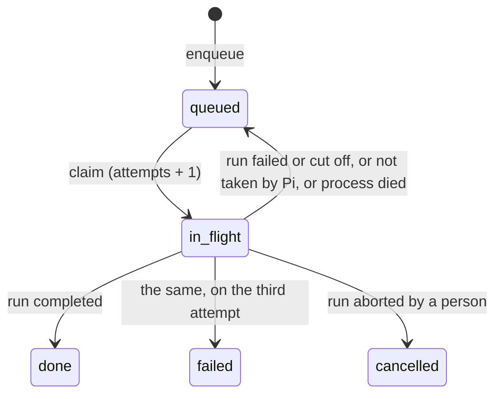

# Message queue

Each agent has a message queue: a SQLite file at `agent-x/agents/<name>/storage/message_queue.db`. One file per agent means an agent's processes see only its own messages. Senders put messages on it, the [runner](../../agent-runner/README.md) starts a Pi process for each thread with messages, and the [message queue extension](#the-message-queue-extension) in that session hands them to Pi.

```
src/agent-runtime/pi-package/extensions/message-queue/
  queue.ts     class Queue: the file, its tables, every step on it
  render.ts    how messages look to the model: metadata block, then content
  index.ts     the extension
```

All queue code is in the extension's folder: the CLI and the runner use its compiled copy in `dist/`, the extension its source. Each process opens the file with `new Queue(agentRoot)`, which first migrates an older file ([D37](#d37)).

## Messages

A sender gives:

| Field | Meaning |
|---|---|
| `threadId` | Required. The conversation, which is the id of the Pi session that gets the message ([D21](#d21)). Pi's rule for session ids applies: letters, digits, `.`, `_`, `-`, starting and ending with a letter or digit, at most 200 characters. |
| `content` | The text for the agent. It may not contain `<agentx-metadata` ([D25](#d25)). |
| `metadata` | Optional facts for the model, one per line. A name may not start with `agentX-` or contain `:` or a line break. No name or value may contain `<agentx-metadata`. |
| `doNotSteer` | Never joins a run in progress; starts the next run. |
| `isSilent` | Never starts a run; goes along with the next message that does, or joins a run in progress. |

The queue adds `id` (12 random letters, digits, `-` and `_`, so nobody can guess one), `status`, `attempts`, `error`, `entryId` (the Pi session entry of the last delivery), `createdAt` and `updatedAt`. The column `seq` keeps the order of arrival.

Messages are first in, first out: the runner serves the thread of the oldest waiting message first, and a thread's messages go oldest first. The one exception: a newer message can be steered into a run ahead of an older `doNotSteer` one.

## States



- **Claim.** The thread's holder takes its queued messages. To start a run, it takes all of them, or none if all are silent. To steer, it takes those not marked `doNotSteer`.
- **Delivered.** Once Pi has saved the user message, the extension writes its session entry id to `entry_id`. The message has reached the model.
- **Settle.** When the run ends:
  - completed: the messages Pi saved become `done`;
  - failed: they go back to the queue, or become `failed` on the third attempt ([D24](#d24));
  - aborted: every message in flight becomes `cancelled`, or gets another attempt in a worker ([D32](#d32)).
- **Not taken, or the process died.** A claimed message Pi never saved, or one left in flight by a process that stopped, goes back to the queue the same way ([Agent runner](../../agent-runner/README.md#when-a-pi-process-ends)).

`done`, `failed` and `cancelled` are final. To try a message again, send it again.

## Threads and leases

Two processes writing one Pi session split the conversation, and Pi has no lock against it ([Pi](../../pi/README.md#sessions)). So one process at a time holds a thread ([D22](#d22)):

- The `threads` table has one lease per thread: the owner (process id and start time) and when it was last written. A lease not written for 2 minutes is free.
- A Pi session takes its thread's lease when it starts and gives it up when it closes. It checks the lease every second, before every model call and after every turn, and writes it again once it is 10 seconds old.
- Only the holder can claim or settle the thread's messages. A claim renews the lease in the same step.
- The runner holds no thread; the Pi process it starts takes it.
- Taking a thread from a holder that stopped ends the attempt of the messages it left in flight. This waits for the old lease to run out, unless the runner frees the thread of its own dead Pi process ([D33](#d33)).
- `agentx run` refuses a thread that another live process holds ([Agent](../../agent/README.md#threads)).

## The message queue extension

`extensions/message-queue/index.ts` claims the thread's messages, sends them to Pi, records the session entry each became, and settles them when the run ends. It reads the thread id from the session id. It works the same under `agentx run` and under the runner ([D23](../../agent-runner/README.md#d23)), apart from [workers](#workers).

| When | What it does |
|---|---|
| `session_start` | Reads the agent's time zone. Opens the queue, takes the thread's lease. |
| `resources_discover` (after every extension's `session_start`) | Starts a one-second timer, so messages are taken only once every extension has started ([D44](#d44)). Adds no resources. |
| every second | Checks the lease. If Pi is idle, claims the queued messages and sends them as one user message, which starts a run. A worker with no work ends the session instead. |
| `context` (before every model call) | Checks the lease. For each new user message entry with metadata blocks, writes the entry's id to the messages named in the opening tags. |
| `turn_end` | Checks the lease. After a completed turn, claims the messages that may be steered and sends them as a steer, which Pi adds before the next model call. Skipped while the run is being aborted. |
| `agent_before_settle` | Notes whether Pi judged the run failed, and why. |
| `agent_settled` | Settles the run's messages. |
| `input` | Refuses input in a session without the lease. |
| `session_shutdown` | Stops the timer, gives up the lease, closes the queue. |

Checking the lease renews it when due. A session whose lease belongs to another process aborts its run in progress and takes no more input or messages. The new holder retries that run's messages.

How this fits Pi ([Pi](../../pi/README.md#delivering-messages)):

- Pi has no event for "a message arrived" while idle, so the extension waits with a timer.
- `deliverAs: "steer"` joins a run in progress, or starts one when Pi is idle.
- A one-shot run takes nothing from the queue ([D28](#d28)). Neither does an unsaved session (`--no-session`), which would keep no record.
- Pi does not say whether it accepted a message. So before starting a run, the extension checks that Pi has a model and a login, and fails the messages with the reason if not. Otherwise, if Pi is idle a minute after the last send and a message is still in flight, Pi did not take it, and it gets another attempt.
- A session can lack the lease when Pi picked it itself (`-c`, `-r`, `/resume`) while another process runs that thread. The extension says so, a one-shot run exits with status 1, and nothing is written to the session.
- An unknown time zone in `agentx.timezone` is reported, and messages show the machine's time.

### Workers

The runner starts Pi with `--agentx-worker`, a flag this extension registers ([D32](#d32)). It marks a session nobody watches:

- A worker ends its own session when its thread has no work left (no queued message that can start a run, nothing in flight) or when it does not hold its thread. The runner starts a new Pi process when messages arrive.
- An aborted run of a worker gets another attempt, because only Pi closing the session aborts it: the runner stopped or died, or the process was told to end. In a session a person runs, an abort is a choice, and the messages become `cancelled`.

## What the model sees

`render` turns the messages of one delivery into one user message: for each message, a metadata block and its content, with a blank line between messages.

```
<agentx-metadata id="q7Rk2mXa9LbT">
agentX-ThreadId: main
agentX-SentTime: Wednesday 2026-11-11 21:58:10 GMT+5:30
agentX-CurrentTime: Wednesday 2026-11-11 21:59:54 GMT+5:30
agentX-IsRetry: true
agentX-RetryAttempt: 1
from: ops
</agentx-metadata>
The message itself.
```

- The opening tag carries the message's id. The extension finds delivered messages by it.
- `agentX-SentTime` is when the message was queued, `agentX-CurrentTime` when it is delivered. Both use the agent's time zone: `agentx.timezone` in its [settings](../../agent/README.md#pisettingsjson), or the machine's.
- `agentX-IsRetry` is `true` from the second attempt on. `agentX-RetryAttempt` (1 for the first retry) appears only on retries, `agentX-IsSilent: true` only on silent messages.
- Other lines are the sender's metadata. Values that are not text are shown as JSON; line breaks become spaces.

A queue message always starts with `<`, so Pi never reads it as a slash command. The harness prompt explains the block to the agent ([Pi package](../README.md#the-system-prompt-extension)).

## The Queue class

| Method | Used by | Does |
|---|---|---|
| `enqueue(message)` | senders | Adds a message; returns its id. |
| `acquire`, `renew`, `release(threadId)` | the holder | Takes, keeps and gives up the lease. `acquire` returns false when another live process holds the thread; `renew` when the lease is not this process's. |
| `abandon(threadId, pid, failure)` | the runner | Frees a thread whose holder, process `pid`, has ended. With `failure`, if the holder left nothing in flight, the waiting messages lose an attempt. |
| `expired(threadId, pid)` | the runner | Whether the lease of process `pid` has run out, as when the process is blocked. |
| `heldElsewhere(threadId)` | `agentx run` | Whether another live process holds the thread. |
| `nextThread(except)` | the runner | The thread of the oldest message with work that nobody holds. Work is a queued message that can start a run, or one in flight. |
| `hasWork(threadId)` | a worker | Whether the thread still has work. |
| `claim(threadId, steer)`, `inFlight(threadId)` | the extension | Takes queued messages and counts the attempt; whether a taken message is not settled yet. |
| `delivered(threadId, ids, entryId)` | the extension | Records the session entry. |
| `settle(threadId, result)` | the extension | Settles the messages of a run that ended. |
| `fail(threadId, error)` | the extension | Ends the attempt of everything in flight on the thread. |

Each method is one atomic step: one statement, or a transaction that takes the write lock first (`BEGIN IMMEDIATE`). The file uses WAL mode and waits up to 5 seconds for another process's write. Opening retries the switch to WAL for 5 seconds, because that step fails at once when two processes make it together.

## Looking at the queue

`agentx send` puts a message on the queue ([CLI](../../../cli/README.md#commands)). No command lists it; read the file:

```sh
sqlite3 storage/message_queue.db 'SELECT id, thread_id, status, attempts, error FROM messages ORDER BY seq DESC LIMIT 20'
```

## Known limits

- No delay between attempts, so a model provider outage fails messages within seconds, after Pi's own retries inside the run.
- A thread held by a killed process stays blocked for 110 to 120 seconds, unless the runner that started it frees it ([D33](#d33)).
- Nothing prunes settled messages from the file.
- Nothing carries the answer back to the sender. It is in the session, at the message's `entry_id`.
- The file must be on a local disk; SQLite locking is not reliable on network file systems.
- SQLite before 3.51.3 (or 3.50.7, 3.44.6) has a rare bug that can corrupt a WAL file ([sqlite.org](https://sqlite.org/wal.html), "The WAL-Reset Bug"). `node -p process.versions.sqlite` shows what Node bundles; Node 24.12 bundles 3.50.4.
- Only senders are checked for `<agentx-metadata`. Typed input or another extension's message could mark a message delivered, but only by its id, which nobody can guess.
- Aborting, closing or switching (`/new`, `/resume`) a terminal session during a run cancels its queue messages, including those waiting inside Pi to be steered in. Pi may still put such a waiting message into that session's next run.
- An agent's extension that drops a block's opening tag from user messages makes delivered messages look undelivered, so they are retried and fail.

## Decisions

<a id="d19"></a>
### D19. SQLite through Node's built-in `node:sqlite`

- **Decision.** `node:sqlite` in WAL mode, with a busy timeout and `BEGIN IMMEDIATE` for transactions that read and then write.
- **Why.** WAL lets many processes on one machine share a file safely, and a built-in module needs no install and loads inside Pi. The tests run eight processes on one file.
- **Rejected.** `better-sqlite3`, a native build that pnpm blocks until the user approves it; Turso, where several processes on one file is experimental.

<a id="d21"></a>
### D21. A thread is a Pi session; the thread id is the session id

- **Decision.** The runner and `agentx run --thread-id <id>` pass the thread id to Pi as `--session-id`, which opens or creates that session. `agentx run` uses `main` by default.
- **Why.** No table maps threads to sessions, and the CLI and the runner land in the same session file.
- **Consequence.** `/new`, `/resume` and `/fork` in a terminal move the session to another thread.

<a id="d22"></a>
### D22. One live process per thread, by a lease in the queue file

- **Decision.** Each thread has a lease in the `threads` table that lasts 2 minutes and is written every 10 seconds. A session without the lease takes no input, and a holder that loses it aborts its run at once.
- **Why.** Pi does not lock session files, and a lease that expires covers a killed holder, even across containers; asking whether a process id is alive does not, since ids are reused.
- **Consequence.** A process paused or blocked for more than 110 seconds can lose its thread; it notices within a second of resuming and stops.

<a id="d24"></a>
### D24. A retry sends the message again, marked as a retry; three attempts

- **Decision.** A message whose run failed or was cut off is sent again in full, with `agentX-IsRetry: true` and the retry number. After three attempts it is `failed`.
- **Why.** One way to deliver; the model is told some work may be done, and the session shows what.

<a id="d25"></a>
### D25. A queue message is a user message that starts with a metadata block

- **Decision.** Each message starts with a block from `<agentx-metadata id="<message id>">` to `</agentx-metadata>`, one fact per line, the harness's named `agentX-<Name>`. The queue refuses content or metadata that contains the tag.
- **Why.** No sender can fake a block, and the random id links a message to its session entry without being guessable.
- **Rejected.** A Pi custom message: Pi keeps it apart from user messages and skips their input handling.

<a id="d28"></a>
### D28. Only a session that stays open takes messages from the queue

- **Decision.** One-shot runs (`-p`, `--mode json`) take nothing from the queue, though they hold their thread while they run.
- **Why.** A one-shot run prints its last answer, and a steered queue message would replace the answer to the prompt that was asked.
- **Consequence.** `agentx run -p` does not drain a thread's queue; the runner or a terminal session does.

<a id="d32"></a>
### D32. The runner's sessions are workers, marked with `--agentx-worker`

- **Decision.** The extension registers `--agentx-worker`, and the runner passes it. A worker ends its session when its thread has no work, and its aborted runs get another attempt instead of `cancelled`.
- **Why.** Only the extension takes messages, so only it can tell without a race that nothing is left. Unlike an environment variable, a flag is visible and not inherited by the commands the agent runs.

<a id="d33"></a>
### D33. The runner takes a thread from its dead Pi process by process id

- **Decision.** When a Pi process the runner started ends with a failure, the runner calls `abandon(threadId, pid, failure)`: it deletes that process's lease, takes the thread (ending the attempts left in flight), and gives it up.
- **Why.** The runner is the parent, so it knows the process has ended and need not wait for the lease.
- **Consequence.** Across a container boundary the process id does not match, and the messages wait for the lease to run out.

<a id="d37"></a>
### D37. The queue file carries a version; migrations bring older files up

- **Decision.** The file's version is SQLite's `PRAGMA user_version`; opening an older file runs the missing migrations from `queue.ts` in one transaction under the write lock, and a newer file is refused. A shipped migration is never changed.
- **Why.** Only one of the processes that open the file after an upgrade may migrate it, and a stale build must not write to tables it does not know.
- **Consequence.** An older agentx refuses a migrated file.

<a id="d44"></a>
### D44. The session takes queued messages only once every extension has started

- **Decision.** The extension takes the thread's lease in `session_start`, but starts the timer that delivers messages in `resources_discover`, which Pi sends right after every extension's `session_start` handler has finished.
- **Why.** An extension that awaits work in `session_start`, such as one that registers an MCP server after a network call, must be done before the first run: Pi's MCP support waits for direct servers only at the first run's start, and only for those registered by then. Pi loads the agent's own extensions after agentx's package, so no order of extensions could ensure it.
- **Consequence.** `resources_discover` is meant for adding skill and prompt folders; the extension uses it as the one event that follows start-up, and returns none.
