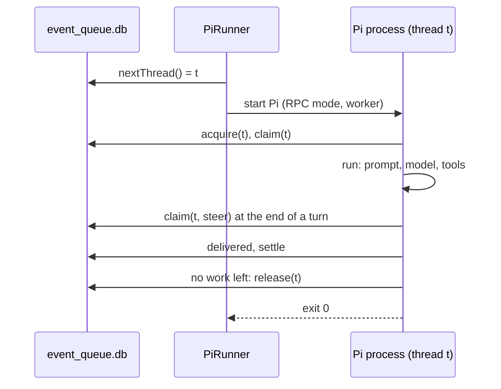

# Pi

How agentx starts Pi for an agent (`pi/pi-launch.ts`), and the Pi runner, which runs an agent's Pi threads. What Pi loads into every agent: [Pi package](pi-package/README.md). What agentx relies on in Pi: [Pi reference](pi-reference/README.md).

## The Pi runner

The `PiRunner` (`src/agent-runtime/pi/pi-runner.ts`) is one of the loops of [`agentx run`](../supervisor/README.md). It starts a Pi process for each Pi thread that has events. Workflow threads are the [workflow runner](../workflows/README.md)'s.

### How it works

The runner only starts Pi processes ([D31](#d31)). The [event queue extension](pi-package/event-queue/README.md) in each session takes, delivers and settles the events ([D23](#d23)), and ends the session when its thread has no work left.

Once a second the runner:

1. **Ends stuck workers.** A worker whose lease ran out is blocked, and gets `SIGKILL`. A worker that wrote nothing for `stallSeconds` is stuck, for example on a tool that never returns, and gets `SIGTERM`.
2. **Starts threads.** While fewer than `maxThreads` run, it starts the Pi thread of the oldest waiting event that no process holds ([settings](../supervisor/README.md#settings)).

**Stopping.** The first stop starts no more threads and waits for the running ones. The second sends `SIGTERM` to every worker: its run is aborted, and its events wait for the next start. If `agentx run` dies, its Pi processes end with it, because their input closes.

### Starting a thread's Pi process

The runner starts Pi as `agentx chat --thread-id <thread> --mode rpc` would, with the same CLI, flags and environment ([below](#how-agentx-chat-starts-pi)), plus `--agentx-worker`, which tells the event queue extension that nobody watches the session ([D32](pi-package/event-queue/README.md#d32)). Each Pi process has a process group of its own, so a terminal's Ctrl-C reaches only `agentx run`.

While it runs ([RPC mode](pi-reference/README.md#rpc-mode)), the runner:

- **Reads its output**, one JSON record per line, since Pi waits when nobody reads.
- **Cancels every extension dialog**, since nobody is there to answer, and logs its title. The harness prompt tells the model that such questions count as declined.
- **Logs** extension notifications and errors.
- **Keeps its input open**, because Pi closes its session when the input closes.
- **Keeps the end of its error output**, which says why Pi stopped.

The runner holds no lease; the Pi process holds the thread ([Threads and leases](../events/README.md#threads-and-leases)).

### When a Pi process ends

| What happens | Who updates the events |
|---|---|
| The session ends itself, its thread empty | The extension settled them. |
| The session lost its lease to another process | The new holder gives them another attempt. |
| Pi is told to stop: `SIGTERM`, `SIGHUP`, or its input closes | Pi aborts the run, and the extension ends the attempt. |
| Pi crashes, cannot start, or is killed | The runner, at once: events in flight lose their attempt, or, with none in flight, the waiting events lose one, with Pi's error as the reason. |
| Everything dies, as with the machine | The next process to take the thread, once the lease runs out. |

The runner frees the thread of its dead process at once, instead of waiting for the lease ([D33](#d33)). Waiting events lose an attempt so that a broken agent fails its events after three starts, instead of restarting forever ([D24](pi-package/event-queue/README.md#d24)). The reason is the last `Error:` line of Pi's error output, or the signal or exit code.

## How `agentx chat` starts Pi

`chat` runs the Pi CLI, `dist/bundle/cli.js`, with agentx's own Node, the flags of `pi/pi-launch.ts` and the environment of `agent-env.ts`, which the Pi runner, the routers and workflows share:

| Setting | Value | Why |
|---|---|---|
| Pi CLI | agentx's own dependency | [D1](../agent/README.md#d1) |
| `cwd` | the agent directory | Pi reads `.pi/` from `cwd` ([D2](../agent/README.md#d2)) |
| `PI_CODING_AGENT_DIR` | `agent-x/.pi` | one per project, without `~/.pi/agent` ([D17](../agent/README.md#d17)) |
| environment | agentx's own, plus `agent-x/.env` | keys for all agents ([D43](../agent/README.md#d43)) |
| `PATH` | `agent-x/node_modules/.bin` first | `agentx` in Pi's bash is the pinned one |
| `AGENTX_AGENT` | the agent's name | `agentx event send` works in Pi's bash, and `agentx event deliver` does not ([Events](../events/README.md#sending-and-delivering)) |
| `TZ` | the agent's `agentx.timezone`, when it names one | the agent's processes tell the time in its time zone ([D98](../agent/README.md#d98)) |
| `-nc`, `--approve` | except for Pi subcommands | skip `AGENTS.md` and `CLAUDE.md`; trust `.pi/` ([D6](../agent/README.md#d6)) |
| `-e <agentx>/src/agent-runtime/pi/pi-package` | except for Pi subcommands | load agentx's Pi package ([D16](pi-package/README.md#d16)) |
| `--session-dir storage/sessions/<thread>` | `--thread-id`, or `main`; except for Pi subcommands | the thread is the folder of its sessions ([D21](#d21)) |
| `--continue` | unless the arguments pick a session or open none (`-c`, `-r`, `--session`, `--session-id`, `--fork`, `--no-session`, …) | the thread's latest session goes on, or a first one starts ([D21](#d21)) |

Pi subcommands (`install`, `remove`, `uninstall`, `update`, `list`, `config`, `mcp`, `auth`) must be the first argument, so `chat` adds no flags before them. When it continues a thread, `chat` first stops if another live process holds it; when the arguments pick the session, the event queue extension checks instead.

## Known limits

- Each burst of events on a thread starts a new Pi process, which costs starting Pi, its extensions and MCP servers: about 0.2 s on a laptop.
- Nothing limits a run that keeps writing, such as a model that calls tools in a loop. A silent tool that rightly runs longer than `stallSeconds` is stopped.
- Every interruption costs an event an attempt, a restart of `agentx run` too.
- Each running thread is a Pi process of about 130 MB.
- Threads of one agent share `storage/workspace`; nothing stops two from writing the same file.

## Decisions

### D21. A thread is a folder of Pi sessions, and its latest session goes on

- **Decision.** The Pi runner and `agentx chat` pass the thread's folder, `storage/sessions/<thread>/`, as `--session-dir`, with `--continue`, so Pi goes on with the thread's latest session, or starts one. A person's own choice (`-c`, `-r`, `--session`, `--session-id`, `--fork`) picks among the thread's sessions instead. The event queue extension and `agentx event send` take the thread from the session's folder. `agentx chat` uses `main` by default.
- **Why.** No table maps threads to sessions, and a person and `agentx run` land in the same session. Pi's own session commands, `-c`, `-r`, `/new` and `/resume`, all work and stay in the thread.
- **Consequence.** The thread's live session is the one written last: after `/new` or `/resume`, that one goes on.

### D23. The event queue extension is the only consumer of a Pi thread's events; the runner only starts Pi processes

- **Decision.** The extension in every session takes its thread's events, starts or joins a run, and settles them. The runner starts a Pi process per thread, and touches events only when that process fails.
- **Why.** One delivery path for a person's session and the runner's, so the agent behaves the same in both.

### D31. The runner starts a Pi process per thread, in RPC mode

- **Decision.** Each running thread gets one Pi CLI process in RPC mode, started as `agentx chat` starts Pi, plus `--agentx-worker`. `maxThreads` caps how many run at once.
- **Why.** A process can fail alone, be seen to fail, and be killed. Sharing `pi-launch.ts` keeps the agent the same as under `agentx chat`.
- **Rejected.** Pi's `RpcClient`: it cannot answer dialogs, runs whichever `node` is on `PATH`, and kills the process one second after asking it to stop.

### D33. The Pi runner frees a thread of its dead Pi process by process id

- **Decision.** When a Pi process the runner started ends with a failure, the runner deletes that process's lease, takes the thread, ending the attempts left in flight, and gives it up.
- **Why.** The runner is the parent, so it knows the process ended and need not wait for the lease.
- **Consequence.** Across a container boundary the process id does not match, and the events wait for the lease to run out.
