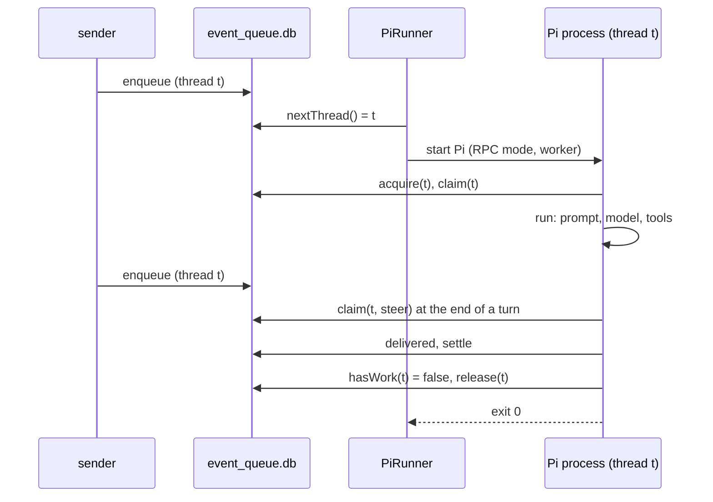

# Pi

Starting Pi for an agent (`pi/pi-launch.ts`), and the Pi runner, which runs an agent's Pi threads. What Pi loads into every agent: [Pi package](pi-package/README.md). What agentx relies on in Pi: [Pi reference](pi-reference/README.md).

## The Pi runner

The `PiRunner` (`src/agent-runtime/pi/pi-runner.ts`) is one of the three loops of `agentx run` ([agent supervisor](../supervisor/README.md)). It serves the Pi threads of one agent's queue: it starts a Pi process for each thread that has events. Workflow threads, `workflow.<name>`, are the [workflow runner](../workflows/README.md)'s. A session opened with `agentx chat` also works its thread's queue ([Agent](../agent/README.md#threads)).

### How it works

The runner only starts Pi processes ([D31](#d31)). The [event queue extension](pi-package/event-queue/README.md#the-event-queue-extension) in each session takes, delivers and settles the events ([D23](#d23)), and ends the session when its thread has no work left ([D32](pi-package/event-queue/README.md#d32)).

`new PiRunner(agentRoot, maxThreads, stallMs = 10 minutes)` serves one agent. `agentx run` takes both from the agent's settings ([agent supervisor](../supervisor/README.md#settings)). Once a second it:

1. **Ends stuck workers.** A worker whose lease has run out has a blocked main thread; it gets `SIGKILL`. A worker that wrote nothing on stdout for `stallMs` is stuck, for example on a tool that never returns; it gets `SIGTERM` once. Set `stallSeconds` above the longest a tool may run without output.
2. **Starts threads.** While fewer than `maxThreads` run, it takes the Pi thread of the oldest waiting [event](../events/README.md#events). It skips threads it already runs, threads a live process holds, workflow threads, and events that have no thread yet.

A worker is the pinned Pi CLI in RPC mode, which stays open until its input closes. The runner sends it no prompts. The session takes the thread's lease, works its events, and ends itself when the thread has no [work](../events/README.md#the-queue-class) left.

**Stopping.** `stop()` starts no more threads; `run()` returns when the running ones end, which can take long under steady traffic. `stop(true)` also sends `SIGTERM` to every worker: each run is aborted and its events wait for the next start, with the attempt counted. `agentx run` calls `stop()` on the first `SIGINT` or `SIGTERM` and `stop(true)` on the second. If `agentx run` dies, its Pi processes end with it, because their input closes.

**Health.** `lastRound()` says when the loop last looked at the queue. The supervisor writes the agent's heartbeat only while that was in the last 30 seconds.

### Starting a thread's Pi process

The runner starts Pi as `agentx chat --thread-id <thread> --mode rpc` does. Both take the CLI and flags from `pi/pi-launch.ts` and the environment from `agent-env.ts` ([below](#how-agentx-chat-starts-pi)).

| The runner passes | Why |
|---|---|
| `cwd` = the agent directory, `PI_CODING_AGENT_DIR` = `agent-x/.pi` | as `agentx chat` |
| `-nc`, `--approve`, `-e <pi-package>`, `--session-dir` | as `agentx chat` |
| `--session-id <thread>` | the thread is the session ([D21](#d21)) |
| `--mode rpc` | Pi stays open and reports on stdout, with no terminal UI |
| `--agentx-worker` | tells the event queue extension that nobody watches the session ([D32](pi-package/event-queue/README.md#d32)) |

Each Pi process gets a process group of its own ([D46](../supervisor/README.md#d46)), so a terminal's Ctrl-C reaches only `agentx run`, which lets the run finish. Pi itself ends at once on `SIGINT`.

While it runs ([Pi](pi-reference/README.md#rpc-mode)), the runner:

- **Reads stdout**, one JSON record per line. Pi waits when nobody reads.
- **Cancels every extension request.** Nobody is there, and an unanswered dialog would block its run forever. The extension gets `false` or no value. The runner logs each cancelled dialog's title, so an extension that keeps asking can be found. The harness prompt tells the model that such questions count as declined. In RPC mode `ctx.hasUI` is true, so extensions still ask.
- **Logs** extension notifications and extension errors with the thread id. It ignores other records.
- **Keeps stdin open**, because Pi closes its session when stdin closes.
- **Keeps the end of stderr**, which says why Pi stopped.

The runner holds no lease. The Pi process holds the thread from the moment its session starts ([Event queue](../events/README.md#threads-and-leases)).

### When a Pi process ends

| What happens | Who updates the events |
|---|---|
| The session ends itself because its thread has no work left; exit 0 | The extension has settled them. The runner does nothing. |
| The session lost its lease to another process; exit 0 | It aborts its run at once. The new holder took its events in flight and gives them another attempt. The runner does nothing. |
| Pi is told to stop: `SIGTERM` or `SIGHUP`, or stdin closes because `agentx run` died | Pi closes the session and aborts the run; the extension ends the attempt. A runner that is still there also puts back anything left in flight, with no extra attempt counted. |
| Pi dies by itself (crash, out of memory, killed), cannot start, or hangs and gets `SIGKILL` | The runner, at once. Events left in flight lose their attempt. If none were in flight, the waiting events lose one, with Pi's error as the reason. |
| Everything dies, as when the machine does | The next process to take the thread, once the lease runs out: 110 to 120 s later |

A lost attempt puts an event back on the queue, or marks it `failed` after the third ([D24](pi-package/event-queue/README.md#d24)).

- The runner frees the thread at once by its dead process's id, instead of waiting up to two minutes for the lease to run out ([D33](#d33)).
- Waiting events lose an attempt so that a broken agent fails its events after three starts, instead of restarting every second forever.
- Exit codes 143 and 129 (Pi closing after `SIGTERM` or `SIGHUP`), and the signals `SIGTERM`, `SIGHUP` and `SIGINT`, count as told to stop.
- The reason is the last stderr line like `Error: ...` or `TypeError: ...`, or else the signal or exit code. The runner logs it.

## How `agentx chat` starts Pi

`src/cli/commands/chat.ts` runs `node <pi>/bundle/cli.js [flags] [args]`:

| Setting | Value | Why |
|---|---|---|
| Pi CLI | from agentx's own dependency | [D1](../agent/README.md#d1) |
| `cwd` | the agent directory | Pi reads `.pi/` from `cwd` ([D2](../agent/README.md#d2)) |
| `PI_CODING_AGENT_DIR` | `agent-x/.pi` (`<agent>/../../.pi`) | keeps `~/.pi/agent` out; one per project ([D17](../agent/README.md#d17)) |
| the rest of the environment | agentx's own, plus the variables in `agent-x/.env` it does not already have | keys such as `COMPOSIO_API_KEY` for all agents of the project, kept out of git ([D43](../agent/README.md#d43)) |
| `PATH` | `agent-x/node_modules/.bin` first | `agentx` in Pi's bash tool, the router and workflows is the one the project pins |
| `-nc` | except for Pi subcommands | skip `AGENTS.md` and `CLAUDE.md` ([D6](../agent/README.md#d6)) |
| `--approve` | except for Pi subcommands | trust `.pi/` for this run, with no prompt ([D6](../agent/README.md#d6)) |
| `-e <agentx>/src/agent-runtime/pi/pi-package` | except for Pi subcommands | load agentx's Pi package ([D16](pi-package/README.md#d16)) |
| `--session-dir <agent>/storage/sessions/<thread>` | except for Pi subcommands | keep each thread's sessions in a folder of its own in the agent's storage ([D16](pi-package/README.md#d16), [D21](#d21)). The thread is the `--thread-id` value, or the id given to Pi's own `--session-id`, or `main`. With `-c` or `-r`, Pi picks among the sessions of that folder. |
| `--session-id <thread>` | the `--thread-id` value, which `chat` takes out of the arguments. Otherwise `main`, unless the arguments pick a session or open none (`--session-id`, `--session`, `-c`, `-r`, `--fork`, `--no-session`, `--export`, `--list-models`, `--help`, `--version`) | the session is the thread ([D21](#d21)) |

Pi subcommands (`install`, `remove`, `uninstall`, `update`, `list`, `config`, `mcp`, `auth`) must be the first argument, so `chat` adds no flags before them.

The Pi CLI and the flags come from `src/agent-runtime/pi/pi-launch.ts`, and the environment from `src/agent-runtime/agent-env.ts`, which the router and workflows get too. The Pi runner uses the same files, so a thread's session is the same under both ([Pi runner](#starting-a-threads-pi-process)). The router and workflows get the same environment.

When `chat` opens `main` or a `--thread-id`, it first checks `storage/event_queue.db` for a live holder of the thread and stops if there is one. `chat` creates `storage/event_queue.db`; Pi creates `agent-x/.pi` and `storage/sessions` when they are missing.

## Known limits

- Each burst of events on a thread starts a new Pi process, which pays for starting Pi, loading extensions and connecting MCP servers. Pi is ready in 0.15 to 0.2 s on a laptop.
- Nothing limits a run that keeps writing, such as a model that calls tools in a loop. A silent tool that rightly runs longer than `stallSeconds` is stopped, and its event fails after three attempts.
- Every interruption costs an event an attempt, including a restart of `agentx run`.
- Each running thread is a Pi process of about 130 MB.
- Threads of one agent share `storage/workspace`; nothing stops two from writing the same file.
- A session made with `/new` or `/fork` is a thread of its own, but lies in the folder of the thread it came from. Events for its thread start a new session in a folder of that thread's name, apart from it; reach the old one with `agentx chat --thread-id <old thread> -r`.

## Decisions

### D23. The event queue extension is the only consumer of a Pi thread's events; the runner only starts Pi processes

- **Decision.** The extension in every session takes its thread's events, starts or joins a run, and settles them. The runner only starts a Pi process per thread, and touches events only when that process fails.
- **Why.** One delivery path for a person's session and the runner's, so the agent behaves the same in both.

### D31. The runner starts a Pi process per thread, in RPC mode

- **Decision.** Each running thread gets one Pi CLI process in RPC mode, started with what `agentx chat` passes plus `--agentx-worker`; `maxThreads` caps how many run at once.
- **Why.** A process can fail alone, be seen to fail, and be killed. Sharing `pi/pi-launch.ts` keeps the agent the same as under `agentx chat`.
- **Rejected.** Pi's `RpcClient`: it cannot answer dialogs, runs whichever `node` is on `PATH`, and kills the process one second after asking it to stop.

### D21. A thread is a Pi session; the thread id is the session id

- **Decision.** The Pi runner and `agentx chat --thread-id <id>` pass the thread id to Pi as `--session-id`, which opens or creates that session, and the thread's folder, `storage/sessions/<id>/`, as `--session-dir`. `agentx chat` uses `main` by default.
- **Why.** No table maps threads to sessions, and a person and `agentx run` land in the same session file. A folder per thread keeps each thread's files apart, and Pi's own choices (`-c`, `-r`) to one thread.
- **Consequence.** `/new`, `/resume` and `/fork` in a terminal move the session to another thread. A session that `/new` or `/fork` creates has a new id, which is a new thread, but its file stays in the folder of the thread it came from.

### D33. The Pi runner takes a thread from its dead Pi process by process id

- **Decision.** When a Pi process the Pi runner started ends with a failure, the runner calls `abandon(threadId, pid, failure)`: it deletes that process's lease, takes the thread (ending the attempts left in flight), and gives it up.
- **Why.** The runner is the parent, so it knows the process has ended and need not wait for the lease.
- **Consequence.** Across a container boundary the process id does not match, and the events wait for the lease to run out.
