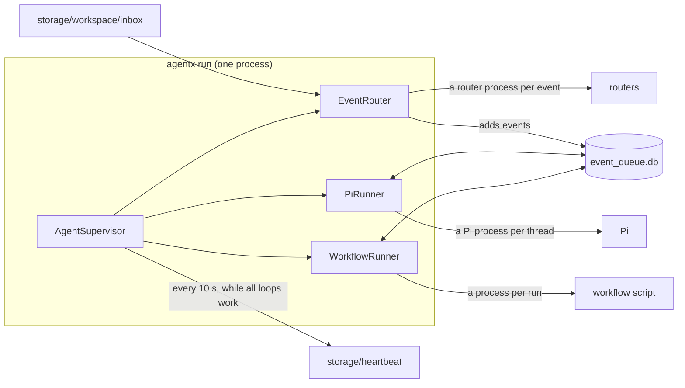

# Agent supervisor

`agentx run`, in an agent directory, runs the agent until it is stopped. A person runs it on a laptop; the [coordinator](../../coordinator-runtime/README.md) runs it for each agent on a server. `runAgent` (`src/agent-runtime/supervisor/run-agent.ts`) reads the agent's [settings](#settings) and creates the `AgentSupervisor`, the parent of three loops ([D46](#d46)). The CLI's `agentx run` calls it, and so does `agent-process.ts`, the process the coordinator starts.

| Loop | Takes | Does |
|---|---|---|
| `EventRouter` | the inbox, oldest first | puts each event on the queue, after the [routers](../events/README.md#routing) give one without a thread its thread |
| `PiRunner` | events on Pi threads | starts a [Pi process](../pi/README.md) per thread |
| `WorkflowRunner` | events on `workflow.<name>` threads | runs the [workflow](../workflows/README.md) |

The loops share only the queue file, and each has its own limits, so a slow router does not hold up Pi, and busy Pi threads do not hold up workflows.

## What the supervisor does

- **Starts the loops** and waits for all three to end.
- **Restarts a loop** that crashes, after 1 s, doubling up to a minute, and back to 1 s after a run of 10 minutes.
- **Writes the heartbeat**, the time in `storage/heartbeat`, every 10 seconds, but only while every loop is healthy: it looked for work in the last 30 seconds, or the router is waiting on a call. A stuck loop shows as a heartbeat that stops, and the coordinator then restarts the process ([coordinator](../../coordinator-runtime/README.md#an-agents-process)).
- **Stops** (`stop-signals.ts`, which `agentx serve` uses too). The first `SIGINT` or `SIGTERM` stops new work and lets running work finish. The second stops it now. A `SIGTERM` within a second of a `SIGINT` counts as the same stop, because `pnpm exec` sends one after a terminal's Ctrl-C.
- **Ends with the coordinator.** Started by the coordinator, the process has an IPC channel to it, and exits at once when the channel closes.

Every child process starts in a process group of its own, so a terminal's Ctrl-C reaches only `agentx run`.

## Settings

`agentx.runner` in the agent's `.pi/settings.json` ([D36](../agent/README.md#d36)). All keys are optional; a value that is not a number above 0 stops `agentx run` with an error.

| Key | Default | Meaning |
|---|---|---|
| `maxThreads` | 4 | Pi threads that run at once. Each Pi process uses about 130 MB. |
| `stallSeconds` | 600 | A Pi process that writes nothing for this long is stopped. Set it above the longest a tool runs without output. |
| `routerSeconds` | 60 | How long each router may take for one event. |

Up to 4 workflow runs go at once, apart from `maxThreads`.

## Known limits

- Two `agentx run` on one agent stay correct, since a lease keeps a thread to one process and the queue adds an event once, but together they run up to twice `maxThreads`. Nothing stops a second one.
- Under `pnpm exec`, pnpm ends on Ctrl-C, so the prompt comes back while the work finishes.

## Decisions

### D46. `agentx run` is one process: a supervisor with three loops

- **Decision.** `agentx run` runs the `EventRouter`, the `PiRunner` and the `WorkflowRunner` as loops of one process, under an `AgentSupervisor` that restarts a crashed loop, writes the heartbeat only while all three work, and stops them. Every child process has a process group of its own.
- **Why.** The code that can fail or hang, the routers, workflows and Pi, runs in child processes, so it cannot take the loops down. One process is one thing for the coordinator to start, watch and stop, and later to put in a sandbox. Process groups keep a terminal's Ctrl-C from ending running work, and let a kill reach what a script started.
- **Rejected.** Three processes per agent, which would repeat the coordinator's restarts and health checks inside every agent.
