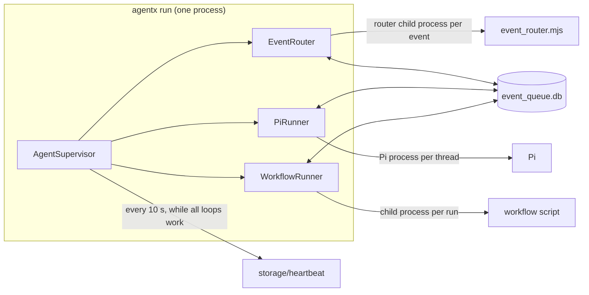

# Agent supervisor

`agentx run`, in an agent directory, runs the agent until it is stopped. A person runs it on a laptop; the planned [coordinator](../../coordinator-runtime/README.md) will start it for each agent on a server, and later in a sandbox. `src/cli/commands/run.ts` reads the agent's [settings](#settings) and creates the `AgentSupervisor` (`src/agent-runtime/agent-supervisor.ts`), the parent of three loops ([D46](#d46)):

| Loop | Takes | Does | Doc |
|---|---|---|---|
| `EventRouter` | events without a thread | calls the agent's router, which gives each its thread | [event router](../events/README.md) |
| `PiRunner` | events on Pi threads | starts a Pi process per thread | [Pi runner](../pi/README.md) |
| `WorkflowRunner` | events on `workflow.<name>` threads | runs the workflow with each | [workflows](../workflows/README.md) |

The loops share only the queue file, and each has its own limits, so a slow router does not hold up Pi, and busy Pi threads do not hold up workflows.

## What the supervisor does

- **Starts the loops** and waits for all three to end.
- **Starts a loop again** when it crashes, after 1 s, doubling up to a minute, and back to 1 s after a run of 10 minutes. It logs why. The same loop object runs again, so it keeps the child processes it was watching.
- **Writes the heartbeat**, the time in `storage/heartbeat`, when it starts and every 10 seconds after, but only while every loop is healthy. A loop is healthy when it looked at the queue in the last 30 seconds, or, for the router, while it waits for a router call, which has its own time limit. A loop that has ended after a stop counts as healthy, so the heartbeat goes on while the others finish their work. So a stuck loop shows as a heartbeat that stops; the coordinator will act on it.
- **Stops.** The first `SIGINT` or `SIGTERM` stops new work in every loop and lets running work finish: Pi runs, workflow runs, and a router call in progress. The second stops running work now. A `SIGTERM` within a second after a `SIGINT` counts as the same stop, because `pnpm exec` sends one right after a terminal's Ctrl-C (pnpm 11.21). `agentx run` exits 0 when everything has stopped.

Every child process of the loops starts in a process group of its own, so a terminal's Ctrl-C reaches only `agentx run`. A Pi process ends with `agentx run` because its input closes; a router or workflow process ends with it because its IPC channel closes.

## Settings

`agentx.runner` in the agent's own `.pi/settings.json` ([D36](../agent/README.md#d36)). All keys are optional; a value that is not a number above 0 stops `agentx run` with an error.

| Key | Default | Meaning |
|---|---|---|
| `maxThreads` | 4 | Pi threads that run at once. Each Pi process uses about 130 MB. |
| `stallSeconds` | 600 | A Pi process that writes nothing for this long is stopped. Set it above the longest time a tool of the agent runs without output. |
| `routerSeconds` | 60 | How long the router may take for one event. Long enough to ask a model. |

They depend on the agent's tools, so the agent's developer sets them, and whoever starts `agentx run` passes none. The template has no entry. Up to 4 workflow runs go at once, apart from `maxThreads`.

## Known limits

- Two `agentx run` on one agent stay correct: a thread's lease keeps it to one process, and the router and the workflow runner check an event's status in the update that moves it on. But together they run up to twice `maxThreads`, and a thread one has just started can be started again by the other, whose Pi process then ends at once. Nothing stops a second `agentx run`; the coordinator will start one per agent.
- Under `pnpm exec`, pnpm itself ends on Ctrl-C, so the prompt comes back while the work finishes.

## Decisions

### D46. `agentx run` is one process: a supervisor with three loops

- **Decision.** `agentx run` runs the `EventRouter`, the `PiRunner` and the `WorkflowRunner` as loops of one process, under an `AgentSupervisor` that starts a crashed loop again, writes the heartbeat only while all three work, and stops them. Every child process of the loops has a process group of its own.
- **Why.** The code that can fail or hang, the router, workflows and Pi, already runs in child processes, so it cannot take the loops down. One process is one thing for the coordinator to start, watch and stop, and later one thing to put in a sandbox. Process groups keep a terminal's Ctrl-C from ending running work, and let a kill reach what a script started.
- **Rejected.** Three processes per agent: they would repeat, inside every agent, the restart and health checks the coordinator has, for no more safety.
