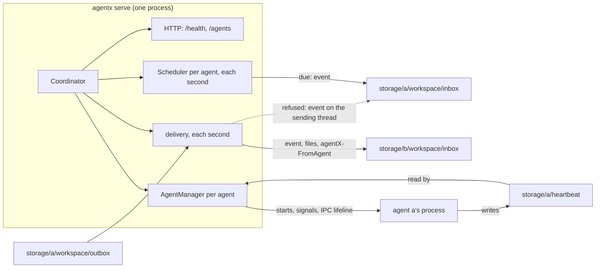

# Coordinator runtime

The coordinator is the one always-running process of a project. `agentx serve`, in the project root or `agent-x/`, starts it. It runs every agent as a process of its own, delivers the events they send, fires their schedules, and reports their health over HTTP. With a person's `agentx event deliver`, it is the only way into an agent from outside.

It reaches an agent only by starting and stopping its process, by reading `agentx.json` and the agent's checked-in files, and through plain files: its inbox, outbox, heartbeat and schedule state, in the agent's central folder, `agent-x/storage/<agent>/`, not through its `storage` link, which a sandbox's host will not have ([D65](../agent-runtime/agent/README.md#d65)).

```
src/coordinator-runtime/
  coordinator.ts     class Coordinator: finds the agents, starts them, delivers, serves HTTP, stops
  agent-manager.ts   class AgentManager: one agent's process, its restarts and its heartbeat
  delivery.ts        deliverOutbox: an agent's outbox into the inboxes it names
  deliver-event.ts   deliverEvent, deliverTo: put an event into an inbox, the only code that does
  scheduler.ts       class Scheduler: one agent's schedules
```



The coordinator finds the agents when it starts: those `agent-x/agentx.json` lists that have a folder in `agent-x/agents/` ([D63](#d63)). It logs a listed agent without a folder and a folder that is not listed, and runs neither. It makes an agent's storage when it is missing, and skips an agent whose `storage` is a folder of its own. Adding or removing an agent means starting `agentx serve` again.

## An agent's process

The `AgentManager` runs one agent ([D56](#d56)). It is where the agent's sandbox will go.

- **Start.** It starts the agent's process (`dist/agent-runtime/supervisor/agent-process.js`), which runs it as `agentx run` does ([supervisor](../agent-runtime/supervisor/README.md)), in the agent directory, with the coordinator's own Node and environment, in a process group of its own. It prefixes each line the process prints with the agent's name.
- **Lifeline.** The process exits when its IPC channel to the coordinator closes ([D59](#d59)).
- **Restarts.** A process that exits by itself is started again, with a backoff. After 5 restarts with no long run, the agent is `failed`, and its events wait in its inbox until `agentx serve` starts again.
- **Heartbeat.** The process writes `storage/heartbeat` every 10 seconds while its loops work. A process with no new heartbeat for 60 seconds is hung, and the manager kills it ([D57](#d57)).
- **Stop.** The first stop sends `SIGTERM`, which lets running work finish; a second stops it now.

An agent's state is `starting`, `running`, `restarting`, `failed`, `stopping` or `stopped`.

## Delivering

`deliverEvent` (`deliver-event.ts`) puts an event into an agent's inbox ([D48](../agent-runtime/events/README.md#d48)). Delivery uses its two halves apart, `prepareDelivery` and the write, to refuse a bad event but retry a failed write; nothing else writes an inbox. The coordinator calls it for what agents send, refusals and schedules, and later webhooks. A person's `agentx event deliver` calls it in the CLI's process, needs no `agentx serve`, and is held to no `canSendTo`. `deliverTo` takes the agent by its name, which `agentx.json` must list.

- It writes the inbox in the agent's central folder, and refuses an agent whose `storage` is a folder of its own.
- It checks the event as the queue would, and refuses a `workflow.<name>` thread the agent does not have.
- It adds the `agentX-` facts its caller gives, copies the files into the event's folder, and adds the content's last line, which names them.

## Delivery

Each second, and once more after the agents have stopped, the coordinator takes every agent's outbox, oldest first ([D60](#d60)). An outbox is the sender's own folder, so it names the sender. Everything in it is the sender's word, and is checked as input from outside.

1. An event that cannot be read, or whose folder is a link, is set aside in the outbox's `.rejected/`.
2. It is refused when the agent it names does not exist, when the sender's `canSendTo` does not allow it ([D62](#d62)), when its id was not made from its key ([D50](../agent-runtime/events/README.md#d50)), or when its folder holds anything but plain files. An agent may always send to itself.
3. Otherwise it is delivered as `deliverEvent` delivers, with the files of its folder. The coordinator drops any `agentX-` fact the sender wrote and sets its own: `agentX-FromAgent`, the agent whose outbox it was; `agentX-FromThread`; and `agentX-FromWorkflow` when a workflow sent it. The receiver answers with `agentx event send --agent <sender> --thread-id <thread>`, or without `--agent` when it sent to itself.
4. A refused event comes back to the sending thread as an event that says why and quotes it, keyed `undeliverable:<id>` ([D61](#d61)). The sending thread is `main` when the outbox names none it has.
5. The marker is deleted; the folder stays as a record of what the agent sent.

A delivery repeated after a crash adds nothing, since the id is already there. A file that cannot be written leaves the marker, and the event is tried again a second later.

## Schedules

A schedule sends an agent an event at the times a cron pattern names. The developer lists schedules in `.pi/schedules.json`, the agent in `storage/knowledge/schedules.json`; on a name in both, the developer's wins. A new agent has both, empty.

```json
{
	"daily-report": { "cron": "0 9 * * 1-5", "content": "Write the daily report.", "threadId": "reports", "catchUp": true }
}
```

| Key | Required | Meaning |
|---|---|---|
| `cron` | yes | Five fields, or six with seconds first, in the agent's `timezone` ([croner](https://github.com/hexagon/croner) patterns). |
| `content` | yes | The event's text. |
| `threadId` | no | A thread, or `workflow.<name>`. Without it, the routers pick. |
| `metadata`, `isSilent` | no | As for any event; `source: schedule` is added. |
| `isActive` | no | Default `true`; `false` pauses it. |
| `fireOnce` | no | Fires at the next match, then never again until the entry changes. |
| `catchUp` | no | Fires missed while `agentx serve` was down become one late fire. Otherwise they are skipped. |

A `Scheduler` per agent, each second ([D64](#d64)):

1. It reads a file again only when it changed: the two lists, and the agent's settings for its time zone. A broken entry is reported once on the agent's `main` thread.
2. A new or changed schedule counts from now.
3. A fire due less than 60 s ago is on time; an older one was missed, and fires only with `catchUp`.
4. A fire is delivered into the agent's inbox, sent at the time it was due, with `agentX-Schedule: <name>` and the key `schedule:<name>:<time>`, so a fire is added once. A fire the agent refuses, such as one for a workflow it does not have, is reported on `main`.
5. What it fired is kept in `storage/schedule-state.json`, so a restart neither repeats nor forgets a fire.

## The server

`node:http`, on `--host` (default `127.0.0.1`) and `--port` (default 3100). Plain HTTP: TLS comes from a reverse proxy. The routes are for the host, not the public ([D58](#d58)):

| Route | Answers |
|---|---|
| `GET /health` | 200 `{ "ok": true }` while the coordinator runs. |
| `GET /agents` | `{ "agents": [{ agent, state, since, restarts, lastExit, pid }] }`: 200 when every agent is `running`, 503 otherwise. |

## Stopping

The first `SIGINT` or `SIGTERM` lets every agent finish its running work; the second stops them at once. When every agent has exited, the coordinator delivers what their outboxes still hold, closes the server, and `agentx serve` exits 0. Events that arrive meanwhile wait in the inboxes.

How to run it on a server: [Run a project on a server](../../user_guides/run_on_a_server.md).

## Known limits

- Until sandboxes, an agent runs as the same OS user as the others, so it can write any agent's files and send as another agent. The rules hold for agentx's own code, not against an agent that sets out to break them.
- A send that cannot be delivered is not an error of the command that sent it: it comes back as an event, about a second later, or once `agentx serve` runs.
- An agent that crashes after runs of more than 10 minutes is restarted for ever; `/agents` shows its restarts.
- One project on one machine: each agent's queue is a file on a local disk.

## Decisions

<a id="d56"></a>
### D56. Each agent is a process of its own, which the coordinator's AgentManager keeps running

- **Decision.** The coordinator starts each agent's process, in a process group of its own, through an `AgentManager`. It restarts an exited process after 1 s, doubling up to a minute, sets that back after a run of 10 minutes, and marks the agent `failed` after 5 restarts with no such run.
- **Why.** A process keeps one agent's crash from stopping the others, and is the boundary a sandbox needs. Only something outside the process can restart it, kill a hung one, or give up.
- **Rejected.** All agents' loops inside the coordinator: a Node process less per agent, but a sandbox would split them apart again.

<a id="d57"></a>
### D57. An agent's heartbeat is a file in its `storage/`

- **Decision.** The manager reads `storage/heartbeat`, and counts only a time written since it started the process. 60 seconds without one is a hung process, which it kills.
- **Why.** A file works the same across a sandbox's boundary. A time later than the start tells this process from an earlier one, which a process id would not.
- **Rejected.** Messages over the IPC channel, which exist only between Node processes on one machine; an HTTP port per agent.

<a id="d58"></a>
### D58. `/health` says whether the coordinator runs; `/agents` says how each agent is

- **Decision.** `GET /health` is 200 while the coordinator runs. `GET /agents` lists each agent's state and is 503 unless every agent is `running`.
- **Why.** A load balancer that watched the agents would take the whole server out of service for one failed agent. A person's monitor wants to know about that agent.

<a id="d59"></a>
### D59. An agent's process ends with the coordinator

- **Decision.** The manager gives the agent's process an IPC channel, and the process exits at once when it closes.
- **Why.** A coordinator killed with `SIGKILL` runs no handler, so only something the operating system closes can end the agents. Otherwise the next coordinator would start a second process per agent.
- **Consequence.** The channel exists only between Node processes on one machine; a sandbox will replace it with its own end.

<a id="d60"></a>
### D60. Every event an agent sends goes from its outbox, through the coordinator, into the receiver's inbox

- **Decision.** An agent writes every event it sends, to another agent or to itself, into its own outbox. The coordinator takes every outbox each second, takes the sender from the folder, checks the event and the sender's `canSendTo`, and delivers it with `agentX-FromAgent` and `agentX-FromThread`.
- **Why.** In a sandbox an agent can write only its own `storage/`, so its folder names it and no token is needed. Files travel as files. A send waits while the coordinator is down. One place decides who may send to whom, from settings the agent cannot change.
- **Rejected.** `POST /agents/<agent>/events` with a token per process: it refuses at once, but needs a token, a way from the sandbox to the coordinator, the coordinator up at the moment of sending, and file bytes in the request.
- **Consequence.** A refusal comes back later, as an event, not as an error of the send.

<a id="d61"></a>
### D61. A send that cannot be delivered is reported on the sending thread

- **Decision.** Every outbox event names its sending thread: Pi's session when the model runs `agentx event send`, a workflow's babysitter thread, `main` otherwise. A refusal goes there as an event keyed `undeliverable:<id>`.
- **Why.** The thread that sent knows what it meant, and can fix it or tell a person. A workflow's own thread would run the workflow with its refusal, so a workflow sends from the thread that looks after it.
- **Rejected.** The sender's routers, which would have to guess which thread sent it.

<a id="d62"></a>
### D62. The sender's entry in `agentx.json` says which agents it may send to

- **Decision.** An agent's `canSendTo` in `agentx.json` lists the agents it may send to; without it, every agent of the project. The coordinator refuses a send to any other. The agent's system prompt lists the same agents, with their descriptions.
- **Why.** The list the agent is shown and the list it is held to are one list. It is outside the agent's directory, which is the only place the agent writes.
- **Consequence.** A receiver cannot turn away an agent that lists it; its developer changes the sender's entry.

<a id="d63"></a>
### D63. The project's `agentx.json` lists its agents

- **Decision.** `agent-x/agentx.json` holds, under `agents`, each agent's `description` and `canSendTo`. `init-agent` adds an entry. The coordinator runs the agents it lists. What one agent needs to run stays in its `.pi/settings.json`.
- **Why.** Who the agents are, what each does and who may reach whom are facts about the project, read by the coordinator and by every agent's prompt.
- **Consequence.** A folder in `agents/` that the file does not list is not run by `agentx serve`; `agentx run` and `agentx chat` in it still work.

<a id="d64"></a>
### D64. Schedules are files the coordinator polls each second

- **Decision.** Schedules are entries in `.pi/schedules.json` and `storage/knowledge/schedules.json`. The coordinator checks the files' times each second, reads one again when it changed, fires what is due into the agent's inbox, and keeps what it fired in `storage/schedule-state.json`.
- **Why.** The coordinator already runs a loop each second, so a few `stat` calls cost nothing. File watching misses changes on mounted and linked folders, which central storage and sandboxes use. The agent writes its own schedules as it writes its workflows.
- **Rejected.** File watching (`fs.watch`); asking the coordinator to register a schedule, which needs an answer the agent can only get later.
- **Consequence.** An edit applies within a second. Fires missed while `agentx serve` is down are skipped unless the schedule sets `catchUp`.
