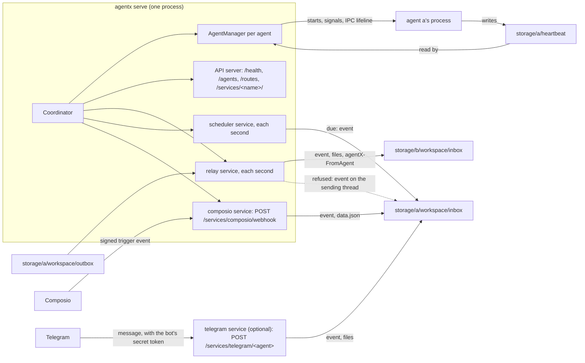

# Coordinator runtime

The coordinator is the one always-running process of a project. `agentx serve`, in the project root or `agent-x/`, starts it. It runs every agent as a process of its own, and its services: the [relay](services/relay/README.md), which delivers the events agents send, the [scheduler](services/scheduler/README.md), which fires their schedules, [Composio](services/composio/README.md)'s webhook, which brings them their triggers' events, and the optional services a project turns on, such as [Telegram](services/telegram/README.md). It owns the API server: its own routes report and control the agents, and each service's routes are served under `/services/<name>/`. With a person's `agentx event deliver`, it is the only way into an agent from outside.

It reaches an agent only by starting and stopping its process, by reading `agentx.json` and the agent's checked-in files, and through plain files: its inbox, outbox, heartbeat and schedule state, in the agent's central folder, `agent-x/storage/<agent>/`, not through its `storage` link, which a sandbox's host will not have ([D65](../agent-runtime/agent/README.md#d65)).

```
src/coordinator-runtime/
  coordinator.ts     class Coordinator: finds the agents and the services, starts them, its own routes, stops
  api-server.ts      class ApiServer: routes and the API token; Route, the API contract of the coordinator and every service
  agent-manager.ts   class AgentManager: one agent's process, its restarts and its heartbeat
  deliver-event.ts   deliverEvent, deliverTo: put an event into an inbox, the only code that does
  service.ts         class Service, the contract of every service, and its context
  service-runner.ts  class ServiceRunner: starts a service, runs its polling, stops it
  services/
    services.ts      the core services, in the order they start, and the optional ones, by name
    relay/           core: deliverOutbox, an agent's outbox into the inboxes it names
    scheduler/       core: class Scheduler, one agent's schedules
    composio/        core: Composio's webhook, each trigger event into its agent's inbox
    telegram/        optional: each listed agent's Telegram bot, its chats' messages into the agent's inbox
```



The coordinator finds the agents when it starts: those `agent-x/agentx.json` lists that have a folder in `agent-x/agents/` ([D63](#d63)). It logs a listed agent without a folder and a folder that is not listed, and runs neither. It makes an agent's storage when it is missing, and skips an agent whose `storage` is a folder of its own. Adding or removing an agent means starting `agentx serve` again.

## An agent's process

The `AgentManager` runs one agent ([D56](#d56)). It is where the agent's sandbox will go.

- **Start.** It starts the agent's process (`dist/agent-runtime/supervisor/agent-process.js`), which runs it as `agentx run` does ([supervisor](../agent-runtime/supervisor/README.md)), in the agent directory, with the coordinator's own Node and environment, in a process group of its own. It prefixes each line the process prints with the agent's name.
- **Lifeline.** The process exits when its IPC channel to the coordinator closes ([D59](#d59)).
- **Restarts.** A process that exits by itself is started again, with a backoff. After 5 restarts with no long run, the agent is `failed`, and its events wait in its inbox until it is started again, through the API or by starting `agentx serve` again.
- **Heartbeat.** The process writes `storage/heartbeat` every 10 seconds while its loops work. A process with no new heartbeat for 60 seconds is hung, and the manager kills it ([D57](#d57)).
- **Stop.** The first stop sends `SIGTERM`, which lets running work finish; a second stops it now.

An agent's state is `starting`, `running`, `restarting`, `failed`, `stopping` or `stopped`.

## Delivering

`deliverEvent` (`deliver-event.ts`) puts an event into an agent's inbox ([D48](../agent-runtime/events/README.md#d48)). The relay uses its two halves apart, `prepareDelivery` and the write, to refuse a bad event but retry a failed write; nothing else writes an inbox. The relay calls it for what agents send and its refusals, the scheduler for schedules, and every other service through `context.deliver`. A person's `agentx event deliver` calls it in the CLI's process, needs no `agentx serve`, and is held to no `canSendTo`. `deliverTo` takes the agent by its name, which `agentx.json` must list.

- It writes the inbox in the agent's central folder, and refuses an agent whose `storage` is a folder of its own, or whose inbox is reached through a link inside that folder: the agent owns its storage, and could point its inbox at another folder of the host, such as another agent's inbox.
- It checks the event as the queue would, and refuses a `workflow.<name>` thread the agent does not have.
- It adds the `agentX-` facts its caller gives, copies the files into the event's folder, and adds the content's last line, which names them.

## Services

Everything the coordinator does besides running the agents is a service ([D66](#d66)): a class that extends `Service` (`service.ts`), in a folder of its own under `services/`, with a doc of its own under `services/` here. Each hook may be left out, and `routes`, its API contract, may be empty:

| Hook | When | What it does |
|---|---|---|
| `onStart(context)` | once, before the agents start | Checks its config and secrets, and starts its polling with `context.every`. A throw leaves the service off. |
| `onStop()` | after the agents have stopped and its polling has ended | Its last work. |

A service declares its API in `routes`: each route's method, path below `/services/<name>/`, access and summary, and its handler ([the API server](#the-api-server)). They are served only while the service is on.

The context gives a service its `config`, its own `secrets`, the `agents` the coordinator runs (each one's name, directory and central storage folder), the project's `publicUrl`, `stopping()`, true once a stop has begun, `deliver(agent, event, files)`, which puts an event into an agent's inbox with `deliverEvent` and `agentX-Service: <name>`, keyed by the service's own id for it, and `every(ms, work)`, which runs `work` every `ms` until the service stops ([D67](#d67)).

| Service | Kind | What it does |
|---|---|---|
| [relay](services/relay/README.md) | core | Each second, and once more when the agents have stopped, delivers every agent's outbox. |
| [scheduler](services/scheduler/README.md) | core | Each second, fires every agent's schedules that are due; not while the coordinator stops. |
| [composio](services/composio/README.md) | core | Composio's webhook: each signed trigger event into the inbox of the agent with its Composio user id. On when `COMPOSIO_WEBHOOK_SECRET` is set. |
| [telegram](services/telegram/README.md) | optional | Sets each listed agent's bot webhook at start; each message from a chat the agent lists, with its files, into its inbox. |

- **Core and optional.** The core services are always on, and start in the order above. Optional services ship with agentx too, and start after them, each when `agentx.json` lists it under `services` ([D68](#d68)). A name agentx has no service for is logged and skipped.
- **Config.** A service's config is `services.<name>` in `agentx.json`, `{}` when there is none; the service checks it. `publicUrl` in `agentx.json`, such as `https://agents.example.com`, is where the API server is reached from outside, for a service that registers a webhook.
- **Secrets.** A service names the environment variables it needs in `secrets`; a name that ends with `*`, such as `TELEGRAM_BOT_TOKEN_*`, takes every variable that starts with it. It gets their values from the coordinator's environment, which wins, or `agent-x/.env.services`, which only the coordinator reads; agents read `agent-x/.env`. A secret set in the coordinator's environment reaches the agents' processes too, until they run in sandboxes.
- **A service that fails to start** is off, says why, and stays off until `agentx serve` starts again; the agents and the other services start all the same.
- **Polling.** `every` never starts a run while the last one goes on, and logs a failure, so no service can end the coordinator.

## The API server

The coordinator owns the one API server (`api-server.ts`); a service has no server of its own. `node:http`, on `--host` (default `127.0.0.1`) and `--port` (default 3100). Plain HTTP: TLS comes from a reverse proxy.

Every route, the coordinator's and each service's, is a `Route` ([D69](#d69)):

```ts
{ method: "POST", path: "agents/:agent/stop", access: "private", summary: "Stops an agent once its running work is done.", handle: ({ params, headers, body }) => ({ status: 202, body: … }) }
```

A segment that starts with `:` is a parameter. The handler gets the parameters, the headers and the body, up to 1 MB (413 over it), and answers a status and a JSON body; a throw answers 500. A path no route has is 404, and one with another method 405.

**Who may call** ([D70](#d70)):

- **`private`**, the default: the project's own systems, such as the web app's server, with `Authorization: Bearer <AGENTX_API_TOKEN>`. Without it, or with another, 401. The token comes from the coordinator's environment or `agent-x/.env.services`; when it is not set, private routes answer 503, and `agentx serve` says so.
- **`public`**: anyone. A route that must know its caller, such as a webhook, checks it itself, by the signature or the token of the external service that calls it, before it does anything.

People are never authenticated here. The web app signs them in, and calls the coordinator with the token.

| Route | Access | Answers |
|---|---|---|
| `GET /health` | public | 200 `{ "ok": true }` while the coordinator runs, for the host's health check ([D58](#d58)). |
| `GET /agents` | private | `{ "agents": [{ agent, state, since, restarts, lastExit, pid }] }`: 200 when every agent is `running` or `stopped`, 503 otherwise. |
| `POST /agents/:agent/start` | private | Starts a stopped or failed agent, with its count of restarts at 0. 202 with its state. |
| `POST /agents/:agent/stop` | private | Stops an agent once its running work is done, as at a stop of `agentx serve`. 202 at once with its state; its events wait in its inbox. |
| `POST /agents/:agent/restart` | private | Stops it, then starts it; a stop meanwhile cancels the start. 202. |
| `GET /routes` | private | Every route, the coordinator's and the services', with its method, path, access and summary, so the web app can find them. |
| `/services/<name>/...` | as the route says | The routes of the service `<name>`, while it is on. |

An unknown agent is 404, and controlling one while `agentx serve` stops is 409.

## Stopping

The first `SIGINT` or `SIGTERM` lets every agent finish its running work; the second stops them at once. The services go on meanwhile, but the scheduler fires nothing: a fire due then is dealt with at the next start, as one due while `agentx serve` was down. When every agent has exited, the services stop, the last started first: each one's polling ends, a run in progress is awaited, and its `onStop` runs. The relay starts first, so it stops last, and delivers what the agents' outboxes still hold. Then the API server closes, and `agentx serve` exits 0. Events that arrive meanwhile wait in the inboxes.

How to run it on a server: [Run a project on a server](../../user_guides/run_on_a_server.md).

## Known limits

- Until sandboxes, an agent runs as the same OS user as the others, so it can write any agent's files and send as another agent. The rules hold for agentx's own code, not against an agent that sets out to break them.
- A send that cannot be delivered is not an error of the command that sent it: it comes back as an event, about a second later, or once `agentx serve` runs.
- An agent that crashes after runs of more than 10 minutes is restarted for ever; `/agents` shows its restarts.
- One project on one machine: each agent's queue is a file on a local disk.

## Decisions

<a id="d56"></a>
### D56. Each agent is a process of its own, which the coordinator's AgentManager keeps running

- **Decision.** The coordinator starts each agent's process, in a process group of its own, through an `AgentManager`. It restarts an exited process after 1 s, doubling up to a minute, sets that back after a run of 10 minutes, and marks the agent `failed` after 5 restarts with no such run.
- **Why.** A process keeps one agent's crash from stopping the others, and is the boundary a sandbox needs. Only something outside the process can restart it, kill a hung one, or give up.
- **Rejected.** All agents' loops inside the coordinator: a Node process less per agent, but a sandbox would split them apart again.

<a id="d57"></a>
### D57. An agent's heartbeat is a file in its `storage/`

- **Decision.** The manager reads `storage/heartbeat`, and counts only a time written since it started the process. 60 seconds without one is a hung process, which it kills.
- **Why.** A file works the same across a sandbox's boundary. A time later than the start tells this process from an earlier one, which a process id would not.
- **Rejected.** Messages over the IPC channel, which exist only between Node processes on one machine; an HTTP port per agent.

<a id="d58"></a>
### D58. `/health` says whether the coordinator runs; `/agents` says how each agent is

- **Decision.** `GET /health` is 200 while the coordinator runs, and needs no token. `GET /agents` lists each agent's state, needs the API token, and is 503 unless every agent is `running` or `stopped`: one stopped on purpose is not a fault.
- **Why.** A load balancer that watched the agents would take the whole server out of service for one failed agent. A person's monitor wants to know about that agent.

<a id="d59"></a>
### D59. An agent's process ends with the coordinator

- **Decision.** The manager gives the agent's process an IPC channel, and the process exits at once when it closes.
- **Why.** A coordinator killed with `SIGKILL` runs no handler, so only something the operating system closes can end the agents. Otherwise the next coordinator would start a second process per agent.
- **Consequence.** The channel exists only between Node processes on one machine; a sandbox will replace it with its own end.

<a id="d63"></a>
### D63. The project's `agentx.json` lists its agents

- **Decision.** `agent-x/agentx.json` holds, under `agents`, each agent's `description` and `canSendTo`. `init-agent` adds an entry. The coordinator runs the agents it lists. What one agent needs to run stays in its `.pi/settings.json`.
- **Why.** Who the agents are, what each does and who may reach whom are facts about the project, read by the coordinator and by every agent's prompt.
- **Consequence.** A folder in `agents/` that the file does not list is not run by `agentx serve`; `agentx run` and `agentx chat` in it still work.

<a id="d66"></a>
### D66. Everything the coordinator does besides running the agents is a service, in its process

- **Decision.** The relay, the scheduler and every later part of the coordinator extend one class, `Service`, with `onStart`, `routes` and `onStop`. Core services are always on; optional ones are turned on in `agentx.json`. They run in the coordinator's process. One whose `onStart` throws is off, and nothing else is.
- **Why.** Webhooks, Composio's triggers, Telegram and polling each need start-up work, polling, routes and a clean stop. One contract wires each in the same way, instead of by hand in the coordinator. Services ship with agentx, so they are trusted as the coordinator is, and mostly wait on files and the network.
- **Rejected.** A process per service: it would isolate a service's crashes and secrets, but needs requests forwarded to it, a way to deliver, and restarts like an agent's. A service that needs it can start its own child in `onStart`.
- **Consequence.** Running the agents stays the coordinator's own, not a service: every service waits for it at stop, and the agents will run apart from the coordinator, in sandboxes.

<a id="d67"></a>
### D67. A service polls with `context.every`

- **Decision.** A service asks the coordinator to run its work every so many milliseconds. A run never overlaps the last one, a failure is logged, and when the service stops its runs end and the one in progress is awaited.
- **Why.** Each service keeps its own interval, as with a timer of its own, but the coordinator stops every one of them, and an unhandled rejection in a service's timer would end the coordinator and every agent with it.
- **Rejected.** A timer of the service's own; a `tick` the coordinator calls each second, which makes every service count its own interval.

<a id="d68"></a>
### D68. A service's config is in `agentx.json`, and its secrets in `agent-x/.env.services`

- **Decision.** `services.<name>` in `agentx.json` is a service's config, and lists an optional service to turn it on. A service names its secrets, or a prefix of them with `*` when they are one per agent, such as `TELEGRAM_BOT_TOKEN_*`, and gets only those, from the coordinator's environment or `agent-x/.env.services`. `publicUrl` in `agentx.json` is the project's address from outside.
- **Why.** The project's config is already read once by `agentx serve` and checked in. Agents read only `agent-x/.env`, so a file of the services' own keeps their secrets out of what Pi, the routers and the workflows get, with no list of names to leave out.
- **Rejected.** A `services.json` of its own; the services' secrets in `agent-x/.env`, which every agent's process reads; `--public-url` on `agentx serve`, which every deployment would have to pass.
- **Consequence.** A secret the host sets in the coordinator's environment is inherited by the agents' processes. Sandboxes, which start agents apart from it, end that.

<a id="d69"></a>
### D69. The coordinator and every service declare their API as routes

- **Decision.** The coordinator's own routes and each service's are `Route`s: a method, a path with parameters, an access, a summary and a handler. A service's are served under `/services/<name>/`, while it is on. `GET /routes` lists them all.
- **Why.** The contract is in one place, which the server matches, guards and lists, so the web app can find what each service offers. Under `/services/<name>/`, two services never claim one path.
- **Rejected.** One `onRequest` per service that routes its requests itself: every service would parse paths and check the token, and nothing could list the API.

<a id="d70"></a>
### D70. Private routes need the API token; a public route checks its caller itself; people sign in to the web app

- **Decision.** A route is `private` unless it says `public`. A private route needs `Authorization: Bearer` with `AGENTX_API_TOKEN`, compared in constant time. A public route is open: `/health`, and webhooks, whose handlers check the signature or token of the service that calls them. The coordinator never signs people in: the web app does, and calls it with the token.
- **Why.** Three kinds of caller need three kinds of proof: the project's own systems hold a shared secret; an external service proves itself as that service does, such as Composio's signature; people already sign in to the web app, and a second sign-in would be a second auth system to keep in step. Private by default means nothing is open by mistake.
- **Rejected.** Binding the server to localhost instead of a token, which fails once the web app runs on another machine; the coordinator checking people's sessions.
- **Consequence.** The web app's server holds the token, never the browser. A reverse proxy should forward only webhook paths from the internet.
