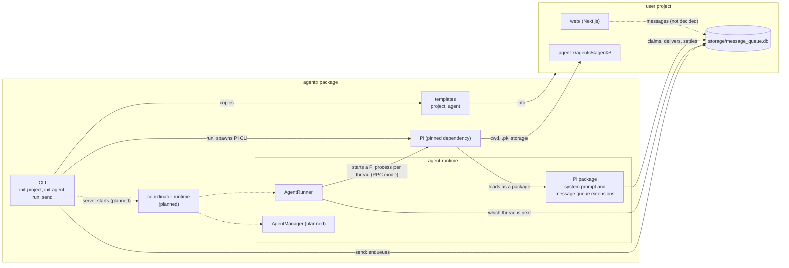

# High-level design

## Purpose

agentx is a meta harness around the [pi coding agent](https://github.com/earendil-works/pi). It creates projects that hold a Next.js app and Pi agents, runs each agent with only its own config, and gives each agent a message queue.

## Goals

1. **Minimal, readable code.** Less code beats more features.
2. **The agent directory is the source of truth.** Its checked-in files define the agent, plus the Pi package from the pinned agentx ([D11](architecture/agent-runtime/pi-package/README.md#d11)). Starting an agent changes none of them ([D4](architecture/agent-runtime/agent/README.md#d4)). What it learns goes to `storage/knowledge/` ([D35](architecture/agent-runtime/agent/README.md#d35)).
3. **Use Pi as it is.** Settings, extensions, env vars and flags; no patches, no fork.
4. **The same agent under `agentx run` and the runner.** Both start the same Pi CLI the same way ([D31](architecture/agent-runtime/agent-runner/README.md#d31)).
5. **One pinned Pi** per agentx version ([D1](architecture/agent-runtime/agent/README.md#d1)).

Non-goals: hosting many tenants, a UI for agents, custom model providers.

## Components

| Component | Role | Doc |
|---|---|---|
| CLI | Creates projects and agents, runs an agent, queues messages | [cli](architecture/cli/README.md) |
| Project | The generated repo: `web/` and `agent-x/` | [cli/project](architecture/cli/project/README.md) |
| Agent | One Pi agent's directory, and how Pi starts in it | [agent-runtime/agent](architecture/agent-runtime/agent/README.md) |
| Agent runner | Starts a Pi process per thread with messages and ends stuck ones; no command starts it yet | [agent-runtime/agent-runner](architecture/agent-runtime/agent-runner/README.md) |
| Pi package | What agentx adds to every agent: two extensions and the harness prompt. Shared skills are planned | [agent-runtime/pi-package](architecture/agent-runtime/pi-package/README.md) |
| Message queue | A versioned SQLite file per agent, and the extension that delivers its messages | [agent-runtime/pi-package/message-queue](architecture/agent-runtime/pi-package/message-queue/README.md) |
| Pi | The agent engine, and what we rely on in it | [agent-runtime/pi](architecture/agent-runtime/pi/README.md) |
| Coordinator | Will run all agents of a project; planned | [coordinator-runtime](architecture/coordinator-runtime/README.md) |

## Mental model

**An agent is a directory.** agentx starts Pi with `cwd` = the agent directory, `PI_CODING_AGENT_DIR` = the project's `agent-x/.pi`, `-nc` (no context files), `--approve` (trust `.pi/`), and one thread as the session.

**A thread is a Pi session.** A queue message names its thread. An open session holds its thread, so one process at a time runs a conversation.

**Config is checked in; state is not.**

| Checked in | `storage/`, gitignored |
|---|---|
| `.pi/settings.json`, `.pi/mcp.json` | `sessions/`: one per thread |
| `.pi/system_prompt/*.md` | `workspace/`: the agent's files |
| `.pi/skills/`, `.pi/extensions/` | `message_queue.db` |
| | `knowledge/`: what the agent learns |

`agent-x/.pi/`, also gitignored, holds the login and Pi's state for all agents of the project.

**Two front ends, one agent.** `agentx run` starts Pi for a person at a terminal. The `AgentRunner` starts the same Pi without a terminal, for threads with messages.

## Flows

**Create a project.** `agentx init-project my-project` copies the template, pins `agent-x` in `agent-x/package.json`, and runs `git init`. `pnpm install` in the root installs `web/` and `agent-x/`.

**Create an agent.** `agentx init-agent main`, in the root or `agent-x/`, creates `agent-x/agents/main`.

**Which agentx runs.** Inside a project, every command but `init-project` hands over to the agentx the project installed. If none is installed, it stops and says to run `pnpm install`.

**Run an agent.** `agentx run` in `agent-x/agents/main` starts the pinned Pi on the thread `main`. Pi loads agentx's Pi package and the agent's `.pi/`, and saves the session in `storage/sessions`.

**Handle a message.**

1. `agentx send` queues a message for a thread, with `--meta name=value` facts. It is the only sender; how the web app sends messages and gets answers is not decided.
2. A session for the thread is open: from `agentx run --thread-id <thread>`, or started by the `AgentRunner`.
3. The message queue extension takes the message and starts a run. The model sees it after a metadata block.
4. A message that arrives during the run joins it at the end of a turn.
5. When the run ends, the extension settles the messages: done, or back on the queue for another try. A runner's session ends when its thread is empty.
6. If a runner's Pi process dies or gets stuck, the runner ends it and puts its messages back.

Details: [Agent runner](architecture/agent-runtime/agent-runner/README.md#how-it-works), [Message queue](architecture/agent-runtime/pi-package/message-queue/README.md).

## Status

| Built | Planned |
|---|---|
| CLI: `init-project`, `init-agent`, `run`, `send` | `agentx serve`, `agentx upgrade` |
| Templates; Pi package | Coordinator; `AgentManager` and sandboxes |
| Queue: versioned SQLite file per agent, threads, retries | App-to-agent messages and answers |
| `AgentRunner` (no command starts it yet) | |
