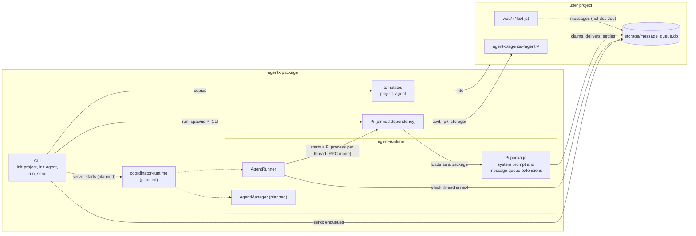

# High-level design

## Purpose

agentx is a meta harness around the [pi coding agent](https://github.com/earendil-works/pi). It creates projects that combine a Next.js full-stack app with Pi agents, runs each agent with only its own configuration, and runs an agent continuously behind a message queue.

## Goals

1. **Minimal, readable code.** Any file is understandable on its own. Fewer features over more code.
2. **The agent directory is the source of truth.** An agent is defined by checked-in files in its directory, plus the agentx version the project pins, which supplies the Pi package every agent shares ([D11](architecture/agent-runtime/pi-package/README.md#d11)). Starting an agent changes nothing there ([D4](architecture/agent-runtime/agent/README.md#d4)). What an agent learns while it runs is kept apart, as state in its `storage/knowledge/` ([D35](architecture/agent-runtime/agent/README.md#d35)).
3. **Use Pi as it is.** Configure Pi through settings, extensions, env vars and flags; never patch or fork it.
4. **Same agent under `agentx run` and the runner.** The agent directory means the same thing to both, because both start the same Pi CLI with the same settings ([D31](architecture/agent-runtime/agent-runner/README.md#d31)).
5. **One pinned Pi.** Each agentx version runs exactly one Pi version ([D1](architecture/agent-runtime/agent/README.md#d1)).

Non-goals for now: multi-tenant hosting, a UI for agents, custom model providers.

## Components

| Component | Role | Doc |
|---|---|---|
| CLI | Creates projects and agents; runs an agent with the Pi CLI; puts messages on an agent's queue | [cli](architecture/cli/README.md) |
| Project | The generated repo: the app package and the agent-x package | [cli/project](architecture/cli/project/README.md) |
| Agent | A directory that defines one Pi agent, and how Pi is started in it | [agent-runtime/agent](architecture/agent-runtime/agent/README.md) |
| Agent runner | Starts a Pi process for each thread with messages, and updates the messages of one that dies; no command starts it yet | [agent-runtime/agent-runner](architecture/agent-runtime/agent-runner/README.md) |
| Pi package | What agentx adds to every agent: the system prompt and message queue extensions, the harness prompt, shared skills | [agent-runtime/pi-package](architecture/agent-runtime/pi-package/README.md) |
| Message queue | Each agent's message queue: a SQLite file, its message states, one process per thread, and the extension that delivers the messages | [agent-runtime/pi-package/message-queue](architecture/agent-runtime/pi-package/message-queue/README.md) |
| Pi | The agent engine; the behavior we rely on | [agent-runtime/pi](architecture/agent-runtime/pi/README.md) |
| Coordinator | The process that will run all agents of a project; planned, like the agent sandboxes | [coordinator-runtime](architecture/coordinator-runtime/README.md) |

## Mental model

**An agent is a directory.** Running an agent means starting Pi with:

- `cwd` = the agent directory, so Pi reads `.pi/` as project config;
- `PI_CODING_AGENT_DIR` = the project's `agent-x/.pi`, shared by its agents, so nothing from `~/.pi/agent` leaks in;
- no context files (`-nc`) and `.pi/` trusted for the run (`--approve`);
- a session that is a thread of the agent: `main`, or the one named with `--thread-id`.

**A thread is a Pi session.** A message on an agent's queue names its thread, and the Pi session with that id receives it. While a session is open it holds its thread, so one process at a time runs a conversation.

**Config is checked in; state is in `storage/` and `agent-x/.pi/`.**

| Checked in (defines the agent) | `storage/`, gitignored (produced by running it) |
|---|---|
| `.pi/settings.json`, `.pi/mcp.json` | `sessions/`: every session, one per thread |
| `.pi/system_prompt/*.md` | `workspace/`: files the agent creates |
| `.pi/skills/`, `.pi/extensions/` | `message_queue.db`: the agent's message queue |
| | `knowledge/`: what the agent learns and keeps: its own skills, extensions, prompt text and files |

`agent-x/.pi/`, also gitignored, is Pi's agent directory for all agents of the project: login, saved trust, Pi's runtime files.

**The CLI and the runtime are two front ends to the same agent.** `agentx run` starts the Pi CLI for a person at a terminal. The `AgentRunner` starts the same Pi CLI, without a terminal, for threads that have queued messages. Both read the same directory, load the same Pi package, and open the same session for a thread.

## Flows

**Create a project.** `agentx init-project my-project` copies `templates/project`, pins the `agent-x` package in `agent-x/package.json`, runs `git init`. `web/` and `agent-x/` are independent packages; `pnpm install` in the root installs both.

**Create an agent.** `agentx init-agent main` in the project root or in `agent-x/` copies `templates/agent` to `agent-x/agents/main`.

**Run an agent.** `agentx run` in `agent-x/agents/main` → spawns the pinned Pi CLI with the settings above, on the thread `main` → Pi loads agentx's Pi package, passed by `run` (its extensions set the system prompt and connect the session to the queue) and the agent's `.pi/`: settings, extensions, skills and MCP servers → the session is written to `storage/sessions`.

**Handle a message.** A sender puts a message for a thread on the agent's queue (`agentx send`) → the thread's Pi session is open, started with `agentx run --thread-id <thread>` → the message queue extension in the session claims the message and sends it to Pi, which starts a run → a message that arrives during the run is steered in at the end of a turn → when the run ends, the extension marks the messages done, or queues them for another attempt if the run failed. The `AgentRunner` does the opening without a person: it sees that a thread has work and starts a Pi process for it, and the session ends itself when the thread has no work left. If the process dies instead, the runner puts its messages back on the queue. Details: [Agent runner](architecture/agent-runtime/agent-runner/README.md#how-it-works), [Message queue](architecture/agent-runtime/pi-package/message-queue/README.md).

## Status

| Built | Planned |
|---|---|
| CLI: `init-project`, `init-agent`, `run`, `send` | `agentx serve`, `agentx upgrade` |
| Project and agent templates; Pi package (system prompt and message queue extensions, harness prompt) | Coordinator runtime; `AgentManager` and sandboxes |
| Queue: one SQLite file per agent, threads, retries | App-to-agent messaging and answers back to the sender |
| Agent runtime: `AgentRunner`, one Pi process per thread (no command starts it yet) | |
