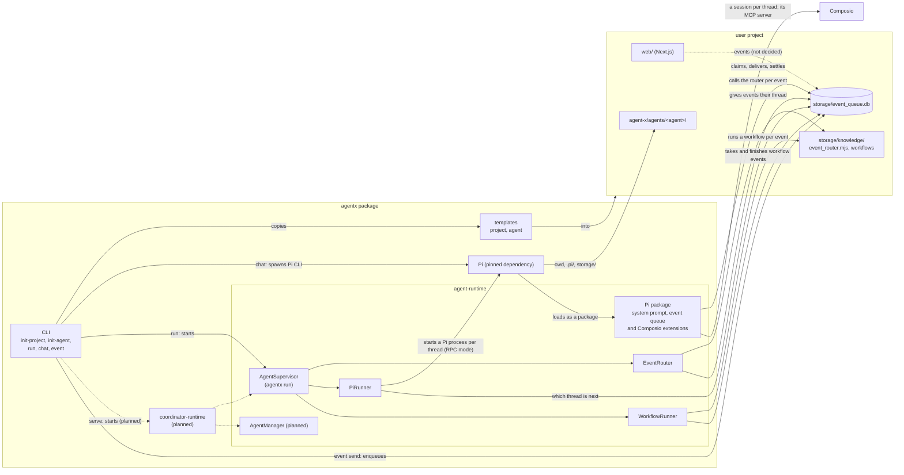

# High-level design

## Purpose

agentx is a meta harness around the [pi coding agent](https://github.com/earendil-works/pi). It creates projects that hold a Next.js app and Pi agents, runs each agent with only its own config, and gives each agent an event queue, a router it keeps, and workflows.

## Goals

1. **Minimal, readable code.** Less code beats more features.
2. **The agent directory is the source of truth.** Its checked-in files define the agent, plus the Pi package from the pinned agentx ([D11](architecture/agent-runtime/pi/pi-package/README.md#d11)). Starting an agent changes none of them ([D4](architecture/agent-runtime/agent/README.md#d4)). What it learns, its router and workflows included, goes to `storage/knowledge/` ([D35](architecture/agent-runtime/agent/README.md#d35)).
3. **Use Pi as it is.** Settings, extensions, env vars and flags; no patches, no fork.
4. **The same agent under `agentx chat` and `agentx run`.** Both start the same Pi CLI the same way ([D31](architecture/agent-runtime/pi/README.md#d31)).
5. **One pinned Pi** per agentx version ([D1](architecture/agent-runtime/agent/README.md#d1)).

Non-goals: hosting many tenants, a UI for agents, custom model providers.

## Components

| Component | Role | Doc |
|---|---|---|
| CLI | Creates projects and agents, runs an agent, opens a thread for a person, sends and shows events | [cli](architecture/cli/README.md) |
| Project | The generated repo: `web/` and `agent-x/` | [cli/project](architecture/cli/project/README.md) |
| Agent | One Pi agent's directory, and how Pi starts in it | [agent-runtime/agent](architecture/agent-runtime/agent/README.md) |
| Supervisor | `agentx run`: runs the three loops, starts a crashed one again, writes the heartbeat, stops | [agent-runtime/supervisor](architecture/agent-runtime/supervisor/README.md) |
| Events | The event queue (a versioned SQLite file per agent), how events are sent, and the router loop that gives each event without a thread its thread | [agent-runtime/events](architecture/agent-runtime/events/README.md) |
| Workflows | Runs the agent's workflows, scripts that handle events without the model, and reports their failures | [agent-runtime/workflows](architecture/agent-runtime/workflows/README.md) |
| Functions | Calls the router and workflows in a child process; their contracts | [agent-runtime/functions](architecture/agent-runtime/functions/README.md) |
| Pi | Starts Pi, and the Pi runner: a Pi process per Pi thread with events | [agent-runtime/pi](architecture/agent-runtime/pi/README.md) |
| Pi package | What agentx adds to every agent: three extensions, one of which delivers events to Pi, and the harness prompt. Shared skills are planned | [agent-runtime/pi/pi-package](architecture/agent-runtime/pi/pi-package/README.md) |
| Composio | Each agent's access to external services through its own Composio user id, a Composio session per thread | [agent-runtime/pi/pi-package/composio](architecture/agent-runtime/pi/pi-package/composio/README.md) |
| Pi reference | The agent engine, and what we rely on in it | [agent-runtime/pi/pi-reference](architecture/agent-runtime/pi/pi-reference/README.md) |
| Coordinator | Will run all agents of a project; planned | [coordinator-runtime](architecture/coordinator-runtime/README.md) |

## Mental model

**An agent is a directory.** agentx starts Pi with `cwd` = the agent directory, `PI_CODING_AGENT_DIR` = the project's `agent-x/.pi`, `-nc` (no context files), `--approve` (trust `.pi/`), and one thread as the session.

**What reaches an agent is an event**, and its thread decides who takes it: none, the agent's router; `workflow.<name>`, that workflow; any other, Pi ([D47](architecture/agent-runtime/events/README.md#d47)).

**A Pi thread is a Pi session.** An open session holds its thread, so one process at a time runs a conversation.

**Config is checked in; state is not.**

| Checked in | `storage/`, gitignored |
|---|---|
| `.pi/settings.json`, `.pi/mcp.json` | `sessions/<thread>/`: one folder per thread |
| `.pi/system_prompt/*.md` | `workspace/`: the agent's files, and the logs of workflows and the router |
| `.pi/skills/`, `.pi/extensions/` | `event_queue.db`, `attachments/`, `heartbeat` |
| `.pi/workflows.json` | `knowledge/`: what the agent learns, its router and its own workflows |

`agent-x/.pi/`, also gitignored, holds the login and Pi's state for all agents of the project, and `agent-x/.env` their keys, such as `COMPOSIO_API_KEY`.

**Two front ends, one agent.** `agentx chat` starts Pi for a person at a terminal. `agentx run` runs the agent with no person present: it starts the same Pi for threads with events, and routes events and runs workflows besides.

## Flows

**Create a project.** `agentx init-project my-project` copies the template, pins `agent-x` in `agent-x/package.json`, and runs `git init`. `pnpm install` in the root installs `web/` and `agent-x/`.

**Create an agent.** `agentx init-agent main`, in the root or `agent-x/`, creates `agent-x/agents/main`, with its Composio user id in its settings.

**Which agentx runs.** Inside a project, every command but `init-project` hands over to the agentx the project installed. If none is installed, it stops and says to run `pnpm install`.

**Talk to an agent.** `agentx chat` in `agent-x/agents/main` starts the pinned Pi on the thread `main`. Pi loads agentx's Pi package and the agent's `.pi/`, and saves the session in `storage/sessions/main/`. The Composio extension gives the thread a Composio session and its tools, or tells the model why it cannot, such as when `COMPOSIO_API_KEY` is not set.

**Handle an event.**

1. `agentx event send` adds an event, with `--meta name=value` facts and, optionally, a thread. Every sender goes through `sendEvent`; the planned coordinator will add events from Composio and other services the same way. How the web app sends events and gets answers is not decided.
2. `agentx run` runs the agent. Its router loop gives an event without a thread the thread the agent's router picks, or `main` with `agentX-RouterError` when the router fails.
3. An event on `workflow.<name>` is run by the workflow runner, one at a time per workflow. A failed run is not retried; the workflow's `failureReportTo` thread gets an event that says why and where the log is.
4. For an event on a Pi thread, a session for the thread is open: from `agentx chat --thread-id <thread>`, or started by the Pi runner. The event queue extension takes the event and starts a run. The model sees it after a metadata block. An event that arrives during the run joins it at the end of a turn.
5. When the run ends, the extension settles the events: done, or back on the queue for another try. A Pi runner's session ends when its thread is empty. If a Pi process dies or gets stuck, the Pi runner ends it and puts its events back.
6. `agentx event show <id>` shows what became of an event: its thread, its status, the session entry that got it, or its workflow run.

Details: [Agent supervisor](architecture/agent-runtime/supervisor/README.md), [Event router](architecture/agent-runtime/events/README.md), [Pi runner](architecture/agent-runtime/pi/README.md#how-it-works), [Workflows](architecture/agent-runtime/workflows/README.md), [Event queue](architecture/agent-runtime/events/README.md).

## Status

| Built | Planned |
|---|---|
| CLI: `init-project`, `init-agent`, `run`, `chat`, `event send`, `event list`, `event show` | `agentx serve`, `agentx upgrade` |
| Templates; Pi package | Coordinator; `AgentManager` and sandboxes |
| Event queue: versioned SQLite file per agent, threads, retries, keys | Events added by the coordinator: Composio triggers, other agents |
| `agentx run`: event router, Pi runner, workflows, heartbeat | App-to-agent events and answers; message channels to people |
| Composio access, checked against Composio by hand | Composio connect links through channels |
