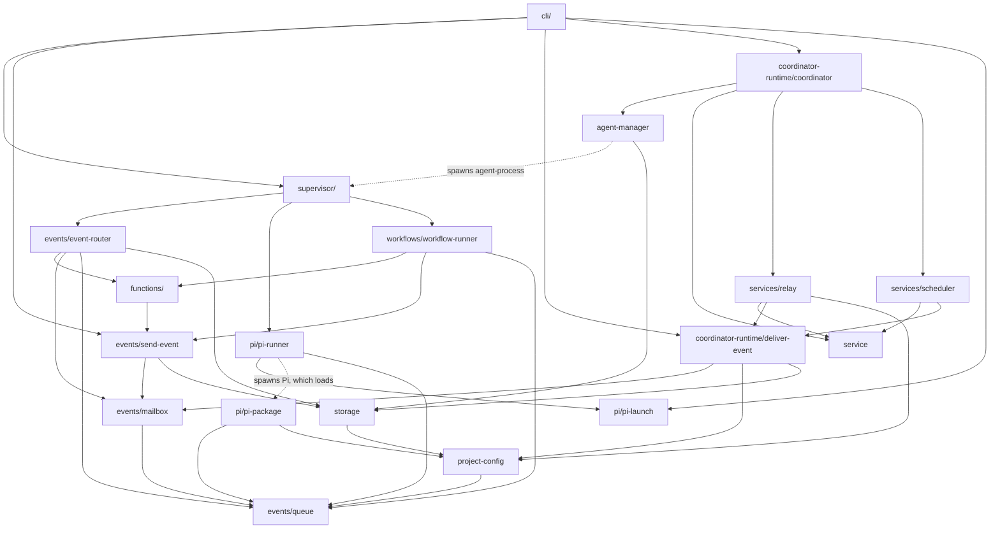

# High-level design

agentx is a meta harness around the [pi coding agent](https://github.com/earendil-works/pi). It creates projects that hold a Next.js app and Pi agents. It runs each agent with only its own config, and gives each agent an event queue, routers, workflows and schedules. Its goals and mental model are in [CLAUDE.md](../CLAUDE.md#design-goals).

Not goals: many tenants, a UI for agents, custom model providers.

## Project structure

What `agentx init-project` and `agentx init-agent` make, and who writes each part. Checked in means the developer's; the rest is gitignored.

```
my-project/
  web/                          Next.js app, its own package (checked in)
  agent-x/                      its own package, which pins agentx (checked in)
    agentx.json                 the agents: description and canSendTo of each; agentx serve runs the ones it lists; the services' config (developer)
    .env                        keys for every agent, such as COMPOSIO_API_KEY (developer, gitignored)
    .env.services               the coordinator's services' secrets, which no agent reads (developer, gitignored)
    .pi/                        Pi's agent directory for all agents: login and Pi's state (Pi, gitignored)
    agents/<agent>/             one agent
      .pi/                      its definition, read-only to the agent (developer, checked in)
        settings.json mcp.json  Pi's config; agentx's settings under `agentx`
        system_prompt/ skills/ extensions/
        event_router.mjs        picks the thread of an event that has none
        workflows.json workflows/  scripts that handle events without the model
        schedules.json          cron patterns that send the agent events
      storage                   link to agent-x/storage/<agent>/
    storage/<agent>/            the agent's runtime state (gitignored)
      workspace/inbox/          events delivered to it (the coordinator and agentx event deliver write it)
      workspace/outbox/         events it sends (the agent writes it, the coordinator takes it)
      workspace/                its working files, router and workflow logs (the agent)
      event_queue.db            its queue (its router adds, Pi sessions and workflows settle)
      sessions/<thread>/        one folder of Pi sessions per thread (Pi)
      knowledge/                what it learns: skills, prompt text, its own router, workflows and schedules (the agent)
      heartbeat                 written by agentx run while it works; read by the coordinator
      schedule-state.json       what each schedule has fired (the coordinator)
```

The agentx repository itself is laid out in [README.md](../README.md#repository-layout).

## Modules



Arrows are imports; dotted ones start a process. The runtimes never import the CLI. `events/queue.ts` and `project-config.ts` import nothing else of agentx: Pi loads them as source, through the Pi package.

| Module | Files | Responsibility | Depends on | Doc |
|---|---|---|---|---|
| CLI | `src/cli/` | Parses commands and hands each to a runtime: creates projects and agents, removes an agent, opens a thread, runs one agent or all, sends and delivers events. Runs the agentx the project pins | supervisor, coordinator, events, storage, project config, pi-launch | [cli](architecture/cli/README.md) |
| Project | `templates/` | The generated repo: `web/` and `agent-x/` | | [cli/project](architecture/cli/project/README.md) |
| Agent | `agent-env.ts`, `storage.ts`, `project-config.ts` | An agent's directory, its storage and the link to it, the environment of its processes, the project's agents and canSendTo | queue (for name rules) | [agent](architecture/agent-runtime/agent/README.md) |
| Supervisor | `src/agent-runtime/supervisor/` | `agentx run`: the three loops, restarting a loop that crashes, the heartbeat, stopping | event router, Pi runner, workflow runner, storage | [supervisor](architecture/agent-runtime/supervisor/README.md) |
| Events | `src/agent-runtime/events/` | The queue (SQLite), the inbox and outbox (`mailbox.ts`), `sendEvent`, and the EventRouter loop, the only writer of new events to the queue | functions, workflows, storage | [events](architecture/agent-runtime/events/README.md) |
| Workflows | `src/agent-runtime/workflows/` | Reads the agent's workflows, and the WorkflowRunner loop that runs each workflow event | functions, queue, send-event | [workflows](architecture/agent-runtime/workflows/README.md) |
| Functions | `src/agent-runtime/functions/` | Calls a router or workflow script in a child process, with a time limit; the scripts' types | agent env, send-event | [functions](architecture/agent-runtime/functions/README.md) |
| Pi | `src/agent-runtime/pi/` | How Pi is started, the same for `chat` and `run` (`pi-launch.ts`); the PiRunner loop, a Pi process per thread with events | agent env, queue | [pi](architecture/agent-runtime/pi/README.md) |
| Pi package | `src/agent-runtime/pi/pi-package/` | Loaded by Pi into every agent: the harness prompt, the event queue extension (takes, steers and settles a thread's events), Composio | queue, project config (as source) | [pi-package](architecture/agent-runtime/pi/pi-package/README.md) |
| Composio | `pi-package/extensions/composio/` | Each agent's access to external services | | [composio](architecture/agent-runtime/pi/pi-package/composio/README.md) |
| Pi reference | | What agentx relies on in Pi | | [pi-reference](architecture/agent-runtime/pi/pi-reference/README.md) |
| Coordinator | `src/coordinator-runtime/` | `agentx serve`: an AgentManager per agent, the services, the API server with its routes to report and control the agents, and the services' routes under `/services/<name>/`; `deliverEvent`, the only code that writes an inbox | storage, project config, mailbox, workflows | [coordinator-runtime](architecture/coordinator-runtime/README.md) |
| Relay | `src/coordinator-runtime/services/relay/` | Core service: each agent's outbox into the inboxes it names, or a refusal back to the sending thread | service, deliverEvent, mailbox, project config | [relay](architecture/coordinator-runtime/services/relay/README.md) |
| Scheduler | `src/coordinator-runtime/services/scheduler/` | Core service: each agent's schedules, fired into its inbox | service, deliverEvent, queue | [scheduler](architecture/coordinator-runtime/services/scheduler/README.md) |

## Lifecycles

**A project.** `agentx init-project my-project` copies the template, pins `agent-x`, and runs `git init`. `agentx init-agent main` creates `agent-x/agents/main`, its storage and the link to it, and lists it in `agentx.json`. `agentx remove-agent main --yes` deletes the three, and takes it off the other agents' canSendTo; not while it runs.

**The coordinator** (`agentx serve`). It starts, reads `agentx.json` once, and starts its services: the core ones, the relay and the scheduler, then the optional ones `agentx.json` lists. One that fails to start is off; the rest go on. Then it starts an AgentManager per listed agent with a folder, and its API server, with its own routes, which report, start and stop the agents with the API token, and the services' routes under `/services/<name>/`. Each second the scheduler fires the schedules that are due, and the relay delivers every outbox. The first SIGINT or SIGTERM lets the agents finish their running work, the second stops it, while the services go on, except the scheduler, which fires nothing during a stop. Then the services stop, the last started first, so the relay delivers once more, and the server closes.

**An agent's process**, as its AgentManager sees it: `starting` until its first heartbeat, then `running`. When it exits it is `restarting`, after 1 s, doubled up to a minute. After 5 restarts with no 10-minute run between them it is `failed` until it is started again, through the API or by starting `agentx serve` again. A process with no heartbeat for a minute is killed and restarted. On a stop, of the agent through the API or of `agentx serve`, it is `stopping`, then `stopped`. `agentx run` runs the same process in a terminal.

**`agentx run`** (the AgentSupervisor). It runs the EventRouter, the PiRunner and the WorkflowRunner, and starts again a loop that crashes, with the same backoff. It writes the heartbeat every 10 s while every loop has looked for work in the last 30 s. The first stop lets running work finish, the second stops it.

**An event.**

1. Delivered: a folder in the inbox and a marker that waits. From the coordinator (another agent, the agent itself, a schedule, a refusal) or a person's `agentx event deliver`.
2. Routed: the EventRouter takes the inbox oldest first. An event without a thread gets one from the routers, else `main`. It goes on the queue as `queued`, and its marker goes. One it cannot read moves to `.rejected/`.
3. Taken: `in_flight`, by the Pi session or the workflow run that holds its thread.
4. Settled: `done`, or `failed`. A Pi event whose process failed goes back to `queued`, three attempts at most. A workflow event is never tried again.
5. What the agent sends goes into its outbox, and the coordinator delivers it, or tells the sending thread why not.

**A Pi thread.** The PiRunner starts a Pi process in RPC mode for a thread with events, the oldest event's thread first, `maxThreads` at a time. The event queue extension in it takes the events, steers new ones into the running run, and settles them. The session ends itself when the thread is empty. A process that writes nothing for its stall time is stopped. One process holds a thread at a time; `agentx chat --thread-id` can hold it instead.

**A workflow run.** One child process per workflow event, one at a time per workflow, with the workflow's time limit. A failure, or a run cut off by a stop, is reported to the workflow's babysitter thread.

**A schedule.** The scheduler reads the schedule files when they change. A due fire becomes an event in the inbox, keyed by its time, so a fire is never put twice. Fires missed while the coordinator was down become one late fire with `catchUp`, else none. A `fireOnce` schedule fires once. `schedule-state.json` remembers what was fired.

**A chat.** `agentx chat` in the agent directory starts the pinned Pi on the thread `main`, or `--thread-id`. Its event queue extension works the thread's events while it is open.

## Status

| Built | Planned |
|---|---|
| CLI: `init-project`, `init-agent`, `remove-agent`, `serve`, `run`, `chat`, `event send`, `event deliver` | `agentx upgrade` |
| `agentx run`: router loop, Pi runner, workflows, heartbeat | Sandboxes |
| `agentx serve`: agent processes, restarts, the API server with the API token and agent controls, services: the relay and the scheduler | Composio's webhook and triggers, as a service |
| Pi package: harness prompt, event queue, Composio | The web app's use of the API: agent controls, events from people, answers back |
| Each agent's state in `agent-x/storage/` | Telegram, an optional service |
