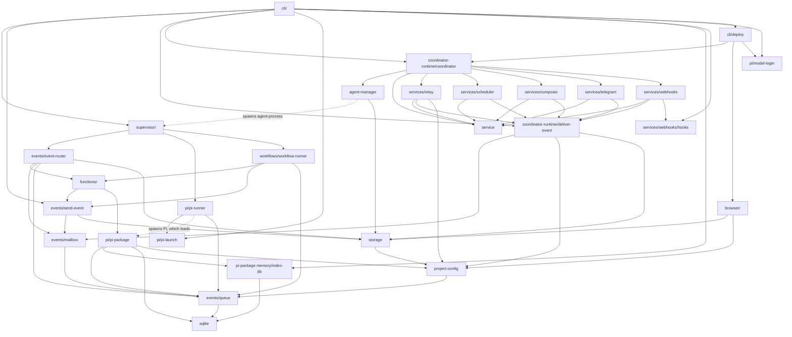

# High-level design

agentx is a meta harness around the [pi coding agent](https://github.com/earendil-works/pi). It creates projects that hold a Next.js app and Pi agents. It runs each agent with only its own config, and gives each agent an event queue, a router, workflows and schedules. Its goals and mental model are in [CLAUDE.md](../CLAUDE.md#design-goals).

Not goals: many tenants, a UI for agents, custom model providers.

## Project structure

What `agentx init-project` and `agentx init-agent` make, and who writes each part. Checked in means the developer's, except an agent's `.pi/knowledge/`, which the agent writes too; the rest is gitignored.

```
my-project/
  web/                          Next.js app, its own package (checked in)
  deploy/check.sh setup.sh      the project's own steps, which agentx dev and agentx server run (developer, checked in)
  agent-x/                      its own package, which pins agentx (checked in)
    agentx.json                 the agents: description and canSendTo of each; agentx serve runs the ones it lists; the services' config (developer)
    .env                        the secrets of the coordinator and its services, such as AGENTX_API_TOKEN, which no agent reads (developer, gitignored)
    services/<name>/index.ts    the project's own coordinator services, on when agentx.json lists them (developer, checked in)
    .pi/                        Pi's agent directory for all agents: login and Pi's state (Pi, gitignored)
    agents/<agent>/             one agent
      .pi/                      its definition (checked in)
        settings.json mcp.json  Pi's config; agentx's settings under `agentx` (developer; read-only to the agent)
        knowledge/              its knowledge, a folder per kind (developer and agent)
          system_prompt/ skills/ extensions/
          router/event_router.ts  picks the thread of an event that has none
          workflows/            workflows.json and its scripts, which handle events without the model
          schedules/schedules.json  cron patterns that send the agent events
          webhooks/webhooks.json    its webhooks with their tokens, kept with agentx webhook
      .env                      its keys, such as COMPOSIO_API_KEY, which only its processes read (developer, gitignored)
      storage                   link to agent-x/storage/<agent>/
    storage/<agent>/            the agent's runtime state (gitignored)
      workspace/inbox/          events delivered to it (the coordinator and agentx event deliver write it)
      workspace/outbox/         events it sends (the agent writes it, the coordinator takes it)
      workspace/                its working files (the agent); router and workflow logs (agentx run); webhook logs (the coordinator)
      workspace/browser/        its browser profiles (the agent)
      event_queue.db            its queue (its router adds, Pi sessions and workflows settle)
      sessions/<thread>/        one folder of Pi sessions per thread (Pi)
      memory/index.db           the index of its episodes (its Pi sessions)
      heartbeat                 written by agentx run while it works; read by the coordinator
      schedule-state.json       what each schedule has fired (the coordinator)
```

The agentx repository itself is laid out in [README.md](../README.md#repository-layout).

## Modules



Arrows are imports; dotted ones start a process. The runtimes never import the CLI. `events/queue.ts`, `sqlite.ts`, `project-config.ts` and `time-zone.ts` import nothing of agentx but each other: Pi loads them as source, through the Pi package.

| Module | Files | Responsibility | Depends on | Doc |
|---|---|---|---|---|
| CLI | `src/cli/` | Parses commands and hands each to a runtime: creates and upgrades projects and agents, removes an agent, opens a thread or removes one with its episodes, runs one agent or all, sends and delivers events, keeps an agent's webhooks. Runs the agentx the project pins | supervisor, coordinator, events, storage, project config, pi-launch, the model login check, the memory index's file, the webhooks file | [cli](architecture/cli/README.md) |
| Deploy | `src/cli/deploy/` | `agentx dev`, a project on a laptop with an ngrok tunnel, and `agentx server`, on an Ubuntu server with Caddy and systemd user services; the logins and keys both ask for, and the web app's builds beside the running one | coordinator, project config, the model login check, browser | [cli/deploy](architecture/cli/deploy/README.md) |
| Project | `templates/` | The generated repo: `web/` and `agent-x/` | | [cli/project](architecture/cli/project/README.md) |
| Agent | `agent-env.ts`, `storage.ts`, `project-config.ts`, `time-zone.ts` | An agent's directory, its storage and the link to it, the environment of its processes, its time zone and times as it reads them, the project's agents and canSendTo | queue (for name rules) | [agent](architecture/agent-runtime/agent/README.md) |
| Supervisor | `src/agent-runtime/supervisor/` | `agentx run`: the three loops, restarting a loop that crashes, the heartbeat, stopping | event router, Pi runner, workflow runner, storage | [supervisor](architecture/agent-runtime/supervisor/README.md) |
| Events | `src/agent-runtime/events/`, `sqlite.ts` | The queue (SQLite, opened by `sqlite.ts`, as the memory index is), the inbox and outbox (`mailbox.ts`), `sendEvent`, and the EventRouter loop, the only writer of new events to the queue | functions, workflows, storage | [events](architecture/agent-runtime/events/README.md) |
| Workflows | `src/agent-runtime/workflows/` | Reads the agent's workflows, and the WorkflowRunner loop that runs each workflow event | functions, queue, send-event | [workflows](architecture/agent-runtime/workflows/README.md) |
| Functions | `src/agent-runtime/functions/` | Calls a router or workflow script in a child process, with a time limit; the scripts' types; a workflow's `ctx.composio` | agent env, send-event, Composio's policy | [functions](architecture/agent-runtime/functions/README.md) |
| Pi | `src/agent-runtime/pi/` | How Pi is started, the same for `chat` and `run` (`pi-launch.ts`); whether an agent's model can be reached (`model-login.ts`); the PiRunner loop, a Pi process per thread with events | agent env, queue | [pi](architecture/agent-runtime/pi/README.md) |
| Pi package | `src/agent-runtime/pi/pi-package/` | Loaded by Pi into every agent: the harness prompt, the event queue extension (takes, steers and settles a thread's events), Composio, skills as sections with versions, and agentx's skills, such as how to write a workflow | queue, sqlite, project config (as source) | [pi-package](architecture/agent-runtime/pi/pi-package/README.md) |
| Composio | `pi-package/extensions/composio/` | Each agent's access to external services, and the policy its workflows' sessions get too | | [composio](architecture/agent-runtime/pi/pi-package/composio/README.md) |
| Episodes | `pi-package/extensions/episodes/` | Divides a thread into episodes, each of Pi's runs, ended by a message with its id and the tokens it added, from the model's usage | | [episodes](architecture/agent-runtime/pi/pi-package/episodes/README.md) |
| Context | `pi-package/extensions/context/` | The episodes the agent folds when a fold nudge asks; Pi compacts by itself | episodes | [context](architecture/agent-runtime/pi/pi-package/context/README.md) |
| Memory | `pi-package/extensions/memory/` | The agent's episodic memory: an index of every thread's episodes, which each session updates with its own file when a run settles, and which the agent searches by keyword and reads back | episodes, sqlite | [memory](architecture/agent-runtime/pi/pi-package/memory/README.md) |
| Pi reference | | What agentx relies on in Pi | | [pi-reference](architecture/agent-runtime/pi/pi-reference/README.md) |
| Browser | `src/agent-runtime/browser/` | `agentx-browser`, the agent's browser command: the agent-browser agentx pins, on one of the agent's profiles in `storage/workspace/browser/` | agent env, storage, project config | [browser](architecture/agent-runtime/browser/README.md) |
| Coordinator | `src/coordinator-runtime/` | `agentx serve`: an AgentManager per agent, the services, agentx's and the project's own from `agent-x/services/`, the API server with its routes to report and control the agents, and the services' routes under `/services/<name>/`; `deliverEvent`, the only code that writes an inbox | storage, project config, mailbox, workflows | [coordinator-runtime](architecture/coordinator-runtime/README.md) |
| Relay | `src/coordinator-runtime/services/relay/` | Core service: each agent's outbox into the inboxes it names, or a refusal back to the sending thread | service, deliverEvent, mailbox, project config | [relay](architecture/coordinator-runtime/services/relay/README.md) |
| Scheduler | `src/coordinator-runtime/services/scheduler/` | Core service: each agent's schedules, fired into its inbox | service, deliverEvent, queue | [scheduler](architecture/coordinator-runtime/services/scheduler/README.md) |
| Composio webhook | `src/coordinator-runtime/services/composio/` | Core service: Composio's signed trigger events, each into the inbox of the agent with its Composio user id | service, deliverEvent | [composio](architecture/coordinator-runtime/services/composio/README.md) |
| Webhooks | `src/coordinator-runtime/services/webhooks/` | Optional service: each agent's webhooks, which the agent keeps with `agentx webhook` in its knowledge, checked in; a request with a webhook's token into the inbox, for the workflow it names | service, deliverEvent, workflows | [webhooks](architecture/coordinator-runtime/services/webhooks/README.md) |
| Telegram | `src/coordinator-runtime/services/telegram/` | Optional service: each listed agent's bot webhook, its bot connected in Composio for its user id, and its chats' messages, with their files, and taps on its buttons into its inbox | service, deliverEvent | [telegram](architecture/coordinator-runtime/services/telegram/README.md) |

## Lifecycles

**A project.** `agentx init-project my-project` copies the template, pins `@cognisphere-sh/agentx`, and runs `git init`. `agentx init-agent main` creates `agent-x/agents/main`, its storage and the link to it, and lists it in `agentx.json`. `agentx remove-agent main` deletes the three once you confirm (`--yes` skips the question), and takes it off the other agents' canSendTo; not while it runs. `agentx remove-thread <id>`, in an agent, deletes one thread's sessions and its episodes in the agent's memory, the same way; not while the thread runs or has events waiting. `agentx upgrade-project` moves the project to the latest agentx, then adds the settings, keys and ignored files of its templates that the project and its agents lack; `agentx upgrade-agent main` does it for one agent. `agentx dev` runs the project on a laptop: it asks for the logins and keys it lacks, runs `deploy/check.sh`, opens an ngrok tunnel, and runs the agents and `next dev`. On an Ubuntu server, `agentx server setup` makes the server ready, with Caddy for HTTPS, and `agentx server start` builds the web app beside the running one and runs both as systemd user services.

**The coordinator** (`agentx serve`). It starts, reads `agentx.json` once, and starts its services: the core ones, the relay, the scheduler and Composio's webhook, on when its secret is set, then the optional ones `agentx.json` lists, then the project's own in `agent-x/services/` that it lists. One that fails to load or start is off; the rest go on. Then it starts an AgentManager per listed agent with a folder, and its API server, with its own routes, which report, start and stop the agents with the API token, and the services' routes under `/services/<name>/`. Each second the scheduler fires the schedules that are due, and the relay delivers every outbox. The first SIGINT or SIGTERM lets the agents finish their running work, the second stops it, while the services go on, except the scheduler, which fires nothing during a stop. Then the services stop, the last started first, so the relay delivers once more, and the server closes.

**An agent's process**, as its AgentManager sees it: `starting` until its first heartbeat, then `running`. When it exits it is `restarting`, after 1 s, doubled up to a minute. After 5 restarts with no 10-minute run between them it is `failed` until it is started again, through the API or by starting `agentx serve` again. A process with no heartbeat for a minute is killed and restarted. On a stop, of the agent through the API or of `agentx serve`, it is `stopping`, then `stopped`. `agentx run` runs the same process in a terminal.

**`agentx run`** (the AgentSupervisor). It runs the EventRouter, the PiRunner and the WorkflowRunner, and starts again a loop that crashes, with the same backoff. It writes the heartbeat every 10 s while every loop has looked for work in the last 30 s. The first stop lets running work finish, the second stops it.

**An event.**

1. Delivered: a folder in the inbox and a marker that waits. From the coordinator (another agent, the agent itself, a schedule, a webhook, a refusal) or a person's `agentx event deliver`.
2. Routed: the EventRouter takes the inbox oldest first. An event without a thread gets one from the router, else `main`. It goes on the queue as `queued`, and its marker goes. One it cannot read moves to `.rejected/`.
3. Taken: `in_flight`, by the Pi session or the workflow run that holds its thread.
4. Settled: `done`, or `failed`. A Pi event whose process failed goes back to `queued`, three attempts at most. A workflow event is never tried again.
5. What the agent sends goes into its outbox, and the coordinator delivers it, or tells the sending thread why not.

**A Pi thread.** The PiRunner starts a Pi process in RPC mode for a thread with events, the oldest event's thread first, `maxThreads` at a time. The event queue extension in it takes the events, steers new ones into the running run, and settles them. The session ends itself when the thread is empty. A process that writes nothing for its stall time is stopped. One process holds a thread at a time; `agentx chat --thread-id` can hold it instead.

**A workflow run.** One child process per workflow event, one at a time per workflow, with the workflow's time limit. A failure, or a run cut off by a stop, is reported to the workflow's babysitter thread.

**A schedule.** The scheduler reads the schedule files when they change. A due fire becomes an event in the inbox, keyed by its time, so a fire is never put twice. Fires missed while the coordinator was down become one late fire with `catchUp`, else none. A `fireOnce` schedule fires once. `schedule-state.json` remembers what was fired.

**A webhook.** The agent makes it with `agentx webhook create`, which writes it, with a random token, into its knowledge and prints its URL, and sets the URL at the calling service with a Composio tool. Each request whose URL holds the token becomes an event for the webhook's workflow, with the request's body and headers as files, and gets 200 once it is in the inbox. `rotate` gives it a new URL, `delete` removes it.

**A chat.** `agentx chat` in the agent directory starts the pinned Pi on the thread `main`, or `--thread-id`. Its event queue extension works the thread's events while it is open.

## Status

| Built | Planned |
|---|---|
| CLI: `init-project`, `init-agent`, `remove-agent`, `upgrade-project`, `upgrade-agent`, `serve`, `run`, `chat`, `remove-thread`, `event send`, `event deliver`, `webhook`, `dev`, `server` | Sandboxes |
| `agentx run`: router loop, Pi runner, workflows with Composio tools, heartbeat | Composio's triggers, made for each agent by its service |
| `agentx serve`: agent processes, restarts, the API server with the API token and agent controls, services: the relay, the scheduler, Composio's webhook, Telegram and the agents' webhooks, and the project's own in `agent-x/services/` | The web app's use of the API: agent controls, events from people, answers back |
| Pi package: harness prompt, event queue, Composio, skills as sections with versions, and skills for the browser, Telegram, routers, workflows, schedules and webhooks | Memory: episodic search by meaning, then dream, task logs and sub-agents; hints later |
| Each agent's state in `agent-x/storage/`, and its knowledge in its checked-in `.pi/knowledge/`, which it and its developer write | |
| The agent's browser: `agentx-browser` and its profiles | |
| The agent's context: episodes and the tokens each added, folds of episodes, fold nudges | |
| Episodic memory: every thread's episodes, searched by keyword and read back | |
| A project on a laptop (`agentx dev`, with an ngrok tunnel) and on an Ubuntu server (`agentx server`, with Caddy and systemd), asking for the logins and keys it lacks | Other server targets, such as AWS or GCP |
