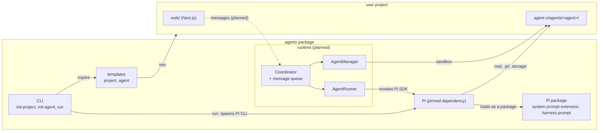

# High-level design

## Purpose

agentx is a meta harness around the [pi coding agent](https://github.com/earendil-works/pi). It creates projects that combine a Next.js full-stack app with Pi agents, runs each agent with only its own configuration, and will later run agents continuously behind a message queue.

## Goals

1. **Minimal, readable code.** Any file is understandable on its own. Fewer features over more code.
2. **The agent directory is the source of truth.** An agent is defined by checked-in files in its directory, plus the agentx version the project pins, which supplies the Pi package every agent shares ([D11](architecture/pi-package/README.md#d11)). Starting an agent changes nothing there ([D4](architecture/agent/README.md#d4)).
3. **Use Pi as it is.** Configure Pi through settings, extensions, env vars and flags; never patch or fork it.
4. **Same agent under the CLI and the SDK.** The agent directory means the same thing to `agentx run` and to the runtime. Small differences are accepted rather than engineered away ([D7](architecture/project/README.md#d7)).
5. **One pinned Pi.** Each agentx version runs exactly one Pi version ([D1](architecture/agent/README.md#d1)).

Non-goals for now: multi-tenant hosting, a UI for agents, custom model providers.

## Components

| Component | Role | Doc |
|---|---|---|
| CLI | Creates projects and agents; runs an agent with the Pi CLI | [cli](architecture/cli/README.md) |
| Project | The generated repo: the app package and the agent-x package | [project](architecture/project/README.md) |
| Agent | A directory that defines one Pi agent | [agent](architecture/agent/README.md) |
| Pi package | What agentx adds to every agent: the system prompt extension, the harness prompt, shared skills | [pi-package](architecture/pi-package/README.md) |
| Runtime | Always-running coordinator, agent sandboxes, queue-driven Pi SDK sessions | [runtime](architecture/runtime/README.md) |
| Pi | The agent engine; the behavior we rely on | [pi](architecture/pi/README.md) |

## Mental model

**An agent is a directory.** Running an agent means starting Pi with:

- `cwd` = the agent directory, so Pi reads `.pi/` as project config;
- `PI_CODING_AGENT_DIR` = the project's `agent-x/.pi`, shared by its agents, so nothing from `~/.pi/agent` leaks in;
- no context files (`-nc`) and `.pi/` trusted for the run (`--approve`).

**Config is checked in; state is in `storage/` and `agent-x/.pi/`.**

| Checked in (defines the agent) | `storage/`, gitignored (produced by running it) |
|---|---|
| `.pi/settings.json`, `.pi/mcp.json` | `sessions/`: every session |
| `system_prompt/*.md` | `workspace/`: files the agent creates |
| `skills/`, `extensions/` | |

`agent-x/.pi/`, also gitignored, is Pi's agent directory for all agents of the project: login, saved trust, Pi's runtime files.

**The CLI and the runtime are two front ends to the same agent.** The CLI starts the Pi CLI for a person at a terminal. The runtime will start Pi SDK sessions for messages from a queue. Both read the same directory.

## Flows

**Create a project.** `agentx init-project my-project` copies `templates/project`, pins the `agent-x` package in `agent-x/package.json`, runs `git init`. `web/` and `agent-x/` are independent packages; `npm install` in the root installs both.

**Create an agent.** `agentx init-agent main` in the project root or in `agent-x/` copies `templates/agent` to `agent-x/agents/main`.

**Run an agent (built).** `npm run pi` in `agent-x/agents/main` → `agentx run` → spawns the pinned Pi CLI with the settings above → Pi loads agentx's Pi package, passed by `run` (its extension sets the system prompt: the harness prompt, then `system_prompt/`), the agent's `.pi/settings.json` and its own extensions, skills and MCP servers → sessions are written to `storage/sessions`.

**Handle a message (planned).** The app or another producer puts a message on the queue → the coordinator routes it → an `AgentRunner` opens or continues a Pi SDK session for that agent inside the sandbox the `AgentManager` provides → the reply goes back through the queue.

## Status

| Built | Planned |
|---|---|
| CLI: `init-project`, `init-agent`, `run` | Runtime: coordinator, `AgentManager`, `AgentRunner` |
| Project and agent templates; Pi package (system prompt extension, harness prompt) | `agentx serve`, `agentx upgrade` |
| | App-to-agent messaging |
