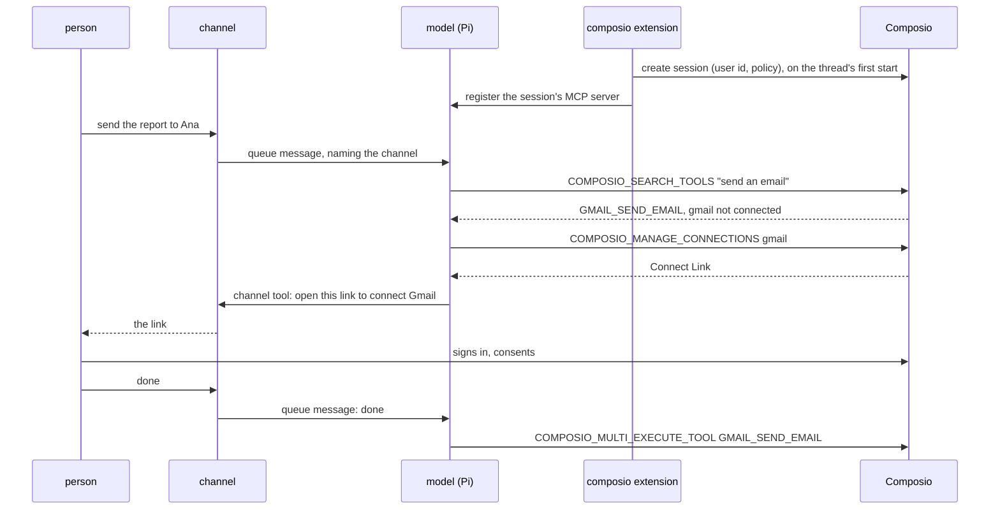

# Give each agent its own access to external services through Composio

Built on 2026-11-13 in commits `324da22` (the extension) and `8fc9371` (cleanup), from the plan in `ac2fc96`, which is kept [below](#original-plan). The design as built: [Composio](../../architecture/agent-runtime/pi/pi-package/composio/README.md).

## What was built

- **The Composio extension** (`src/agent-runtime/pi-package/extensions/composio/index.ts`). On `session_start` it finds the thread's Composio session in a custom entry of its Pi session, reads it from Composio, or creates one when there is none, the settings changed or Composio lost it, and registers its MCP server with direct tools. It records a new session when a run starts. When anything is missing or fails, a `composio` section of the system prompt says why.
- **`init-agent`** writes `agentx.composio.userId` as `<agent>@<project>`.
- **Defaults** for every agent's policy: eight toolkits (Gmail, Google Calendar, Drive, Sheets, Docs, Supabase, HubSpot, Telegram), connection requests on, account removal off, no remote sandbox. An agent's `session` settings go over them key by key; `toolkits` is replaced whole.
- **The harness prompt's "External services" section**, with only the rules Composio's tool descriptions do not give.
- **The message queue** starts delivering only once every extension has started, in `resources_discover` (D44), and the Pi package's manifest lists its extensions in a fixed load order (D42).
- **`agent-x/.env`** gives every agent of a project its keys, gitignored; a variable already in the environment wins.
- **Tests**: `test/composio.test.mjs` with `test/fake-composio.mjs`, a fake Composio with session routes and an MCP endpoint; the fake model records each request's tools.

## Decisions

| # | Decision |
|---|---|
| [D38](../../architecture/agent-runtime/pi/pi-package/composio/README.md#d38) | Each agent has its own Composio user id, written into its settings by `init-agent` |
| [D39](../../architecture/agent-runtime/pi/pi-package/composio/README.md#d39) | One Composio session per thread, recorded in the thread's Pi session |
| [D40](../../architecture/agent-runtime/pi/pi-package/composio/README.md#d40) | The extension registers the session's MCP server, with direct tools, and uses no Composio SDK |
| [D41](../../architecture/agent-runtime/pi/pi-package/composio/README.md#d41) | Without Composio, the session starts and the model is told why |
| [D42](../../architecture/agent-runtime/pi/pi-package/README.md#d42) | The package's manifest lists its extensions in the order they load |
| [D43](../../architecture/agent-runtime/agent/README.md#d43) | Keys for all agents of a project go in the gitignored `agent-x/.env`; the environment wins |
| [D44](../../architecture/agent-runtime/pi/pi-package/event-queue/README.md#d44) | The session takes queued messages only once every extension has started |

## Changes from the plan

| The plan said | Built | Why |
|---|---|---|
| User id `<project>:<agent>` | `<agent>@<project>` | Composio does not document which characters a user id may hold, and suggests ids shaped like an email address. |
| Default policy: the whole catalog | Eight toolkits | Chosen by the user: the services agents need most. |
| A failure note sent with `pi.sendMessage(..., { deliverAs: "nextTurn" })` | A `composio` section of the system prompt | The note was saved in the conversation, so a thread that started many times without Composio collected a copy per start. A prompt section is rebuilt per run, and Pi sends only what changed. |
| No key: a note (then, for a while, silence) | No key: the prompt section says so | Every agent is meant to have Composio, so its absence is worth explaining. |
| A key in `session` replaces agentx's default of the same name | Key by key, also inside an object; `toolkits` whole | `{ "manage_connections": { "enable": true } }` dropped `enable_connection_removal: false` and let the agent delete accounts. `toolkits` stays whole because `enable` and `disable` exclude each other. |
| Connecting accounts when requests are off: not decided | The agent tells the person to ask its developer to add the service | Decided by the user. |
| The extension runs before the message queue's because folders load alphabetically | The message queue starts delivering only after every extension's `session_start` (D44); the manifest fixes the load order (D42) | Pi's MCP support waits for direct servers only at the first run's start, and Pi takes extension folders in the order the file system lists them, which is not sorted on Linux. Ordering extensions could not cover the agent's own, which Pi loads after agentx's package. |
| A new session recorded at `session_start` | Recorded at `before_agent_start` | A session that does not hold its thread runs nothing, and a write from it would fork the conversation. |
| The key only in the environment | Also `agent-x/.env` (D43) | Developers need a place for it that git ignores; `web/.env.local` belongs to the app. |
| — | `COMPOSIO_BASE_URL` | Points the extension at the fake Composio in tests. |

## Migration

For a project created with an earlier agentx. New projects and agents need none of it.

**Steps**

1. **Upgrade agentx** in the project: the version `agent-x/package.json` pins, then `pnpm install` in the project root.
2. **Give each existing agent a Composio user id.** `init-agent` writes it only for new agents. Add it to every `agent-x/agents/<agent>/.pi/settings.json`, once, and never change it afterwards, since the agent's connected accounts are kept under it:
   ```json
   "agentx": {
   	"composio": { "userId": "<agent>@<project>" }
   }
   ```
   Without it, the agent has no Composio tools, and its system prompt says so.
3. **Ignore `agent-x/.env`.** Add the line `agent-x/.env` to the project's `.gitignore`; new projects have it.
4. **Set the key.** Create a Composio project per environment and a scoped key with only **Session management** (read and write) and **Session tool execution** (write). Put `COMPOSIO_API_KEY=...` in `agent-x/.env` for development, or in the environment of the process that runs agentx on a server.
5. **Connect accounts ahead of time for unattended agents.** Until message channels exist, an agent the runner starts cannot show a Connect Link to anyone: open the agent with `agentx run` and ask it to connect the services it will need.

**What changes for every agent**

- Its system prompt has an "External services" section, and, while Composio is unavailable, a `composio` section that says why. With no key set, every agent shows that section: this is expected.
- It may use eight services by default (Gmail, Google Calendar, Drive, Sheets, Docs, Supabase, HubSpot, Telegram) and ask a person to connect them. Change that under `agentx.composio.session`; a key there replaces only that key of the default, and `toolkits` is replaced whole.
- Each Pi start with a key makes one or two calls to Composio, and its first prompt can wait up to 10 seconds for Composio's tools.
- Every Pi process gets the variables of `agent-x/.env`; a variable already in the environment wins.

**Check for**

- **An MCP server named `composio`** in an agent's `.pi/mcp.json`: it would replace the agent's Composio session. Rename it.
- **Settings that set `manage_connections` partly**, such as `{ "enable": true }`: they now keep `enable_connection_removal: false` from the default. Set it to `true` only to let the agent delete accounts.

**For agentx's own code**

- A new extension, skill or prompt in `src/agent-runtime/pi-package/` must be listed in the manifest in its `package.json` (D42).
- The fake model in the tests records each request's tools (`tools`), and `COMPOSIO_BASE_URL` points the extension at the fake Composio.

## Verification

- **Tests**: 54 pass. The Composio tests cover the first queued message seeing the tools while Composio answers slowly, reuse and renewal of a thread's session, the merge of settings over defaults, a refused key, an unreachable Composio, no key across several starts with a clean conversation, a session that does not hold its thread writing nothing, `agent-x/.env` with the environment winning, and an agent's own extension that registers an MCP server after awaiting in `session_start`. The first-message, thread-not-held and agent-extension tests were checked to fail when the behavior they guard is removed.
- **Against a live Composio project**: sessions created and read with the defaults; Pi connected to a session's MCP endpoint and declared its four tools at the first prompt; the endpoint refused `GET` without harm; `COMPOSIO_MANAGE_CONNECTIONS` returned a link on `connect.composio.dev/link/`; the user id `<agent>@<project>` was accepted; an agent with a real model connected Gmail and sent an email; `manage_connections` turned connection requests and account removal off; a key with only Session management (read and write) and Session tool execution (write) worked and was refused elsewhere.
- **Cost seen in a real session**: when Composio becomes available again after it was not, Pi adds the four tools' declarations again, about 3,000 tokens. Accepted: it happens only when availability changes between starts of a thread's Pi process.

## Follow-ups

- **Links through channels**: [message channels](../backlog/message-channels.md). Until then, an unattended agent's accounts are connected ahead of time in `agentx run`.
- **Triggers**: [webhooks](../backlog/coordinator-webhooks.md) and [Composio triggers](../backlog/composio-triggers.md).
- **Keeping the key from the agent**: later, with the sandboxes of the planned [AgentManager](../../architecture/agent-runtime/README.md#planned); a known limit of [Composio](../../architecture/agent-runtime/pi/pi-package/composio/README.md#known-limits).
- **Several accounts of one toolkit** (`multi_account`): not looked at.

## Original plan

The plan as approved before building, unchanged except for its links.

With [Composio](https://docs.composio.dev), every agent gets its own access to external services (Gmail, GitHub, Slack and about a thousand more). Its settings decide which services it may use and whether it may ask a person to connect new accounts. The plan follows Composio's documentation as of 2026-11-13, `@composio/core` 0.29.0, `@composio/experimental` 0.2.8 and Pi 1.5.2. What needs a live Composio project to confirm is listed under [to check in a spike](#to-check-in-a-spike).

### Composio in brief

| Term | Meaning |
|---|---|
| Project | A Composio workspace with its own API keys, auth configs and connected accounts. One per environment: development, production. |
| User id | A string the application chooses: whose accounts to use. Connected accounts are stored under it. It carries no policy. |
| Toolkit | One service's tools: `gmail`, `github`. Tools are named `<TOOLKIT>_<ACTION>`, such as `GMAIL_SEND_EMAIL`. |
| Connected account | A user id's credentials for one toolkit (OAuth tokens or an API key), kept and refreshed by Composio. They never reach the model. |
| Auth config | How a toolkit authenticates in the project, with its scopes: Composio's own OAuth app by default, or the project's app. |
| Session | Made for one user id, with a policy: which toolkits and tools it may find and use, whether it may start connections, which account to use per toolkit. It also keeps runtime state (tool memory, remote sandbox files), and gives the model a few meta tools, also over MCP. It is not the model's conversation memory. Composio does not expire sessions today. |
| Meta tools | `COMPOSIO_SEARCH_TOOLS` (tools for a use case, with a plan and the connection status), `COMPOSIO_GET_TOOL_SCHEMAS`, `COMPOSIO_MANAGE_CONNECTIONS` (a Connect Link when the user id has no account for a toolkit), `COMPOSIO_MULTI_EXECUTE_TOOL`, and a remote sandbox (`COMPOSIO_REMOTE_WORKBENCH`, `COMPOSIO_REMOTE_BASH_TOOL`). |
| Connect Link | A page on `connect.composio.dev` where a person signs in to the service and consents, or enters a key. Valid for 10 minutes. |

A tool runs only when both say yes: the session's policy allows its toolkit, and the user id has an account for it (or the toolkit needs none). A toolkit can be in the policy with no account yet; the agent then asks for one, if its session lets it.

### Plan

Every agent has a Composio user id of its own, so each agent has its own connected accounts. An extension in agentx's Pi package opens a Composio session for each thread and hands its MCP endpoint to Pi, so the model calls the meta tools as ordinary tools. When the model needs a service the agent has no account for, and its session allows it, it gets a Connect Link and gives it to the person the way it talks to them: in its text at the terminal, or with the tool of the [message channel](../backlog/message-channels.md) the message came from. Once the person has connected and said so, the next tool call uses the account. The accounts are the agent's: whoever talks to the agent acts through them.



At the terminal, the channel drops out: the person reads the link in the agent's text and answers by typing.

#### What agentx adds

| Kind | What | Why |
|---|---|---|
| Extension | `extensions/composio/` in agentx's [Pi package](../../architecture/agent-runtime/pi/pi-package/README.md) | The only code: opens the thread's session and registers its MCP server ([below](#the-extension)). |
| Prompt | A `Composio` section in `harness.md` | Every agent has Composio, so the rules are part of the harness prompt, worded to fit any policy ([below](#the-prompt)). |
| Agent settings | `agentx.composio` in `.pi/settings.json`: `userId`, optional `session` | Identity and policy are part of the agent's definition and are checked in ([D36](../../architecture/agent-runtime/agent/README.md#d36)). |
| CLI | `init-agent` writes `agentx.composio.userId` into the new agent's settings | Every agent needs a user id that never changes. |
| MCP server | None in `.pi/mcp.json`. The extension registers one per session with `pi.registerMcpServer`. | The endpoint belongs to a session made at run time, and Pi does not interpolate `url` in `mcp.json`. |
| npm packages | None | The extension makes two REST calls, read a session and create one, with `fetch`. `@composio/core` would add 4.6 MB and raise agentx's Node floor to 22.22.3. |
| Pi packages, skills | None | Composio's installable `composio` skill teaches a coding agent to build an app with Composio, not to use it. Composio's "skills" are playbooks that come back inside search results. |
| Environment | `COMPOSIO_API_KEY`, a scoped project key | Read by the extension to open sessions, and by Pi to call the MCP server ([the key](#the-key)). |
| Composio setup | A project per environment, the scoped key, an auth config of the project's own only where a toolkit needs one | |

#### Settings

```json
"agentx": {
	"composio": {
		"userId": "acme:support",
		"session": {
			"toolkits": { "enable": ["gmail", "github"] },
			"manage_connections": { "enable": false }
		}
	}
}
```

- `userId` is the agent's identity in Composio. `init-agent` writes `<project>:<agent>`, from the names at that moment. Its connected accounts are stored under it, so it never changes, also when the agent is renamed, and no two agents of a Composio project share it.
- `session` goes as it is into the body of Composio's request that creates a session (`POST /api/v3.1/tool_router/session`), in Composio's names: `toolkits`, `tools`, `tags`, `manage_connections`, `auth_configs`, `connected_accounts`, `multi_account`, `workbench` and the rest of [configuring sessions](https://docs.composio.dev/docs/configuring-sessions). The extension adds `user_id`.
- Without `session`, an agent may use the whole catalog and ask for any connection; the person's approval of the Connect Link is the gate. agentx's defaults, each replaced by a key of the same name in `session`:

| Key | Default | Why |
|---|---|---|
| `toolkits` | not set: the whole catalog | The agent can ask for what a task needs. |
| `manage_connections` | `{ "enable": true, "enable_connection_removal": false }` | The agent may ask for connections, but may not delete accounts, which Composio allows by default. |
| `workbench` | `{ "enable": false }` | The agent has its own shell and workspace, and Composio has announced that it will bill sandboxes. |

What the settings control:

| Setting | Effect |
|---|---|
| `toolkits.enable` | The agent may find and use only these toolkits. Nothing it does through its tools widens the list. A toolkit in the list needs no account yet. |
| `manage_connections.enable: false` | No `COMPOSIO_MANAGE_CONNECTIONS` tool: the agent cannot ask for a connection, and a person connects its accounts another way. |
| `connected_accounts` | Pins the account to use for a toolkit, such as the support inbox and never another. Account ids differ between Composio projects, and an account connected later is not used until the pin changes. Not set by default. |

#### The extension

| When | It does |
|---|---|
| `session_start` | Reads `agentx.composio` from the settings (`pi.getSettings()`, which Pi refuses while an extension loads). Looks in the Pi session for the thread's Composio session: a custom entry written with `pi.appendEntry`, holding the session id and the `agentx.composio` it was made from. Reads the session from Composio (`GET /api/v3.1/tool_router/session/{id}`), which gives its MCP URL. If there is no entry, the settings changed since, or Composio no longer has the session (404), creates one (`POST /api/v3.1/tool_router/session`) and appends a new entry. Both calls send `x-api-key`. Then, if the MCP URL is on Composio's API origin, as Composio's SDK checks before it sends the key there, registers the server: `pi.registerMcpServer("composio", { url, headers: { "x-api-key": "${COMPOSIO_API_KEY}" }, exposure: "direct" })`. |

- **One Composio session per thread.** A thread is one conversation, and a Composio session keeps state of its own (tool memory, sandbox files) that should not mix between threads running at once. Connected accounts belong to the user id, so every thread of the agent has the same accounts. The session id lives in the thread's Pi session file in `storage/sessions/`, so nothing is added to `storage/` and nothing checked in changes ([D4](../../architecture/agent-runtime/agent/README.md#d4)). Pi writes the entry with the session's first message, so a thread closed before its first message leaves an unused session at Composio, and its next start makes another.
- **A new account needs no new session.** Composio looks up the user id's accounts when a tool runs, so the same session and MCP URL use an account as soon as it is active, unless `connected_accounts` pins another. A change to `agentx.composio` makes a new session at each thread's next start; a session already running keeps its policy until then.
- **Direct tools.** `exposure: "direct"` puts the meta tools on the model's tool list as ordinary tools, named `mcp__composio__COMPOSIO_SEARCH_TOOLS` and so on. Pi's default, `codemode`, would hide them behind its `codemode` tool, which runs scripts that call them. Pi lists a server's instructions and `description` in the system prompt only for servers whose tools are hidden, so Composio's own guidance does not reach the model; [the prompt](#the-prompt) carries the rules.
- **The name is the extension's.** Pi gives a server in `.pi/mcp.json` precedence over a registered one of the same name, so a `composio` entry in an agent's `.pi/mcp.json` would replace the thread's session with that entry.
- **The key stays a variable.** The header names the variable, not its value, so the key is not part of the server's config, which every extension in the process can read with `pi.getMcpServers()`. Pi resolves it each time it connects.
- **Failures never stop the session, and the model hears of them.** With no `COMPOSIO_API_KEY` or no `userId`, or when Composio cannot be reached or refuses the key, the session starts without Composio tools, and the extension tells the model why with `pi.sendMessage({ customType: "composio", content }, { deliverAs: "nextTurn" })`. The note goes in with the session's next message and starts nothing; the model can then tell the person, when a task needs Composio, the way it talks to them. No UI is assumed, so there is no `ctx.ui.notify`. Nothing goes on the queue: a queue message would start a run only to report the failure. The next start tries again. An extension that throws while loading or in `session_start` would stop every session of the agent.
- **A key refused later.** If the key stops working after the session started, Pi takes the refusal for a server that wants an OAuth sign-in, because the server has no `Authorization` header: `/mcp` shows it as needing sign-in, and the model sees its tool calls fail. A server that drops is Pi's to handle: `/mcp` shows it as disconnected, and Pi reconnects on the next call.

#### The prompt

A `Composio` section in `harness.md`. It is fixed text, because a prompt that changes between runs makes Pi add a patch to the conversation, and it fits every agent's policy:

- Composio's tools act in external services through this agent's own connected accounts.
- Search first, one concrete use case per query. Use the exact tool slugs and schemas the search returns, and follow its plan and known pitfalls.
- If a toolkit is not connected and `COMPOSIO_MANAGE_CONNECTIONS` is among your tools, call it and give the person the link the way you talk to them: in your text at the terminal, or through the channel the message came from. If it is not among your tools, tell the person which service to connect; you cannot do it yourself. Never ask for passwords, API keys or OAuth secrets. When the person says it is done, carry on: the account is used as soon as it is active.
- A toolkit outside your policy fails with `[Session Restriction]`. Say so; only the agent's developer can allow it.
- With no Composio tools, Composio is unavailable in this session; a note says why. Say so when a task needs it.
- Use Composio only through these tools. Never call Composio's API with the key in the environment.

#### Requesting access

| The agent needs | Who acts | How |
|---|---|---|
| A toolkit its policy allows, with no account yet, and connection requests on | The agent asks, a person approves | `COMPOSIO_MANAGE_CONNECTIONS` returns a Connect Link. The agent sends it to the person (at the terminal in its text, otherwise through the message's channel), who opens it within 10 minutes. The session needs no change. |
| The same, with connection requests off | A person | The agent says which service is missing; a person connects it outside the agent, for the agent's user id. How is not designed yet. |
| A second account for a toolkit, such as work and personal mail | The agent asks, a person approves | `multi_account` in `session` lets the user id hold several accounts per toolkit, each with an alias. How the meta tools choose among them is [to check](#to-check-in-a-spike). |
| A toolkit its policy does not allow | The agent's developer | Adds it to `session.toolkits` in `.pi/settings.json`; each thread's next start makes a new session. The agent's own attempts fail with `[Session Restriction]`, and no meta tool changes a session's policy. |
| More scopes on a connected toolkit | The developer, then a person | Scopes belong to the auth config, for the whole project, and apply to new connections only: the developer changes them, then the person connects again. |

Composio has a meta tool that waits until a connection is made (`manage_connections.enable_wait_for_connections`). It stays off. Its timeout is not documented, and Pi ends an MCP request after 60 seconds unless the server's `timeout` is raised. The person saying "done" is enough, because the next tool call finds the account.

#### At the terminal

A person in `agentx run` reads everything the agent writes, so the agent puts the link in its text and the person answers by typing. A message typed at the terminal has no metadata block, which tells the agent that its text is the answer ([message channels](../backlog/message-channels.md#the-idea)).

#### Through a channel

A message from the queue, also one that arrives in a terminal session, came from a channel and carries metadata naming it. The agent's text reaches nobody, so it sends the link with the channel's tool. The person's "done" comes back on the same channel as a new queue message on the thread; under the [runner](../../architecture/agent-runtime/pi/README.md) it starts the thread again, and the session still holds the task. This needs nothing from the Composio extension: no capturing of the link and no watcher for the account.

Until channels exist, an agent that runs unattended has no way to send a link. Its accounts get connected ahead of time instead: a person runs it with `agentx run` and asks it to connect what it will need. The accounts belong to the agent's user id, so every later session, the runner's included, uses them.

A tool call that waits for the person instead would keep the thread's lease and hold a worker for up to the link's 10 minutes. The person's answer through the channel restarts the thread at no such cost.

A message that is tried again runs its task again from the start, including what its first attempt already did through Composio, such as sending an email. The retry's metadata tells the agent to check what is done before it repeats anything.

#### The key

`COMPOSIO_API_KEY` is a scoped project key: a project key limited to chosen groups of routes. This one needs **Session management** (read and write: read and create sessions) and **Session tool execution** (write: search, execute, MCP), and nothing else. It cannot use the routes for connected accounts, auth configs, triggers, webhooks, logs or the proxy. A full project key is for the developer's own setup work, never for an agent's environment.

- **The agent can read it.** The key is in the Pi process's environment, so the agent's `bash` reads it. Hiding it from `bash` would not help: the agent runs as the same OS user, who can read its processes' environment and any file the key is kept in.
- **What a leaked key can do.** Through sessions, what the meta tools do: search, run tools, start connections, each for the session's user id. But it can create a session for any user id of the project, with any policy. No key can be limited to some user ids. So a user id and a policy bind the agent's tools, not the key, and the prompt's rule is the only barrier, as it is for Pi's shared `agent-x/.pi/` ([D17](../../architecture/agent-runtime/agent/README.md#d17)). A connection still needs a person to approve its link.
- **Keeping the key from the agent needs sandboxes.** agentx itself, outside the agent's process, would open each thread's session and hand Pi only the session's URL, with a second key that can only execute. That buys nothing while agents run as processes of one OS user, so it belongs with the sandboxes of the planned [AgentManager](../../architecture/agent-runtime/README.md#planned). Composio does not document whether a session can then be used only with the key that made it. One Composio project per agent separates even more, at the cost of keys and auth configs per agent.

### Other ways considered

| Way | Why not |
|---|---|
| Composio's Pi provider (`@composio/experimental`): an extension registers its three tools, five with the remote sandbox's, with `pi.registerTool` | The types fit, but the package is experimental ("APIs can change or be removed between releases"). It and `@composio/core` require Node 22.22.3, above agentx's 22.19, and core is 4.6 MB before its dependencies. Node imports the provider's `.mjs` outside Pi's module mapping, so a second copy of Pi loads with it (read in jiti's code, not measured). Its tool guidance is dropped, because agentx sets `customPrompt`. What it adds over the MCP endpoint, finding Connect Links and hooks around tool calls, takes a few lines with Pi's own events. |
| An extension with its own tools over Composio's REST API (`fetch`: search, execute, link) | Works without MCP and gives full control, at the cost of agentx owning the tools' schemas, results and errors. It is the fallback if Pi cannot use the session's MCP endpoint ([to check](#to-check-in-a-spike)). |
| A static entry in `.pi/mcp.json` | The URL holds a session id, so someone must create the session and paste the URL, and Pi does not interpolate `url`. All threads would share one session's state, the user id and policy would live only at Composio, and development and production would need different checked-in URLs. |
| The prompt section added by the extension | Every agent has Composio, so the fixed text belongs with the rest of the harness prompt. |
| `ctx.ui.notify`, or a queue message, to report a failure | Nobody watches a runner's session, and a queue message would start a run only to report it. |
| The extension takes the Connect Link out of the tool result, and a watcher restarts the thread when the account is active | The agent sends the link itself through the message's channel, and the person's answer restarts the thread. Finding the link would also rely on the tool's output, which Composio does not document. |
| Composio Connect (`https://connect.composio.dev/mcp`), the one static URL | It serves a person's own accounts ("Composio For You"). Every agent signed in by one person would share that person's accounts, and Pi keeps the sign-in in the shared `agent-x/.pi/mcp-auth.json`. |
| A skill that drives the Composio CLI over `bash` | Composio says not to build on the CLI. Its login is per OS user, in `~/.composio`, so agents would share it, and it is a binary installed by a script, not a pinned dependency. |
| Single-toolkit MCP servers | Deprecated by Composio. |

### To check in a spike

Each needs a Composio project and its key.

1. **Pi against a session's MCP endpoint.** Create a session, register its URL in a scratch agent, check `/mcp` and one tool call. Composio says the endpoint does not support `GET`. Pi opens a `GET` stream once it has connected, but its code drops a refused stream without a trace and keeps the server connected. What is left to see is that Composio accepts Pi's handshake, the `initialize` request and the `notifications/initialized` message after it; an error answer to either fails the connection. If it fails, take the REST fallback. Also check that the tools are declared to the model at the first prompt when the server is registered in `session_start`.
2. **The scoped key.** With the two permissions above, it reads and creates sessions with `toolkits`, `manage_connections` and `auth_configs`, and serves MCP, including the Connect Links of `COMPOSIO_MANAGE_CONNECTIONS`.
3. **`manage_connections`.** With `enable: false` the session has no `COMPOSIO_MANAGE_CONNECTIONS`; with `enable_connection_removal: false` the tool cannot delete an account.
4. **A second account.** How the meta tools choose among several accounts of one toolkit when `multi_account` is on.
5. **User ids** may contain `:`.
6. **The failure note.** A message sent with `deliverAs: "nextTurn"` during `session_start` goes in with the first message of a session that the runner or the message queue extension starts.

### To decide before building

Each with the recommendation the plan above follows.

1. **Key.** One scoped key in the environment (recommended). The alternative, a key that can only execute, with sessions opened outside Pi, pays off only with sandboxes.
2. **Composio session per thread** (recommended) or per agent. Per agent, threads that run at once share one session's state.
3. **Connecting accounts when requests are off.** A person runs the agent with requests on for a moment, or a command or the app makes the link for the agent's user id with a full key.

### Costs and data

- Composio keeps a log of every tool execution, with its arguments and results; Zero Data Retention stops that for the calls it covers.
- The rate limit is per Composio organization, 2,000 or 10,000 requests a minute by plan, shared by every agent and the app.
- Instant tools, which run on Composio's own accounts and are billed per call with no cap, are off until enabled in the project's settings.
