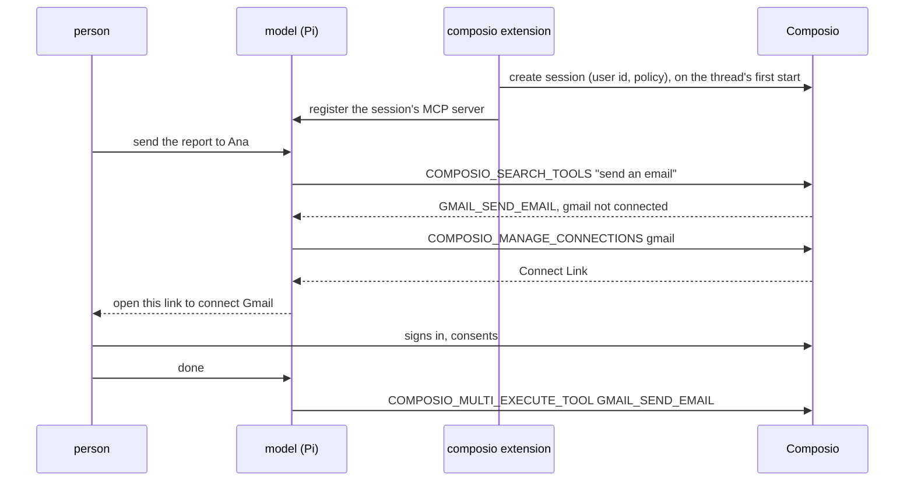

# Give each agent its own access to external services through Composio

With [Composio](https://docs.composio.dev), each agent gets its own access to external services (Gmail, GitHub, Slack and about a thousand more), asks for more access while it works, and has a person approve it. The plan follows Composio's documentation as of 2026-11-12, `@composio/core` 0.29.0, `@composio/experimental` 0.2.8 and Pi 1.5.2. What needs a live Composio project to confirm is listed under [to check in a spike](#to-check-in-a-spike).

## Composio in brief

| Term | Meaning |
|---|---|
| Project | A Composio workspace with its own API keys, auth configs and connected accounts. One per environment: development, production. |
| User id | A string the application chooses. Connected accounts are stored under it, and a session acts as it. |
| Toolkit | One service's tools: `gmail`, `github`. Tools are named `<TOOLKIT>_<ACTION>`, such as `GMAIL_SEND_EMAIL`. |
| Connected account | A user id's credentials for one toolkit (OAuth tokens or an API key), kept and refreshed by Composio. They never reach the model. |
| Auth config | How a toolkit authenticates in the project, with its scopes: Composio's own OAuth app by default, or the project's app. |
| Session | Made for one user id with a policy: which toolkits and tools it may use. Composio does not expire sessions today. It gives the model a few meta tools, also over MCP. |
| Meta tools | `COMPOSIO_SEARCH_TOOLS` (tools for a use case, with a plan and the connection status), `COMPOSIO_GET_TOOL_SCHEMAS`, `COMPOSIO_MANAGE_CONNECTIONS` (a Connect Link when the user id has no account for a toolkit), `COMPOSIO_MULTI_EXECUTE_TOOL`, and a remote sandbox (`COMPOSIO_REMOTE_WORKBENCH`, `COMPOSIO_REMOTE_BASH_TOOL`). |
| Connect Link | A page on `connect.composio.dev` where a person signs in to the service and consents, or enters a key. Valid for 10 minutes. |

## Plan

One Composio user id per agent gives each agent its own connected accounts. An extension in agentx's Pi package opens a Composio session for each thread and hands its MCP endpoint to Pi, so the model calls the meta tools as ordinary tools. When the model needs a service the agent has no account for, it gets a Connect Link and gives it to the person; once the person has connected, the next tool call uses the account. The accounts are the agent's: whoever talks to the agent acts through them.



### What agentx adds

| Kind | What | Why |
|---|---|---|
| Extension | `extensions/composio/` in agentx's [Pi package](../architecture/agent-runtime/pi-package/README.md) | The only code: opens the thread's session, registers its MCP server, adds the prompt section ([below](#the-extension)). |
| MCP server | None in `.pi/mcp.json`. The extension registers one per session with `pi.registerMcpServer`. | The endpoint belongs to a session made at run time, and Pi does not interpolate `url` in `mcp.json`. |
| npm packages | None | The extension makes two REST calls, read a session and create one, with `fetch`. `@composio/core` would add 4.6 MB and raise agentx's Node floor to 22.22.3. |
| Pi packages | None | |
| Skills | None | Composio's installable `composio` skill teaches a coding agent to build an app with Composio, not to use it. Composio's "skills" are playbooks that come back inside search results. |
| Prompt | A `composio` section, added by the extension only in an agent that uses Composio | The meta tools' rules, how to ask for access, and that the key is not the agent's to use. |
| Agent settings | `agentx.composio` in `.pi/settings.json`: `userId`, optional `session` | Identity and policy are part of the agent's definition and are checked in ([D36](../architecture/agent-runtime/agent/README.md#d36)). |
| Environment | `COMPOSIO_API_KEY`, a scoped project key | Read by the extension to open sessions, and by Pi to call the MCP server. |
| CLI | None | A person connects an agent's accounts by asking the agent, in `agentx run`. |
| Composio setup | A project per environment, the scoped key, an auth config of the project's own only where a toolkit needs one | |

### Settings

```json
"agentx": {
	"composio": {
		"userId": "acme:support",
		"session": {
			"toolkits": { "enable": ["gmail", "github"] }
		}
	}
}
```

- `userId` turns Composio on for the agent and is its identity there. Its connected accounts are stored under it, so it never changes, and no two agents of a Composio project share it. `<project>:<agent>` is a good choice. An agent without `agentx.composio` has no Composio tools.
- `session` goes as it is into the body of Composio's request that creates a session (`POST /api/v3.1/tool_router/session`), in Composio's names: `toolkits`, `tools`, `tags`, `auth_configs`, `connected_accounts`, `multi_account`, `workbench` and the rest of [configuring sessions](https://docs.composio.dev/docs/configuring-sessions). The extension adds `user_id`, and turns the remote sandbox off (`"workbench": { "enable": false }`) unless `session` turns it on: the agent has its own shell and workspace, and Composio has announced that it will bill sandboxes.
- Without `toolkits`, a session can find every toolkit in Composio's catalog, and for a toolkit that needs an account, the person's approval of the Connect Link is the gate. With `toolkits`, the agent can neither find nor use any other toolkit, and cannot change that through its tools ([requesting access](#requesting-access)).

### The extension

| When | It does |
|---|---|
| `session_start` | Reads `agentx.composio` from the settings (`pi.getSettings()`, which Pi refuses while an extension loads). Without it, does nothing more. Looks in the Pi session for the thread's Composio session: a custom entry written with `pi.appendEntry`, holding the session id and the `agentx.composio` it was made from. Reads the session from Composio (`GET /api/v3.1/tool_router/session/{id}`), which gives its MCP URL. If there is no entry, the settings changed since, or Composio no longer has the session (404), creates one (`POST /api/v3.1/tool_router/session`) and appends a new entry. Both calls send `x-api-key`. Then, if the MCP URL is on Composio's API origin, as Composio's SDK checks before it sends the key there, registers the server: `pi.registerMcpServer("composio", { url, headers: { "x-api-key": "${COMPOSIO_API_KEY}" }, exposure: "direct" })`. |
| `before_agent_start` | Adds the prompt section as `systemPromptOptions.sections.composio`. Pi keeps custom sections when agentx's system prompt extension sets `customPrompt`. |

- **One Composio session per thread.** A thread is one conversation, and a Composio session keeps state of its own (tool memory, sandbox files) that should not mix between threads running at once. Connected accounts belong to the user id, so every thread of the agent has the same accounts. The session id lives in the thread's Pi session file in `storage/sessions/`, so nothing is added to `storage/` and nothing checked in changes ([D4](../architecture/agent-runtime/agent/README.md#d4)). Pi writes the entry with the session's first message, so a thread closed before its first message leaves an unused session at Composio, and its next start makes another.
- **Direct tools.** `exposure: "direct"` declares the meta tools to the model as ordinary tools, named `mcp__composio__COMPOSIO_SEARCH_TOOLS` and so on. Pi's default, `codemode`, would have the model call them from scripts. For direct tools Pi shows the model neither the server's own instructions nor its `description`, so the prompt section carries the rules. A `composio` entry in the agent's `.pi/mcp.json` would take the registered server's place.
- **The key stays a variable.** The header names the variable, not its value, so the key is not part of the server's config, which every extension in the process can read with `pi.getMcpServers()`. Pi resolves it each time it connects.
- **Failures never stop the session.** With no `COMPOSIO_API_KEY`, or when Composio cannot be reached or refuses the key, the extension reports it with `ctx.ui.notify` and the session starts without Composio tools; the next start tries again. A one-shot run (`agentx run -p`) drops notifications, so there it just has no Composio tools. An extension that throws while loading or in `session_start` would stop every session of the agent. A server that drops later is Pi's to handle: `/mcp` shows it as disconnected, and Pi reconnects on the next call.
- **A refused key looks like a sign-in.** Pi takes an HTTP server without an `Authorization` header for one that may sign in with OAuth, so when Composio refuses the key, `/mcp` shows the server as needing sign-in, not as having a bad key.

The prompt section is fixed text: a section that changes between runs makes Pi add a patch to the conversation. It says:

- Composio's tools act in external services through this agent's own connected accounts.
- Search first, one concrete use case per query. Use the exact tool slugs and schemas the search returns, and follow its plan and known pitfalls.
- If a toolkit is not connected, call `COMPOSIO_MANAGE_CONNECTIONS` and give the person the link. Never ask for passwords, API keys or OAuth secrets. When the person says it is done, carry on: the account is used as soon as it is active.
- A toolkit outside the agent's policy fails with `[Session Restriction]`. Say so; only the agent's developer can allow it.
- Use Composio only through these tools. Never call Composio's API with the key in the environment.

### Requesting access

| The agent needs | Who acts | How |
|---|---|---|
| A toolkit its policy allows, with no account yet | The agent asks, a person approves | `COMPOSIO_MANAGE_CONNECTIONS` returns a Connect Link, which the person opens within 10 minutes. Composio looks up the user id's accounts when a tool runs, so the session needs no change, unless `session` pins an account for that toolkit. |
| A second account for a toolkit, such as work and personal mail | The agent asks, a person approves | `multi_account` in `session` lets the user id hold several accounts per toolkit, each with an alias. How the meta tools choose among them is [to check](#to-check-in-a-spike). |
| A toolkit its policy does not allow | The agent's developer | Adds it to `session.toolkits` in `.pi/settings.json`; each thread's next start makes a new session. The agent's own attempts fail with `[Session Restriction]`, and no meta tool changes a session's policy. |
| More scopes on a connected toolkit | The developer, then a person | Scopes belong to the auth config, for the whole project, and apply to new connections only: the developer changes them, then the person connects again. |

Composio has a meta tool that waits until a connection is made (`manage_connections.enable_wait_for_connections` in `session`). It stays off. Its timeout is not documented, and Pi ends an MCP request after 60 seconds unless the server's `timeout` is raised. The person saying "done" is enough, because the next tool call finds the account.

### Under `agentx run`

The flow in the diagram works as it is. The tool result with the Connect Link shows in the terminal, and the model passes it on. The answer of `agentx run -p` carries the link too, as does a session that a program shows a person through Pi's RPC mode.

### Under the runner

A Pi process that the [runner](../architecture/agent-runtime/agent-runner/README.md) starts has nobody to show a link to. The runner writes extension notifications to its error output and answers dialogs as cancelled, and nothing carries an agent's answer back to the sender ([message queue](../architecture/agent-runtime/pi-package/message-queue/README.md#known-limits)). So an agent that runs unattended gets its accounts connected ahead of time: a person runs it with `agentx run` and asks it to connect what it will need. The accounts belong to the agent's user id, so every later session, the runner's included, uses them.

For an unattended agent to ask for access itself, agentx needs three more things:

1. **The extension keeps the link.** In a session nobody watches, a `tool_result` handler takes the Connect Link out of the tool result, keeps a record of the request in the agent's `storage/`, and tells the model to stop and say what it is waiting for. It finds the link by its address on `connect.composio.dev`, because Composio does not document the tool's output and does not promise to keep it stable. It looks in the raw result Pi keeps beside the text (`structuredContent`), because Pi shortens long text before handlers see it.
2. **A channel to a person.** The link has to reach someone, by the same way that will carry answers back to senders, which is not designed yet.
3. **A watcher.** Something that runs all the time, such as the [coordinator](../architecture/coordinator-runtime/README.md), sees the account become active and puts a message on the thread, as `agentx send` does. It can ask Composio (`GET /api/v3.1/connected_accounts/{id}`); Composio's webhook would need a public URL. The runner then starts the thread again, and the session still holds the task.

A tool call that waits for the person instead would keep the thread's lease, which the message queue extension renews every second during a run, and would cost no attempt. But it holds a worker for up to the link's 10 minutes, and the link still has to reach someone.

A message that is tried again runs its task again from the start, including what its first attempt already did through Composio, such as sending an email. The retry's metadata tells the agent to check what is done before it repeats anything.

### Independence between agents

- **Each agent has its own accounts.** A session acts as its user id, and Composio resolves only that user id's accounts. One agent's connections do not appear in another agent's sessions.
- **Nothing enforces it against an agent that misbehaves.** The key in the environment can create a session for any user id of the project, so an agent that used the key directly could act as another agent. The same holds for the policy: the key can create a session that allows any toolkit, so an allow list binds the agent's tools, not the key. The prompt section's rule is the only barrier, as it is for Pi's shared `agent-x/.pi/` ([D17](../architecture/agent-runtime/agent/README.md#d17)).
- **The scoped key limits the damage.** A Composio scoped project key allows chosen groups of routes. This one needs **Session management** (read and write: read and create sessions) and **Session tool execution** (write: search, execute, MCP), and nothing else. It cannot use the routes for connected accounts, auth configs, triggers, webhooks, logs or the proxy. Through a session it can still do what the meta tools do, such as making a connection for the session's user id, and it can create a session for any user id. No key can be limited to some user ids.
- **Enforcing it needs sandboxes.** A key with Session tool execution alone cannot open sessions, so agentx itself, outside the agent's process, would open each thread's session with a second key and hand it to Pi. That buys nothing while agents run as processes of one OS user, who can read each other's files and environment, so it belongs with the sandboxes of the planned [AgentManager](../architecture/agent-runtime/README.md#planned). Composio does not document whether a session can then be used only with the key that made it. One Composio project per agent separates even more, at the cost of keys and auth configs per agent.

## Other ways considered

| Way | Why not |
|---|---|
| Composio's Pi provider (`@composio/experimental`): an extension registers its three tools, five with the remote sandbox's, with `pi.registerTool` | The types fit, but the package is experimental ("APIs can change or be removed between releases"). It and `@composio/core` require Node 22.22.3, above agentx's 22.19, and core is 4.6 MB before its dependencies. Node imports the provider's `.mjs` outside Pi's module mapping, so a second copy of Pi loads with it (read in jiti's code, not measured). Its tool guidance is dropped, because agentx sets `customPrompt`. What it adds over the MCP endpoint, finding Connect Links and hooks around tool calls, takes a few lines with Pi's own events. |
| An extension with its own tools over Composio's REST API (`fetch`: search, execute, link) | Works without MCP and gives full control, at the cost of agentx owning the tools' schemas, results and errors. It is the fallback if Pi cannot use the session's MCP endpoint ([to check](#to-check-in-a-spike)). |
| A static entry in `.pi/mcp.json` | The URL belongs to a session made at run time, and Pi does not interpolate `url`. A pasted URL ties a runtime session to checked-in config. |
| Composio Connect (`https://connect.composio.dev/mcp`), the one static URL | It serves a person's own accounts ("Composio For You"). Every agent signed in by one person would share that person's accounts, and Pi keeps the sign-in in the shared `agent-x/.pi/mcp-auth.json`. |
| A skill that drives the Composio CLI over `bash` | Composio says not to build on the CLI. Its login is per OS user, in `~/.composio`, so agents would share it, and it is a binary installed by a script, not a pinned dependency. |
| Single-toolkit MCP servers | Deprecated by Composio. |

## To check in a spike

Each needs a Composio project and its key.

1. **Pi against a session's MCP endpoint.** Create a session, register its URL in a scratch agent, check `/mcp` and one tool call. Composio says the endpoint does not support `GET`. Pi opens a `GET` stream once it has connected, but its code drops a refused stream without a trace and keeps the server connected. What is left to see is that Composio accepts Pi's handshake, the `initialize` request and the `notifications/initialized` message after it; an error answer to either fails the connection. If it fails, take the REST fallback. Also check that the tools are declared to the model at the first prompt when the server is registered in `session_start`.
2. **The scoped key.** With the two permissions above, it reads and creates sessions with `toolkits` and `auth_configs`, and serves MCP, including the Connect Links of `COMPOSIO_MANAGE_CONNECTIONS`.
3. **`COMPOSIO_MANAGE_CONNECTIONS`.** Its schema, from `COMPOSIO_GET_TOOL_SCHEMAS`: where the link is, and that finding it by its address is enough. Every link Composio documents is on `https://connect.composio.dev/link/`.
4. **A second account.** How the meta tools choose among several accounts of one toolkit when `multi_account` is on.
5. **User ids** may contain `:`.

## To decide before building

Each with the recommendation the plan above follows.

1. **Key.** One scoped key in the environment (recommended). The alternative, a key that can only execute, with sessions opened outside Pi, pays off only with sandboxes.
2. **Composio session per thread** (recommended) or per agent. Per agent, threads that run at once share one session's state.
3. **Policy default.** The whole catalog, with the person's approval as the gate (recommended, so that an agent can ask for what a task needs), or an allow list in every agent. Like the user id, an allow list binds the agent's tools, not the key.
4. **User id** written in the settings (recommended), or derived from the project and agent names, which would change, and lose the accounts, when an agent is renamed.
5. **Unattended requests for access.** Wait for the channel that will bring answers back to senders (recommended), or send links to the runner's error output until then.

## Costs and data

- Composio keeps a log of every tool execution, with its arguments and results; Zero Data Retention stops that for the calls it covers.
- The rate limit is per Composio organization, 2,000 or 10,000 requests a minute by plan, shared by every agent and the app.
- Instant tools, which run on Composio's own accounts and are billed per call with no cap, are off until enabled in the project's settings.
